# OTK (Open Token Ledger)

[Versão em português](README.md)

> **About this translation.** This file is the English version of `README.md`. The commands and the expected outputs are the same in both versions, and the outputs are in Portuguese because the programs print in Portuguese. The screenshots are also the same.

This repository accompanies the dissertation about the **OTK**, a meter that sits between a program and the AI providers (OpenAI, Anthropic and Google), which count and charge each request in **tokens**, the pieces into which text is split (usually parts of words). On each call, the OTK counts the tokens of the request **before** sending it, stores what the provider declares afterwards and issues a **signed receipt**, which anyone can check. For some models, the OTK also compares the two counts and computes the cost from the public price table, and section 12 says for which ones.


*The path of a call: the count is made before sending and recorded, with the declared usage, when the answer arrives.*

In the October 7, 2026 collection, the OTK itself checked the receipt signature on the spot in 658 of the 662 real calls, and all of them checked out, while the other 4 were refused by the provider (3 for usage limits, 1 by OpenAI) and produced no receipt. The collection program, however, kept only the result of that check, call by call, in the call records of the committee package (`*_calls.jsonl`, field `receipt_signature_verifies`), and not the whole receipt. The November 23 collection was made by a separate program (`scripts/h2eval/`), which uses the same OTK counter but does not go through the proxy and therefore produces no receipt, so the receipts you can check here are the example ones and the ones the demonstration (section 9) creates.

The repository contains:

- the **OTK code in the version evaluated** in the dissertation (version `7606bc9b`), with its tests, and the program that made the November collections (`scripts/h2eval/`, version `b0ec6f24`);
- the **data of the collections** cited in the dissertation, already sanitized, with no conversation text, no provider response identifier and no personal path;
- **a command that recomputes, offline, the numbers of the October 7 collection and part of the numbers of the November 23 collection** (section 6), and says OK or FALHOU (failed) for each item;
- the **receipt verifier**, as a command and as a page that opens in the browser;
- a **step-by-step guide to use the OTK on your computer**, first with no key at all and then, if you want, with your own API key.

To follow this guide **you do not need to know how to program**, since it is enough to follow the sections in order, copying and pasting each command, and if something goes wrong, section [13. If you get stuck: paste this into an AI](#13-if-you-get-stuck-paste-this-into-an-ai) has a ready-made text to ask for help. The guide was rehearsed from start to finish on Windows 11, while the Mac commands follow the same path but **were not rehearsed on a Mac**.

### Quick path (no key and no cost)

1. Install **Git** and **Node.js 24 LTS** ([section 1](#1-what-to-install-first)) and open the terminal ([section 2](#2-how-to-open-the-terminal-and-paste-a-command)).
2. Download the repository with `git clone https://github.com/BrunoQuintaes/otk-open-token-ledger.git C:\otk` (on a Mac, replace `C:\otk` with `~/otk`).
3. Enter the folder with `cd C:\otk` (on a Mac, `cd ~/otk`).
4. Install the libraries with `npm ci`.
5. Recompute the numbers with `npm run reproduzir-tudo`, which at the end should show `TUDO OK: 13 de 13 itens` (all OK: 13 of 13 items).

The details of each step, what you should see and what to do if there is an error are in sections 1 to 6, and the rest of the guide is optional.

### What to read, depending on your interest

| You want to… | Read |
|---|---|
| only check the dissertation numbers | the quick path above (details in sections 1 to 6) |
| run the automated tests | section 7 (they are optional; the start of the section says how they differ from section 6) |
| check a receipt | section 8 |
| see the OTK working, with no key | section 9.2 (needs Docker) |
| know what the OTK proves and what it does not | the summary below and section 11 |
| add a model or provider (requires programming) | section 12 |

### In a few lines: what this proves and what it does not

- **It proves** that the numbers of the October 7 collection and part of the numbers of the November 23 collection come from the data published here, and that, in the published record of the November 23 collection, there is an entry written before each of the 1,720 sends, with the OTK count in 1,505 of them (gpt-6-luna has no count). With the verifier, it also proves that a receipt was not changed after being signed and which key signed it.
- **It does not prove** whether the provider counted correctly, whether the computed cost equals the invoice, whether any receipt is missing, or whether the collections happened as recorded, because the records and the timestamps were written on the author's machine. Moreover, nothing here shows that the results hold for other models, languages or kinds of request, and each of these limits is detailed in section 11.

### Words used in this guide

- A **token** is the piece of text (usually part of a word) by which the provider counts and charges each request and each response.
- An **API key** is the password the provider gives you so that calls are charged to your account, and only section 9.3 uses one.
- **sha256** is a 64-character digest computed over a file, which changes if any letter of the file changes. The keyring **fingerprint** (section 8) is the sha256 of that file.
- The **signed receipt** carries the numbers of a call with the operator's digital signature, and the **keyring** is the public list of the operator's keys, with nothing secret in it.
- The **proxy** is the part of the OTK that sits in the middle of the path, like a doorman, which receives the request, counts, forwards it to the provider and writes down the response.
- The **CU** (normalized consumption unit) adds up the tokens of each kind using as weights the prices of a frozen base date (1 CU = 1,000 uncached input tokens of gpt-4o-mini), as in a Laspeyres quantity index, so that the CU does not change when the price changes (Chapters 2 and 3 of the dissertation).
- **Ruler**, **count correction** and **alert limit** are explained in [section 12.1](#121-a-few-terms-before-the-table).
- **H1** is the main hypothesis of the dissertation, tested in the October 7, 2026 collection.
- **CMP8** is the name, in the command output, of the November 23, 2026 collection, which sent the same 215 texts to 8 models, and which is exploratory and not part of H1.
- **CAL-ANTH** is the name, in the command output, of the independent recomputation of the first Anthropic correction experiment, of October 15, 2026.

---

## Contents

1. [What to install first](#1-what-to-install-first)
2. [How to open the terminal and paste a command](#2-how-to-open-the-terminal-and-paste-a-command)
3. [Check that Node.js, npm and Git are installed](#3-check-that-nodejs-npm-and-git-are-installed)
4. [Download this repository](#4-download-this-repository)
5. [Install the dependencies](#5-install-the-dependencies)
6. [Recompute the dissertation numbers (offline)](#6-recompute-the-dissertation-numbers-offline)
7. [Run the automated tests](#7-run-the-automated-tests)
8. [Check receipts with the verifier](#8-check-receipts-with-the-verifier)
9. [The OTK running on your computer](#9-the-otk-running-on-your-computer)
10. [What needs an API key and what does not](#10-what-needs-an-api-key-and-what-does-not)
11. [What the OTK does and does not do (limits)](#11-what-the-otk-does-and-does-not-do-limits)
12. [Providers and models: what the OTK measures today and how to add a new one](#12-providers-and-models-what-the-otk-measures-today-and-how-to-add-a-new-one)
13. [If you get stuck: paste this into an AI](#13-if-you-get-stuck-paste-this-into-an-ai)
14. [Where everything is, file origin, license and citation](#14-where-everything-is-file-origin-license-and-citation)

---

## 1. What to install first

You need **two programs**, Git and Node.js, plus a third one, Docker, only for section 9, so whoever only wants to check the numbers and the receipts (sections 6 to 8) can skip Docker. All of them are free and should always be downloaded from the official site.

| Program | What for | Version | Windows | Mac |
|---|---|---|---|---|
| **Git** | download the repository | any 2.x (the screenshots in this guide use 2.56) | https://git-scm.com/download/win, with the "64-bit Git for Windows Setup" installer and **Next** on every screen (the default options are fine; if Windows asks "Do you want to allow this app to make changes?", click **Yes**) | open the Terminal (section 2) and type `git --version`, and if the Mac offers to install the "command line developer tools", accept. Or use https://git-scm.com/download/mac |
| **Node.js** (already includes **npm**) | run the OTK, the tests and the reproduction | **24 LTS** (tested with 24.22.2, with the npm 11 that comes with it) | https://nodejs.org/pt/download, under "LTS", version **24**, "Windows Installer (.msi)", and **Next** on every screen | same page, "macOS Installer (.pkg)" of version **24 LTS** |
| **Docker Desktop** (only for section 9) | run the OTK database in an isolated box | any current version (tested with 29.x) | https://www.docker.com/products/docker-desktop/, under "Download for Windows". It asks you to enable **WSL 2**, a Windows feature that requires being an administrator of the computer; accept and restart if it asks | same page, "Download for Mac" (choose Apple Silicon or Intel according to your Mac) |

You do not need to install pnpm, Python or a database, nor to have an account with an AI provider.

> After installing Git and Node.js, **close and reopen** the terminal (section 2), because a terminal opened before the installation does not see the new programs.

## 2. How to open the terminal and paste a command

The terminal is a window where you paste text commands.

**Windows:** press the **Windows** key, type `PowerShell` and press **Enter**. A blue or black window opens with something like `PS C:\Users\your-name>`.

**Mac:** press **Command + Space**, type `Terminal` and press **Enter**.

All the commands in this guide are for **PowerShell**. The Command Prompt (`cmd`), the window with `C:\...>` without `PS` in front, does not work.

Each command comes in a grey block, below a subheading that says what it is for, and the other grey blocks show what you should see. Paste one command at a time, in order, and for each one:

1. click the copy button in the corner of the grey block (or select the text and use **Ctrl + C** on Windows, **Command + C** on a Mac);
2. click inside the terminal window;
3. paste with **Ctrl + V** (Windows; or right-click) or **Command + V** (Mac);
4. press **Enter** and wait for the terminal to show `PS C:\...>` again (or `%` on a Mac) before pasting the next one.

From section 5 on, the start of the line should show `PS C:\otk>` (on a Mac, `otk %`), and if it does not (for example, because the terminal was closed and reopened), first run `cd C:\otk` (on a Mac, `cd ~/otk`).

## 3. Check that Node.js, npm and Git are installed

This section checks, one by one, the three programs of section 1, because none of the following steps works without them. Each command only shows the installed version and changes nothing on the computer.

#### To check Node.js

**Where to run:** in **PowerShell** (on Windows, not the Command Prompt) or in the Terminal (on a Mac), from any folder or drive.

```
node -v
```

This command asks Node.js for its version, which tells you whether it was installed and whether it is version 24, the one the programs in this repository need.

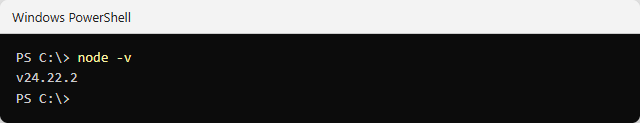

*Real output of the command, with Node.js 24.22.2.*

**What you should see:** `v24.` followed by numbers, for example `v24.22.2`.

**If you see** `node : O termo 'node' não é reconhecido` (Windows, in Portuguese; in English, "The term 'node' is not recognized") or `command not found: node` (Mac), Node.js was not installed or the terminal was opened before the installation. In that case, close the terminal, open it again and repeat, and if it persists, install Node.js again (section 1).

**If you see** `v20.` or `v22.`, install 24 LTS (section 1) before going on, because the programs that recompute the October 7 collection (part A of section 6) were made for Node 24 or newer, and on an older version that part may show `FALHOU`.

#### To check npm

**Where to run:** in **PowerShell** (on Windows, not the Command Prompt) or in the Terminal (on a Mac), from any folder or drive.

```
npm -v
```

This command shows the version of npm, the program that comes with Node.js and downloads the OTK libraries in section 5.

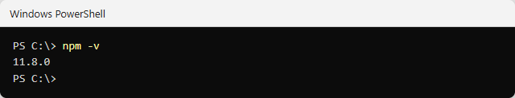

*Real output of the command, with npm 11.8.0.*

**What you should see:** a number like `11.8.0` (any `10.` or `11.` is fine).

**If you see** (Windows only) `npm.ps1 não pode ser carregado porque a execução de scripts foi desabilitada` (in English, "npm.ps1 cannot be loaded because running scripts is disabled"), run the command in the next block, answer `S` (or `Y`) if it asks and repeat `npm -v`.

#### To allow npm in PowerShell (only if the error above appears)

**Where to run:** in **PowerShell**, from any folder, and there is no need to open it as administrator, because the change applies only to your user.

```
Set-ExecutionPolicy -Scope CurrentUser RemoteSigned
```

This command lets your user run scripts that are already on the computer, such as npm's, while scripts downloaded from the internet still need a signature. Since the change applies only to your user (`-Scope CurrentUser`), nothing changes for the other users of the computer. It has no image, because it changes a system setting and was not run in the rehearsal.

#### To check Git

**Where to run:** in **PowerShell** (on Windows, not the Command Prompt) or in the Terminal (on a Mac), from any folder or drive.

```
git --version
```

This command shows the version of Git, the program that downloads the repository in section 4.

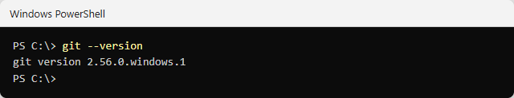

*Real output of the command, with Git 2.56.*

**What you should see:** `git version 2.` followed by numbers.

**If you see** "is not recognized" (in Portuguese, "não é reconhecido") or "command not found", install Git (section 1), then close and reopen the terminal.

## 4. Download this repository

The examples use the folder **`C:\otk`** on Windows and **`otk`** inside your home folder on a Mac.

> **On Windows, use a folder with a short name, such as `C:\otk`.** The longest path inside the committee package has 198 characters, and Windows refuses paths longer than 260, counting the folder where the repository was downloaded, so that folder cannot exceed about 60 characters. In a deep folder (for example a temporary folder, or `Documentos\GitHub\...` with a long user name), Git shows `Filename too long`, the download is incomplete and section 6 shows `FALHOU`.

#### To download the repository

**Where to run:** in **PowerShell** (on Windows, not the Command Prompt) or in the Terminal (on a Mac), from any folder or drive. The command always downloads into `C:\otk`, even when run from another drive, such as the Google Drive `H:`.

**Windows:**

```
git clone https://github.com/BrunoQuintaes/otk-open-token-ledger.git C:\otk
```

**Mac:**

```
git clone https://github.com/BrunoQuintaes/otk-open-token-ledger.git ~/otk
```

This command copies the whole repository from GitHub into the folder `C:\otk` (on a Mac, `~/otk`), which it creates itself, so it only needs to be run once.

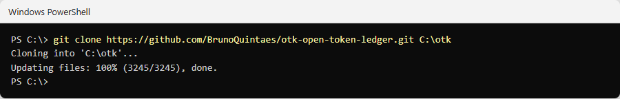

*Real output of the download, with the folder shown as `C:\otk`.*

**What you should see:** `Cloning into 'C:\otk'...` and, after a few seconds, lines ending in `done.`, with no login request, because the repository is **public**.

**If you see** `Repository not found`, the address was typed wrong (copy the command again) or the computer has no internet.

**If you see** `destination path 'C:\otk' already exists`, the repository was already downloaded before, so skip to section 5, or delete the folder `C:\otk` and repeat.

**If you see** `Filename too long` or `Clone succeeded, but checkout failed`, the chosen folder is too deep (see the warning above), so delete the folder and download again into `C:\otk`.

**Only for those going beyond sections 6 to 8 (you can skip the next two blocks).**

#### To download without the line-ending change (optional)

**Where to run:** in **PowerShell** (on Windows, not the Command Prompt) or in the Terminal (on a Mac), from any folder or drive.

```
git -c core.autocrlf=false clone https://github.com/BrunoQuintaes/otk-open-token-ledger.git C:\otk
```

On Windows, Git changes the *line ending* (the invisible character that ends each line) of about a thousand text files, and so their sha256 differs from the one recorded in `PROVENIENCIA.json`. This change **does not affect sections 6 to 8**, because the files the command and the verifier check are protected against it, so only those who want to check `PROVENIENCIA.json` file by file need to download with this command, instead of the previous one. This command has no image, because its output is the same as the normal download shown above.

#### To download into a deep folder (optional)

**Where to run:** in **PowerShell** (on Windows, not the Command Prompt) or in the Terminal (on a Mac), from any folder or drive.

```
git -c core.longpaths=true clone https://github.com/BrunoQuintaes/otk-open-token-ledger.git C:\caminho\da\sua\pasta
```

This command allows Git to use long paths, and in it `C:\caminho\da\sua\pasta` must be replaced with the folder you want. This command has no image, because its output is the same as the normal download shown above, only with your folder instead of `C:\otk`.

#### To enter the folder

**Where to run:** in **PowerShell** (on a Mac, in the Terminal), from any folder or drive.

**Windows:**

```
cd C:\otk
```

**Mac:**

```
cd ~/otk
```

This command makes the terminal enter the repository folder, because all the following commands are pasted **inside it**. It works from any folder or drive (even from the Google Drive `H:`), because the path is complete and PowerShell changes drive by itself.

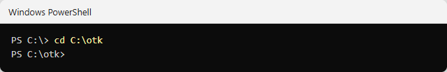

*Real output of the command, with the folder shown as `C:\otk`.*

**What you should see:** the start of the line changes to `PS C:\otk>` (on a Mac, `otk %`).

**If you see** `Cannot find path 'C:\otk'`, the repository was not downloaded into `C:\otk`, so repeat section 4.

**If the start of the line has no `PS`** (for example `H:\>` or `C:\Users\...>`), you opened the Command Prompt, not PowerShell. In that case, close it and open PowerShell (section 2), or, if you want to stay in the Command Prompt, use `cd /d C:\otk`, because there `cd` without `/d` does not change drive.

## 5. Install the dependencies

This step downloads the libraries the OTK uses, in the exact versions stored in the file `package-lock.json`, and **uses the internet** once, only for the public npm registry.

#### To install the dependencies

**Where to run:** in **PowerShell**, inside `C:\otk`, with the line starting with `PS C:\otk>` (if you just opened PowerShell again, first run `cd C:\otk`). On a Mac, in the Terminal, inside `~/otk`, with the line at `otk %` (otherwise, `cd ~/otk`).

```
npm ci
```

This command installs the libraries exactly in the versions of `package-lock.json`, without changing any, so what runs in the following sections is the same evaluated version.

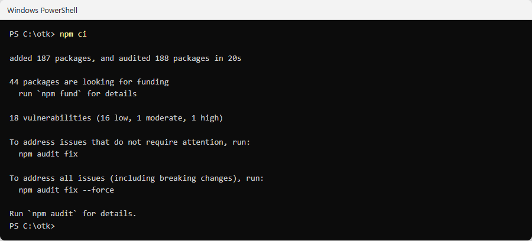

*Real output of the command, which took 20 seconds.*

**What you should see** (in 10 seconds to 2 minutes):

```
added 187 packages, and audited 188 packages in 20s

44 packages are looking for funding
  run `npm fund` for details

18 vulnerabilities (16 low, 1 moderate, 1 high)

To address issues that do not require attention, run:
  npm audit fix

To address all issues (including breaking changes), run:
  npm audit fix --force

Run `npm audit` for details.
```

In that output, *added 187 packages* says how many libraries were installed, *looking for funding* only notes that some authors accept donations, and *vulnerabilities* counts the known security advisories of those libraries, split by severity.

The time, the number of *vulnerabilities* and, on a Mac, the number of packages may differ, because npm checks a list of advisories that changes over time and some packages belong to one system only, so what matters is that `npm error` does not appear.

The last lines, which tell you to run `npm audit fix` or `npm audit fix --force` (and the lines `npm warn deprecated ...`, which may appear), are warnings about the libraries of the evaluated version and are **not** errors. Even so, **run neither of them**, because they change the library versions, and then you are no longer running exactly the evaluated version.

**If you see** `npm error code EUSAGE` or `npm ci can only install packages when your package.json and package-lock.json are in sync`, the terminal is not inside the folder `C:\otk`, so run the `cd C:\otk` of section 4 and repeat.

**If you see** `npm error network` or `ETIMEDOUT`, the internet dropped or a company network blocks npm, and it is worth trying another network.

## 6. Recompute the dissertation numbers (offline)

One command checks the files and **recomputes, offline and with no API key**, the results of the October 7 and November 23 collections listed in the table below, but it does not redo the whole dissertation. To be sure nothing uses the network, Wi-Fi can be **turned off beforehand**, and the command works the same; besides, it has its own lock, which blocks, in the programs it runs, connections and address lookups to outside the computer, and they show up as the error `SEM_REDE` (no network).

> **What this command does not redo.** From the November 23 collection, it redoes the **first version** of the *estimated × declared* table, which applies only the correction lines of claude-sonnet-5-5, claude-opus-5-5 and gemini-3.1-flash-lite (for Sonnet and Gemini 3.1, the line from the side study, which was later not confirmed; see 12.3). Applying a line to these 215 texts only describes what happened, and so it neither approves nor rejects the correction. The Chapter 4 table adds the corrections of the two Haiku models, the recount of gpt-6-luna and the 95% intervals, which this command does not redo, and the rest of what is left out is in section 11.

#### To recompute the numbers

**Where to run:** in **PowerShell**, inside `C:\otk`, with the line starting with `PS C:\otk>` (if you just opened PowerShell again, first run `cd C:\otk`). On a Mac, in the Terminal, inside `~/otk`, with the line at `otk %` (otherwise, `cd ~/otk`).

```
npm run reproduzir-tudo
```

This command runs, one after the other, the programs that redo parts A to D of the table below and compares each result with the value stored in the repository, saying OK or FALHOU (failed) for each item.

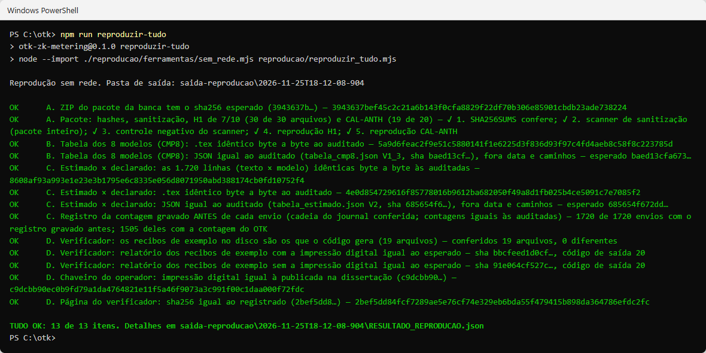

*Real output of the command, with the 13 items OK.*

It takes 20 seconds to 3 minutes, depending on the computer. **What you should see** at the end (each line starts with `OK`):

```
OK      A. ZIP do pacote da banca tem o sha256 esperado (3943637b…) — 3943637bef45c2c21a6b143f0cfa8829f22df70b306e85901cbdb23ade738224
OK      A. Pacote: hashes, sanitização, H1 de 7/10 (30 de 30 arquivos) e CAL-ANTH (19 de 20) — ✓ 1. SHA256SUMS confere; ✓ 2. scanner de sanitização (pacote inteiro); ✓ 3. controle negativo do scanner; ✓ 4. reprodução H1; ✓ 5. reprodução CAL-ANTH
OK      B. Tabela dos 8 modelos (CMP8): .tex idêntico byte a byte ao auditado — 5a9d6feac2f9e51c5880141f1e6225d3f836d93f97c4fd4aeb8c58f8c223785d
OK      B. Tabela dos 8 modelos (CMP8): JSON igual ao auditado (tabela_cmp8.json V1_3, sha baed13cf…), fora data e caminhos — esperado baed13cfa673…
OK      C. Estimado × declarado: as 1.720 linhas (texto × modelo) idênticas byte a byte às auditadas — 8608af93a993e1e23e3b1795e6c8335e056d8071950abd388174cb0fd10752f4
OK      C. Estimado × declarado: .tex idêntico byte a byte ao auditado — 4e0d854729616f85778016b9612ba682050f49a8d1fb025b4ce5091c7e7085f2
OK      C. Estimado × declarado: JSON igual ao auditado (tabela_estimado.json V2, sha 685654f6…), fora data e caminhos — esperado 685654f672dd…
OK      C. Registro da contagem gravado ANTES de cada envio (cadeia do journal conferida; contagens iguais às auditadas) — 1720 de 1720 envios com o registro gravado antes; 1505 deles com a contagem do OTK
OK      D. Verificador: os recibos de exemplo no disco são os que o código gera (19 arquivos) — conferidos 19 arquivos, 0 diferentes
OK      D. Verificador: relatório dos recibos de exemplo com a impressão digital igual ao esperado — sha bbcfeed1d0cf…, código de saída 20
OK      D. Verificador: relatório dos recibos de exemplo sem a impressão digital igual ao esperado — sha 91e064cf527c…, código de saída 20
OK      D. Chaveiro do operador: impressão digital igual à publicada na dissertação (c9dcbb90…) — c9dcbb90ec0b9fd79a1da4764821e11f5a46f9073a3c991f00c1daa000f72fdc
OK      D. Página do verificador: sha256 igual ao registrado (2bef5dd8…) — 2bef5dd84fcf7289ae5e76cf74e329eb6bda55f479415b898da364786efdc2fc

TUDO OK: 13 de 13 itens. Detalhes em saida-reproducao\...\RESULTADO_REPRODUCAO.json
```

In the line about the entry written before the send, *1720 de 1720* (1,720 of 1,720) counts the sends that have that prior entry, and in 1,505 of them the entry already carries the OTK count. In the 215 of gpt-6-luna, however, the entry says the OTK cannot count that model, because the counter of the evaluated version does not know the gpt-6 family, and for that reason the count for that model was redone after the collection, outside this command.

#### How to read the output, line by line

Before the 13 items, npm writes two lines starting with `>`: the first has the package name and version (`otk-zk-metering@0.1.0`) with the shortcut that was run, and the second, the command that shortcut calls, with the network lock (`sem_rede.mjs`) loaded before the program. Besides, the line *Reprodução sem rede* (offline reproduction) says in which subfolder of `saida-reproducao` the files of this run are, named by the date and time.

Then come the 13 items, from top to bottom, each with the part (A to D), what was checked and, after the dash, the detail (a sha256, a count or the list of steps):

| Output line | What the command checked | What OK means | Where it appears in the dissertation | If FALHOU (failed) appears |
|---|---|---|---|---|
| `OK      A. ZIP do pacote da banca...` | the sha256 of the file `reproducao/otk-banca-pack-20261111.zip` | the October 7 collection package is, byte for byte, the one that was audited | Appendix C, table of the items checked by the command (part A) | the ZIP changed or came incomplete; download again (section 4) |
| `OK      A. Pacote: hashes, sanitização, H1 de 7/10...` | the five steps of the package, marked with ✓: the `SHA256SUMS` list checks each file; the scanner finds no personal path, e-mail, phone or other sensitive data; the negative control requires the scanner to find fake examples planted on purpose; the October 7 collection (H1) is redone, with 30 of 30 identical files; and the CAL-ANTH recomputation matches 19 of 20 numbers | the numbers of H1 and of the first Anthropic experiment come from the package data | Appendix C, same table, and the note that explains the 20th number | the step with ✗ is the one that failed; the detail is in `A_pacote_banca.log.txt` |
| `OK      B. Tabela dos 8 modelos (CMP8): .tex...` | redoes the 8-model table from `reproducao/cmp8/dados` and compares the `.tex` file with the stored one | the table comes from the published data, letter by letter | Appendix D, table of declared input tokens by model and kind of text | the detail is in `B_tabela_cmp8.log.txt`; use section 13 |
| `OK      B. Tabela dos 8 modelos (CMP8): JSON...` | the numbers of the same table, in the JSON file, apart from the generation date and the paths | the numbers match the audited ones | Appendix D, the same table | same |
| `OK      C. Estimado × declarado: as 1.720 linhas...` | recomputes, text by text and model by model, the OTK count and the declared number | the 1,720 lines (215 texts × 8 models) are the audited ones | Appendix C, table of the items (part C) | the detail is in `C_estimado.log.txt` |
| `OK      C. Estimado × declarado: .tex...` | the first version of the *estimated × declared* table | the table comes from those lines, letter by letter | Chapter 4, per-model table of the November 23 collection, in the parts listed in *Where to compare* | same |
| `OK      C. Estimado × declarado: JSON...` | the numbers of the same table, apart from the date and the paths | the numbers match the audited ones | Chapter 4, the same table | same |
| `OK      C. Registro da contagem gravado ANTES...` | the *journal* chain and how many sends have the entry written before | 1720 of 1720 sends have the prior entry, and 1505 of them carry the OTK count | Chapter 4, text of the November 23 collection, and Appendix C | the detail is in `C_prova_previsao_antes.log.txt` |
| `OK      D. Verificador: os recibos de exemplo no disco...` | regenerates the 19 example files and compares them with the ones on disk | the verifier examples are the ones the code generates | Appendix C, table of the items (part D) | the detail is in `D_vetores_check.log.txt` |
| `OK      D. Verificador: relatório ... com a impressão digital...` | runs the verifier on the examples with the fingerprint and compares the sha256 of the report and the exit code | the verifier gives exactly the expected verdict; code 20 means there is red, which is right for the examples | Appendix C, same table | the detail is in `D_verify_comImpressaoDigital.log.txt` |
| `OK      D. Verificador: relatório ... sem a impressão digital...` | the same, without the fingerprint | same, with the verdicts of someone who did not confirm the keyring | Appendix C, same table | the detail is in `D_verify_semImpressaoDigital.log.txt` |
| `OK      D. Chaveiro do operador...` | the sha256 of `chaveiro/chaveiro_operador_otk.json` | it is the keyring whose fingerprint is published | Appendix E, section on the keyring and the fingerprint | the line ending was converted when downloading; download again (section 4) |
| `OK      D. Página do verificador...` | the sha256 of `web/verificador/verificador-otk.html` | it is the registered page | Appendix C, same table | same |

The last line adds up the items with OK, and if any failed, it starts with `ALGO FALHOU` (something failed), with a total below 13. Besides, the path written after *Detalhes em* (details in) is the one of the `RESULTADO_REPRODUCAO.json` file of this run.

The folder `saida-reproducao`, inside `C:\otk`, gets one subfolder per run, with the date and time in the name. It holds one `.log.txt` file per step, with the command that was run and everything it wrote, the redone tables (in the folders `A_pacote_banca`, `B_tabela_cmp8` and `C_estimado`) and `RESULTADO_REPRODUCAO.json`, which repeats the 13 items, each with the part, the name, whether it was OK and the detail. To open any of them, double-click the file in File Explorer, and if Windows asks which program to use, choose Notepad.

**What each part redoes:**

| Part | What it is in the dissertation | Where the data come from |
|---|---|---|
| **A** | The October 7, 2026 collection, which tested the main hypothesis (H1), with the 662 operations, the denominators, the error tables and the corpus of 216 texts, and the independent recomputation of the first Anthropic correction experiment, of October 15 (in the output, CAL-ANTH), in which 19 of 20 numbers are reproduced and the 20th differs by definition, because the per-model cost was computed with another scope | the committee package described in Appendix C, `reproducao/otk-banca-pack-20261111.zip` (sha256 `3943637b…`, checked by the command itself), and the same folder already unzipped |
| **B** | The table of input tokens declared by **8 models** for the same 215 texts (November 23, 2026 collection, CMP8 in the output) | `reproducao/cmp8/dados` (1,720 attempts, with no response text) |
| **C** | The first version of the table "what the OTK estimates × what the provider declared" and the **check that the collection program wrote an entry before each send** (1,720 of 1,720, with the OTK count in 1,505) | the same collection, the frozen count corrections and the operations log (*journal*), in which each entry carries the sha256 of the previous one, so that changing an old entry breaks the chain |
| **D** | The verifier's check of the example receipts, the fingerprint of the operator keyring and the sha256 of the page | `test/verifier/vetores` (17 files in the folder `recibos`, plus the test keyring and the expected results, 19 files in total), `chaveiro/`, `web/verificador` |

*Idêntico byte a byte* (identical byte for byte) means that the recomputed file has the same sha256 as the file stored in the repository (in `reproducao/cmp8/esperado` and in the committee package). In the JSON files, the comparison ignores only the generation date and the file paths on the author's machine, and still compares the sha256 of the source files. With that, the command confirms that the calculations, redone from the published data, give the same files, but it does not confirm that those data came from the provider (section 11).

**Where to compare in the dissertation.** The recomputed files are the working versions of the tables, with the same numbers and a different format, and so their sha256 is not that of the printed tables. For part B, the medians and percentages can be compared with the Appendix D table *Tokens de entrada declarados e textos fora do limite de alerta, por modelo e tipo de texto, em 23 de novembro de 2026* (declared input tokens and texts outside the alert limit, by model and kind of text, on November 23, 2026).

For part C, the comparison is with the Chapter 4 table *Tokens de entrada contados pelo OTK antes do envio e declarados pelo provedor, por modelo, na coleta de 23 de novembro de 2026* (input tokens counted by the OTK before sending and declared by the provider, by model, in the November 23, 2026 collection). In it, the *antes da correção* (before correction) rows match, except the root mean square error, as do the *depois* (after) columns of gpt-4o-mini, Sonnet 5.5, Opus 5.5 and Gemini. In that same table, the root mean square error, the *depois* columns of the two Haiku models, gpt-6-luna and the intervals in brackets are left out, because the command does not redo them.

These files were written during the work and so still carry internal project labels, such as *TEXTO NOVO, NÃO APROVADO* (new text, not approved) or *Resultado PARCIAL* (partial result), the latter only because one gpt-6-luna text had no declared usage, and these labels were not touched because the sha256 would change. Moreover, in them *perfil aprovado* (approved profile) means approved in the side study, before the confirmation, while the final result of each correction is in section 12.3.

**If you see** `FALHOU` on any line (and, at the end, `ALGO FALHOU`, something failed), the command goes on to the end, but a part that hit an error may become a single line, with `erro:`, and the total at the end is lower than 13. In that case, open the file named in *Detalhes em ...* and the folder `saida-reproducao` (inside `C:\otk`), which has one `.log.txt` file per step with the error, and use section [13. If you get stuck](#13-if-you-get-stuck-paste-this-into-an-ai).

**If you see** `Falta instalar as dependências` (dependencies are missing), run section 5.

**If you see** `FALHOU ... sha256 ...` only on the keyring or page lines, Git converted the line endings of those files when downloading, so delete the folder `C:\otk` and download again (section 4), since this repository's `.gitattributes` file prevents that conversion in a fresh clone.

## 7. Run the automated tests

For those who only want to check the dissertation numbers, the tests in this section are **optional**, because that is the role of section 6. Even so, the two sections check different things, since section 6 checks the **results**, in 13 checks showing that the tables come from the published data, while this section checks the **program**, piece by piece, in 3,587 tests.

For example, there are tests that the token counter gives the same count with the whole text or with the text cut into pieces (`test/unit/d1d8_b_counter.test.ts`), that an altered receipt comes out red in the verifier (`test/verifier/verificador.test.ts`) and that a request for several answers in one call is refused before it leaves (`test/services/d1d8_c_review_fixes.test.ts`). Besides, the tests cover cases the collections never tested, such as tampering, provider errors and loss of network, and so a dropped connection to the provider leaves the operation as uncertain, without resending it (`test/services/d1d8_c_proxy_durable.test.ts`).

The suite has about 3,600 automated tests, which also run **offline**.

#### To run the tests

**Where to run:** in **PowerShell**, inside `C:\otk`, with the line starting with `PS C:\otk>` (if you just opened PowerShell again, first run `cd C:\otk`). On a Mac, in the Terminal, inside `~/otk`, with the line at `otk %` (otherwise, `cd ~/otk`).

```
npm run testes-banca
```

This command runs, offline, the test suite of the evaluated version and of the verifier, and says at the end whether any test failed.

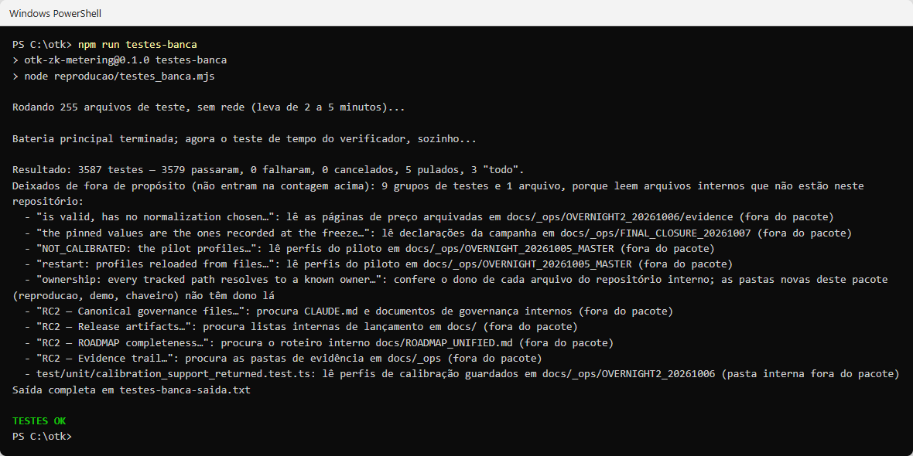

*Real output of the command, ending in TESTES OK.*

It takes 2 to 6 minutes. **What you should see** at the end:

```
Resultado: 3587 testes — 3579 passaram, 0 falharam, 0 cancelados, 5 pulados, 3 "todo".
```

followed by the list of tests left out on purpose and by `TESTES OK`. The total number of tests may be slightly different on your computer, and what matters is `0 falharam` (0 failed) and the last line `TESTES OK`.

#### How to read the output

The line *Resultado* adds up the 3587 tests that ran and splits them into five groups, in which *passaram* (passed, 3579) went right and *falharam* (failed, 0) went wrong, and that is the only number that must be zero, while *cancelados* (cancelled, 0) stopped midway, for example because time ran out. Besides, the *pulados* (skipped, 5) and the ones marked `todo` (3) are explained below, and added up, 3579 + 0 + 0 + 5 + 3 give exactly the 3587.

After the line *Resultado*, the command lists the tests left out, each with the reason, and ends in `TESTES OK` when nothing failed, or in `HOUVE FALHA` (there was a failure) when some test failed. In that case, the detail of each failure is in the lines that start with `✖`, at the end of the screen or in the file `testes-banca-saida.txt`, inside `C:\otk`.

- The **skipped (5)** ("pulados") render the production configuration with Helm and need the Docker image `alpine/helm:3.16.4` already downloaded, which this command does not do, so the test skips itself and warns `alpine/helm:3.16.4 not present locally`, and this warning is not a defect. On a computer without Docker, another 6 tests (of `docker compose`) also skip themselves, with the warning `docker CLI not available`, and the number of skipped tests goes up to 11. The groups that warn `SKIPPED — set OTK_TEST_PG_URL`, which need a test PostgreSQL running, are also left out, but Node does not add them to the skipped count.
- The **todo (3)** are tests marked as *to be decided* since the evaluated version (in the dissertation, the *3 pendentes*, 3 pending), which are open product decisions, not defects, and they appear with `⚠` in the full output.
- The **left out**, which are not counted, are 9 test groups and 1 file that read internal files that are **not** in this repository (the coordination folder `docs/_ops`, governance documents and the owner rules of each file), and the command lists each one with the reason.
- In the evaluated version, with the internal files present, there were 3,563 tests, of which 3,560 passed and 3 were to be decided, a number from the author's internal record that cannot be redone here. The difference from today's total comes from the verifier tests, which did not exist yet, and from the groups left out.

**If you see** `HOUVE FALHA` (there was a failure), look at which lines start with `✖`, at the end of the screen or in the file `testes-banca-saida.txt`, in the folder `C:\otk`, which opens in Notepad with a double click and lets you search with Ctrl+F. If the **only** line with `✖` is `desempenho: 1.000 recibos verificados em menos de 5 s` (performance: 1,000 receipts verified in under 5 s), the computer was just slow at that moment, so it is enough to close the other programs and run `npm run testes-banca` again, and if only that one persists, it is not an OTK defect.

Likewise, if the only lines with `✖` are `H1-S23 GDPR erasure: receipt integrity and audit trail` and `OWNER of A erases A ...` (`test/security/h1_s23_privacy_retention.test.ts:181`), run `npm run testes-banca` again, because that test, with a defect that already existed in the evaluated version, rarely fails by chance, since it looks for the text 1001 in a line that has a random sha256 digest and a random identifier.

Any other line with `✖` deserves section 13.

**If you see** `Aviso: não achei o bash do Git for Windows` (warning: Git for Windows bash not found), install Git with the official installer (section 1) and repeat, because some tests run bash scripts, which come with Git for Windows.

## 8. Check receipts with the verifier

The verifier checks, **on your computer and offline**, whether a receipt was changed after being signed and whether the signature belongs to an operator key.

For that check, it needs the **receipts**, the **public keyring** and the keyring **fingerprint**, which has to arrive through another channel, such as a contract, a website or the dissertation itself.

### 8.1 Using the page (easiest)

1. Open the folder `C:\otk\web\verificador` in File Explorer (on a Mac, in Finder, the folder `otk/web/verificador`).
2. Double-click **`verificador-otk.html`**, which opens in the browser (tested in Edge, on Windows, and not tested in other browsers). The internet can be turned off, and the page works the same.
3. To use the **example receipts**, click **Escolher pasta** (choose folder), in the **Recibos** (receipts) area, and choose the folder `C:\otk\test\verifier\vetores\recibos`, and if the browser asks whether to upload the files to the site, you can accept, because the page runs only on your computer. In the **Chaveiro** (keyring) area, click **Escolher chaveiro** (choose keyring) and choose the file `C:\otk\test\verifier\vetores\chaveiro.json`, or, if you prefer, drag the folder and the file onto those areas.
4. In the field **Impressão digital do chaveiro** (keyring fingerprint), paste:

```
ef9d1aeb4f6ef0b412fad87dfba256cfcc7aa49c6b00f1dc27674d6351bbba24
```

5. Click **Conferir recibos** (check receipts).

**What you should see:** the cards at the top with **9 OK (verde)** (green), **11 Atenção (amarelo)** (attention, yellow) and **33 Falhou (vermelho)** (failed, red). The example receipts were made on purpose to test the verifier, so most of them were **altered** after being signed (hence the red) and only a few are intact. Moreover, the cards count **items**, not files, because one file may hold several receipts (one per line) and one receipt may produce more than one warning, which gives 53 items.

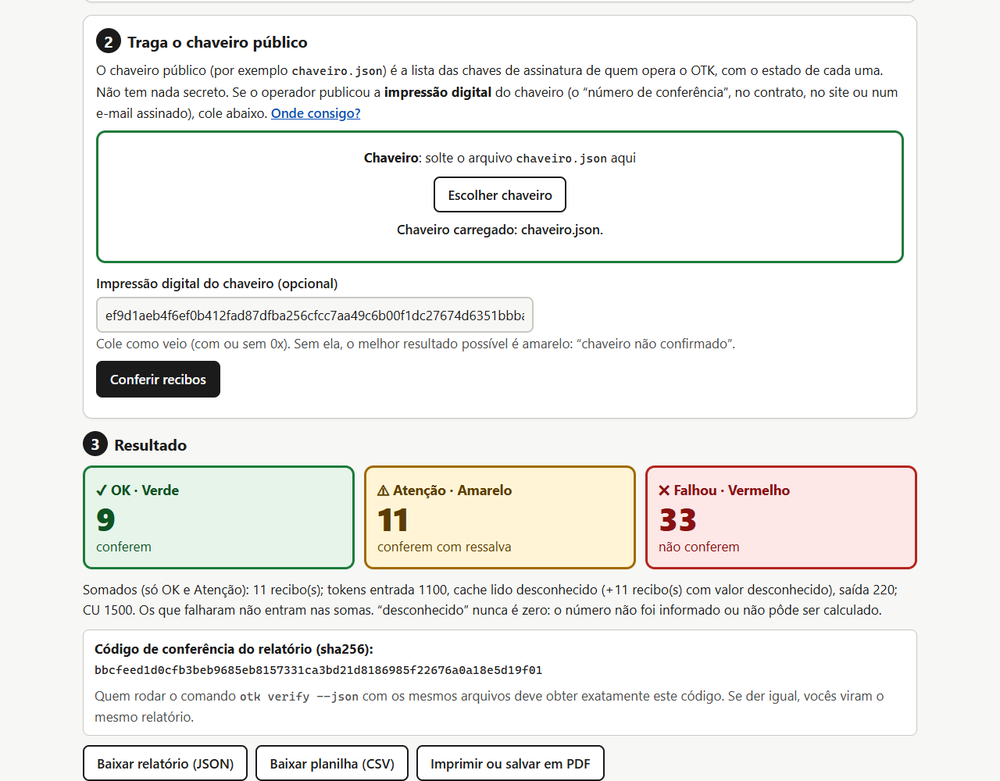

| Color | Meaning |
|---|---|
| ✔ **OK (verde)** | the receipt is intact and was signed by an active key of a keyring confirmed by the fingerprint, and nobody changed the numbers after the signature. |
| ⚠ **Atenção (amarelo)** | there is a caveat, and the reason is on the line, such as a fingerprint not pasted, a key already retired or a signature that could not be checked (key outside the keyring, old format). If the line says "não entra nas somas" (not included in the sums), the numbers of that receipt stay out of the totals. |
| ✖ **Falhou (vermelho)** | the receipt was altered after being signed, the signature does not match, the key was revoked or the file is unreadable, and so its numbers should not be used. |

When you click a row of the table, the page shows, in Portuguese, **o que aconteceu** (what happened), **o que isso significa** (what it means) and **o que isso não garante** (what it does not guarantee).

If the fingerprint is not pasted, no receipt turns green, and the best result becomes yellow, with the reason *Chaveiro não ancorado* (keyring not anchored; in the field help, *chaveiro não confirmado*, keyring not confirmed), which is expected.

### 8.2 Using the terminal

#### To check the example receipts from the terminal

**Where to run:** in **PowerShell**, inside `C:\otk`, with the line starting with `PS C:\otk>` (if you just opened PowerShell again, first run `cd C:\otk`). On a Mac, in the Terminal, inside `~/otk`, with the line at `otk %` (otherwise, `cd ~/otk`).

```
npm run otk -- verify test/verifier/vetores/recibos --keyring test/verifier/vetores/chaveiro.json --fingerprint ef9d1aeb4f6ef0b412fad87dfba256cfcc7aa49c6b00f1dc27674d6351bbba24
```

This command, run inside the folder `C:\otk`, does the same check as the page, with the same receipts folder, the same keyring and the same fingerprint, so it must give the same count as the cards.

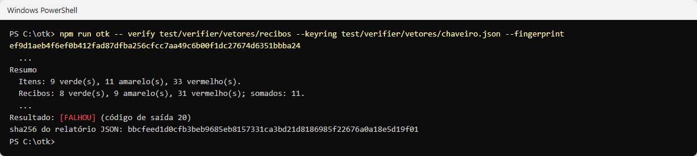

*Excerpt of the real output: the output is long, and the ellipses mark the cut.*

**What you should see** at the end:

```
Resumo
  Itens: 9 verde(s), 11 amarelo(s), 33 vermelho(s).
...
Resultado: [FALHOU] (código de saída 20)
sha256 do relatório JSON: bbcfeed1d0cfb3beb9685eb8157331ca3bd21d8186985f22676a0a18e5d19f01
```

#### How to read the output

The output starts with the two `>` lines of npm and, right after, with the line *Chaveiro* (keyring), which says whether the pasted fingerprint matches the loaded keyring.

Then comes one block per receipt, in the order of the files, and the first line of each block has the verdict in brackets (`[OK]`, `[ATENÇÃO]` or `[FALHOU]`), the operation, the file and the line the receipt came from (for example `recibos/b_alterados.jsonl:1`) and the reason in Portuguese. The lines below it, when there are any, start with *Significa* (means), with the explanation of that verdict, or with `+`, with an extra check of the same receipt.

The *Resumo* (summary) has the line *Itens* (items), with the same count as the cards on the page, and the line *Recibos* (receipts), counting each receipt only once, and so its numbers are smaller. Then come the tokens and the CU added up, only from receipts with a checked signature, split by month and by model. Besides, *Vermelhos (fora das somas)* (reds, left out of the sums) lists the receipts excluded from those totals, and *O que isto NÃO garante* (what this does NOT guarantee) repeats, in seven lines, the limits of the verifier (section 11).

Finally, *Resultado: [FALHOU] (código de saída 20)* is the verdict of the whole set, in which code 0 means all green, 10 that there is yellow and 20 that there is red, and the *sha256 do relatório JSON* is the digest of the full report.

*FALHOU* is right here, because the example set has receipts tampered with on purpose, and a verifier that said OK to them would be wrong. The line *Itens* (items) is the same count as the cards on the page, while the next line, *Recibos* (receipts; 8, 9 and 31), counts only the receipts, and the sha256 of the report is the same one the page shows for the same files. Right after, npm may still write lines `npm error ... code 20` or `command failed`, which are only npm repeating that the verifier ended with code 20 (there is red), and so they are not a defect.

### 8.3 The operator keyring cited in the dissertation

The file **`chaveiro/chaveiro_operador_otk.json`** is the public keyring of the OTK operator whose **fingerprint is published in the dissertation** (Appendix E). This keyring belongs to the key the author created on November 18, 2026 to connect the OTK to his WhatsApp assistant, a key that by November 23 had not yet signed any real receipt, and no receipt signed by it is published here. The example receipts use the test keyring `test/verifier/vetores/chaveiro.json`, with fingerprint `ef9d1aeb…`, while the demonstration creates a new key each time. The fingerprint of this operator keyring is the following.

```
c9dcbb90ec0b9fd79a1da4764821e11f5a46f9073a3c991f00c1daa000f72fdc
```

#### To check the fingerprint of the operator keyring

**Where to run:** in **PowerShell**, inside `C:\otk`, with the line starting with `PS C:\otk>` (if you just opened PowerShell again, first run `cd C:\otk`). On a Mac, in the Terminal, inside `~/otk`, with the line at `otk %` (otherwise, `cd ~/otk`).

**Windows (PowerShell, inside `C:\otk`):**

```
(Get-FileHash chaveiro\chaveiro_operador_otk.json).Hash
```

**Mac:**

```
shasum -a 256 chaveiro/chaveiro_operador_otk.json
```

This command computes the sha256 of the keyring file, which must equal the fingerprint published in the dissertation and shown above, and so it confirms that the file is this one.

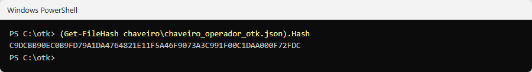

*Real output in PowerShell, in upper case.*

**What you should see:** `C9DCBB90EC0B9FD79A1DA4764821E11F5A46F9073A3C991F00C1DAA000F72FDC` (PowerShell shows it in upper case, and upper or lower case does not matter).

**Watch out for line endings.** The fingerprint is computed over the exact bytes of the file, and so it changes if the file goes through a program that changes the line endings (Git with automatic conversion, an editor that saves with CRLF, an e-mail that reformats the attachment). In that case, the verifier shows red, with the warning *impressão digital não confere* (fingerprint does not match), even with no receipt altered. To avoid that change, this repository marks the folder `chaveiro/` and the page as `-text` in `.gitattributes`, so that Git does not touch them, and besides that the file should not be opened and saved in an editor.

## 9. The OTK running on your computer

In this section, the OTK of the evaluated version is started on your computer, an AI call goes through it and the receipt it produces is checked by the verifier.

### 9.1 What you need

- **Docker Desktop** installed and open (section 1), because the OTK stores the operations in a PostgreSQL database, which Docker runs in an isolated box, so nothing needs to be installed on your system. On Windows without WSL 2 (section 1) and without administrator permission, section 9 does not run, while sections 6, 7 and 8 run the same way.
- About 500 MB of free disk space for the PostgreSQL **image**, the ready-made database package that Docker downloads once, and which therefore **uses the internet** only the first time, plus a few more GB for Docker Desktop itself.

Open Docker Desktop (on Windows, **Windows** key, type `Docker Desktop` and press **Enter**; on a Mac, Applications folder) and wait until **Engine running** appears in the bottom corner of its window.

If it asks for a login or an account, click **Skip**, because no account is needed.

### 9.2 Demonstration mode: no key, no cost

In this mode, the AI provider is **synthetic**, a program on your own machine that answers like `gpt-4o-mini` and declares 20 input tokens and 5 output tokens, and so no call leaves your computer.

#### To run the demonstration

**Where to run:** in **PowerShell**, inside `C:\otk`, with the line starting with `PS C:\otk>` (if you just opened PowerShell again, first run `cd C:\otk`). On a Mac, in the Terminal, inside `~/otk`, with the line at `otk %` (otherwise, `cd ~/otk`).

```
npm run demo-banca
```

This command starts everything the demonstration needs, sends one call to the synthetic provider and checks the receipt at the end, without any call leaving the computer.

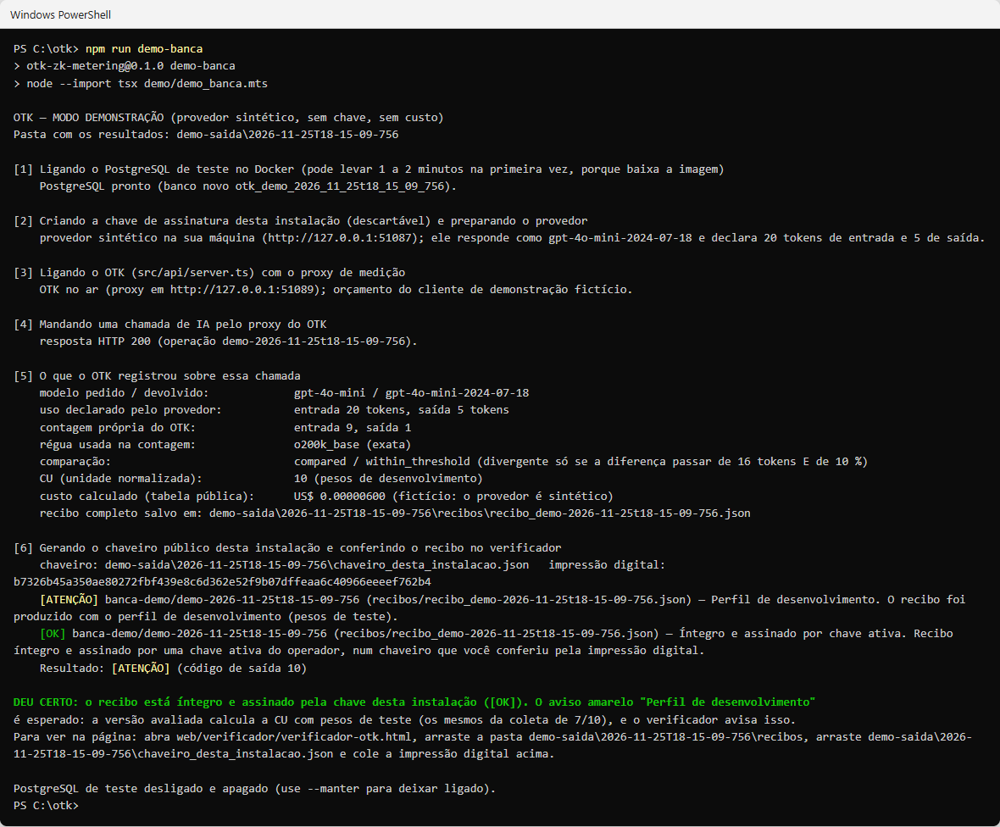

*Real output of the command, with the receipt checked at the end.*

**What happens**, item by item, on the screen:

1. it starts the test PostgreSQL in Docker (the first time it downloads the image, which may take 1 to 2 minutes);
2. it creates a signing key for **this installation** (disposable, in memory only) and the synthetic provider;
3. it starts the OTK (the same entry point as the evaluated version, `src/api/server.ts`) with the measuring proxy;
4. it sends **one AI call** through the proxy;
5. it shows what the OTK recorded, which is the model, the declared usage, its own count made before sending, the comparison, the CU and the cost computed from the public table;
6. it exports the **receipt** (the same one the OTK gives to whoever asks for the receipt of an operation), generates the **public keyring of this installation** and checks the receipt with the verifier.

**What you should see** in item [5] and at the end (port numbers, dates and fingerprint change each time):

```
[5] O que o OTK registrou sobre essa chamada
    modelo pedido / devolvido:             gpt-4o-mini / gpt-4o-mini-2024-07-18
    uso declarado pelo provedor:           entrada 20 tokens, saída 5 tokens
    contagem própria do OTK:               entrada 9, saída 1
    régua usada na contagem:               o200k_base (exata)
    comparação:                            compared / within_threshold (divergente só se a diferença passar de 16 tokens E de 10 %)
    CU (unidade normalizada):              10 (pesos de desenvolvimento)
    custo calculado (tabela pública):      US$ 0.00000600 (fictício: o provedor é sintético)
...
    [ATENÇÃO] banca-demo/demo-... — Perfil de desenvolvimento. O recibo foi produzido com o perfil de desenvolvimento (pesos de teste).
    [OK] banca-demo/demo-... — Íntegro e assinado por chave ativa. ...
    Resultado: [ATENÇÃO] (código de saída 10)

DEU CERTO: o recibo está íntegro e assinado pela chave desta instalação ([OK]). O aviso amarelo "Perfil de desenvolvimento"
é esperado: a versão avaliada calcula a CU com pesos de teste (os mesmos da coleta de 7/10), e o verificador avisa isso.
```

This output reads as follows:

- In steps [1] to [4], each step is confirmed by *PostgreSQL pronto* (PostgreSQL ready), by the addresses of the synthetic provider and of the proxy at `127.0.0.1` (your own computer) and by *resposta HTTP 200* (HTTP response 200), when the call comes back without error.
- In step [5], the **requested / returned model** ("modelo pedido / devolvido") has the name the program asked for (`gpt-4o-mini`) and the dated name the provider returned, and the **ruler** `o200k_base (exata)` is the one the OTK used to count (section 12.1).
- In **declared usage 20 and own count 9** ("uso declarado" and "contagem própria"), the synthetic provider always declares 20 input tokens, whatever the text, while the OTK count (9) is that of the actual text. The difference (11) is within the alert limit (16 tokens), and so the comparison gives `within_threshold`, while with the real provider gpt-4o-mini declares 7 tokens more than the OTK counts, which are the message envelope (see 12.1).
- In the **CU**, the evaluated version uses **test weights**, since the choice of the final weights was left open in the dissertation, which calls this one the *old CU*, and the CU with the base weights of Chapter 3 is not the one shown in this receipt.
- In the **verifier**, the receipt is **[OK] on the signature**, and the **yellow** comes only from the warning *Perfil de desenvolvimento* (development profile), in which *profile* is the set of CU weights, and not the count correction of section 12, and so `Resultado: [ATENÇÃO] (código de saída 10)` is not an error.
- The **cost** is computed from the public price table of gpt-4o-mini and is fictitious here, because nothing was charged, and the line *recibo completo salvo em* (full receipt saved in) says where the receipt is.
- In step [6], the line *chaveiro* has the file of this installation's keyring and its fingerprint, which changes each time, and the following lines are the verifier's verdicts on the receipt.

The demonstration files are in `C:\otk\demo-saida\<data-hora>`, which holds the receipt (`recibos\recibo_....json`), `chaveiro_desta_instalacao.json`, `operacao.json`, `verificacao.txt` and `RESUMO_DEMO.json`.

To see that receipt on the page, open `web\verificador\verificador-otk.html`, choose (or drag) the folder `recibos` and `chaveiro_desta_instalacao.json` and paste the fingerprint the command showed in item [6] of the output, on the line `chaveiro: ... impressão digital: ...`.

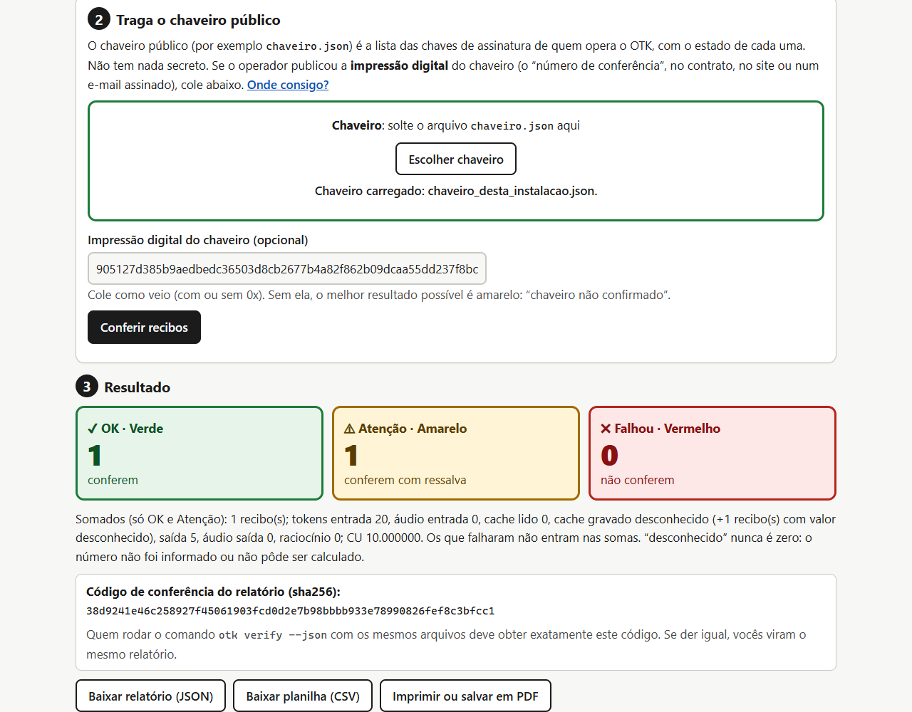

At the end, the command stops and deletes the test PostgreSQL, and to keep it running (and look at the database), use `npm run demo-banca -- --manter`.

**If you see** `PAROU: o Docker não está respondendo` (stopped: Docker is not responding), open Docker Desktop and wait for *Engine running*.

If port 55432 (the number through which the OTK talks to the database inside the computer) is busy or reserved by Windows, the command picks another free port by itself and says so on the screen.

**If you see** `PAROU: ... porta ... already allocated`, `ports are not available` or `porta ocupada` (port busy), use the two commands below.

#### To use another port (only if the port-busy error appears)

**Where to run:** in **PowerShell**, inside `C:\otk`, and both commands in the **same window**, because the variable only applies in that PowerShell window.

```
$env:OTK_DEMO_PG_PORT="15432"
```

```
npm run demo-banca
```

These commands tell the demonstration to use port 15432 for the test database instead of 55432, which is busy. On a Mac, use `OTK_DEMO_PG_PORT=15432 npm run demo-banca`. They have no image, because the port error did not happen while preparing this guide.

**If the command stops with `PAROU:` after item [1]**, the test PostgreSQL may have been left running, and to stop and delete it, use the command in the next block, inside the folder `C:\otk`.

#### To stop and delete the test PostgreSQL

**Where to run:** in **PowerShell**, inside `C:\otk`, with the line starting with `PS C:\otk>` (if you just opened PowerShell again, first run `cd C:\otk`). On a Mac, in the Terminal, inside `~/otk`, with the line at `otk %` (otherwise, `cd ~/otk`).

```
docker compose -p otk-banca-demo -f infra/test/docker-compose.services.yml down -v
```

This command stops the test PostgreSQL and deletes its box and its data, which existed only for the demonstration.

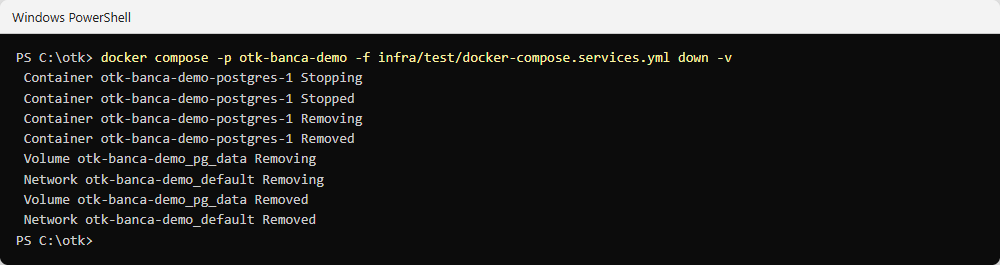

*Real output of the command, with the test PostgreSQL stopped and removed.*

In that output, each line says what was stopped or removed: the database container (*Container*), the volume with the data (*Volume*) and the demonstration's internal network (*Network*).

Or, in Docker Desktop, under **Containers**, delete the group `otk-banca-demo`.

### 9.3 Mode with your own keys (optional; the call costs about US$ 0.0001)

The real-key mode (`--real`) works with the three models that already have a price and a spending cap ready in the evaluated version (see 12.3), **gpt-4o-mini** (OpenAI), **claude-haiku-4-5** (Anthropic) and **gemini-3.5-flash-lite** (Google).

With an API key of yours, this same command sends **one** real call, of at most 16 output tokens, to the provider through the OTK.

> **Warning:** this mode was **not** tested with a real key while preparing this repository, because no paid call was made for that, but it uses the same code path as the October 7 collection.

First, create the key on the provider's site (OpenAI: https://platform.openai.com/api-keys ; Anthropic: https://console.anthropic.com/settings/keys ; Google: https://aistudio.google.com/apikey), knowing that the provider charges your card.

#### To create the .env file

**Where to run:** in **PowerShell**, inside `C:\otk`, with the line starting with `PS C:\otk>`, because the `.env` file has to be at the root of the repository.

```
notepad .env
```

This command opens Notepad on a file named exactly **`.env`** (with the dot in front and without `.txt` at the end), in the folder `C:\otk`, and that is the file where your key goes.

This command has no image, because it only opens the Notepad window.

Notepad asks whether you want to create the file, and the answer is **Yes**.

Write **one** line, according to the provider, with your key after the `=`, and save with Ctrl+S (if the **Save as** window opens, choose **All files** under **Save as type** and keep the name `.env`):

```
OPENAI_API_KEY=cole-aqui-a-sua-chave
```

For the other providers, the line is `ANTHROPIC_API_KEY=...` or `GEMINI_API_KEY=...`. On a Mac, use `nano .env`, write the line, press Control+O, Enter and Control+X.

The `.env` file **never goes to Git**, because this repository's `.gitignore` excludes it and the command checks that before reading the key, and this file should not be sent to anyone.

#### To check the configuration without spending

**Where to run:** in **PowerShell**, inside `C:\otk`, with the line starting with `PS C:\otk>` (if you just opened PowerShell again, first run `cd C:\otk`). On a Mac, in the Terminal, inside `~/otk`, with the line at `otk %` (otherwise, `cd ~/otk`).

```
npm run demo-banca -- --real openai --so-conferir
```

This command checks, before spending and without making any call, whether the key is in `.env`, whether `.env` is outside Git and whether Docker responds. For another provider, replace `openai` with `anthropic` or `gemini`.

**What you should see:** `achei OPENAI_API_KEY (... caracteres)` (found the key, with its length in characters) and, at the end, `CONFIGURAÇÃO OK: a chave OPENAI_API_KEY está no .env, o .env está fora do git e o Docker responde. Nenhuma chamada foi feita (--so-conferir).` (configuration OK; no call was made).

**If you see** `PAROU: não achei OPENAI_API_KEY=... no arquivo .env` (key not found in the file), the file was not saved with the name `.env` (Notepad sometimes saves `.env.txt`) or the line is written differently, so it is worth running `notepad .env` again and checking.

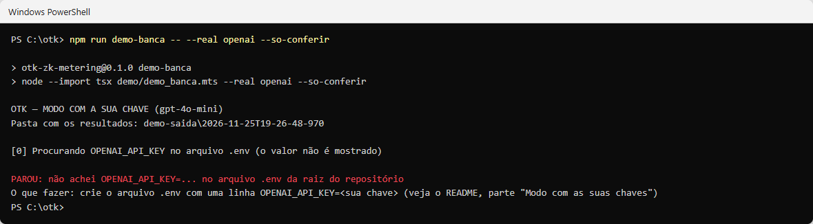

*What appears without the `.env`, in a real run made without a key.*

#### To make the real call

**Where to run:** in **PowerShell**, inside `C:\otk`, with the line starting with `PS C:\otk>` (if you just opened PowerShell again, first run `cd C:\otk`). On a Mac, in the Terminal, inside `~/otk`, with the line at `otk %` (otherwise, `cd ~/otk`).

Choose one of the three commands below, with the same provider you used in the check:

```
npm run demo-banca -- --real openai
```

```
npm run demo-banca -- --real anthropic
```

```
npm run demo-banca -- --real gemini
```

This command runs the same demonstration as 9.2, but with the real provider and your key. It has no image, because it is a paid call, and none was made for this guide.

The command shows that it found the key (only the length, never the value), the **approximate cost** of the call (less than US$ 0.0001 on gpt-4o-mini and gemini-3.5-flash-lite and about US$ 0.0001 on claude-haiku-4-5) and, after that, the same items [4] to [6] of the demonstration mode, now with the usage the real provider declared. The OTK budget for this run is US$ 1, which is a cap, and not the amount charged.

When you finish, delete the `.env` file or revoke the key on the provider's site.

## 10. What needs an API key and what does not

| What | Needs a key? | Uses the internet? | Costs? |
|---|---|---|---|
| Install (`npm ci`) | no | yes, once (npm registry) | no |
| Recompute the numbers (`npm run reproduzir-tudo`) | **no** | **no** | no |
| Automated tests (`npm run testes-banca`) | **no** | **no** | no |
| Verifier (page and `npm run otk -- verify`) | **no** | **no** | no |
| Demonstration mode (`npm run demo-banca`) | **no** | only to download the PostgreSQL image the first time | no |
| Mode with your key (`npm run demo-banca -- --real ...`) | yes, yours | yes | about US$ 0.0001 per run |
| Redo the dissertation's paid collections (October 7 and November 23) | yes, from three providers | yes | yes, but it is **not needed** to check the dissertation and is not part of this guide |

## 11. What the OTK does and does not do (limits)

**It does:**

- count the tokens of the request **before** sending it, but keep that count in memory only and record it at the end of the call, together with the declared usage, since before the send what is recorded is the operation;
- record each operation in a database (PostgreSQL) before the send and, at the end, the count and the declared usage, but whoever controls the database can change those records, and that is why there are signed receipts, which anyone can check and which can be kept outside it;
- store the usage the provider **declares** and, with an exact ruler (OpenAI), compare the two counts with the alert limit (16 tokens **and** 10%), while with an approximate ruler it records both side by side, without a verdict (section 12);
- use an alert limit whose two values were set before the first collection, but without calibration and without a recorded reason for them (Chapter 3);
- compute the cost with the **public price table** frozen before the collection, and the CU, for the models in that table;
- sign one receipt per call, which anyone can check with the verifier, offline.

**It does not:**

- **it does not prove that the provider counted correctly**, because the OTK records what the provider declared, and its own count is auxiliary and, for models whose tokenizer (the rule that cuts the text into tokens) is not published, approximate;
- the **cost is computed, and it is not the invoice**, since checking against the provider's invoice is another step (the reconciliation);
- the amount the OTK **reserves** before each call is a **safety cap**, the cost if the request filled all the text space the model accepts in one call, and not a forecast of the spending;
- the receipt proves that the numbers **did not change after being signed** and which key signed, but it does not prevent the operator itself from signing another receipt, nor does it have a third-party timestamp;
- the verifier points out repeated copies of the same receipt and two different receipts for the same operation, but **does not notice missing receipts**, and the order of the files does not matter to it;
- **it does not prove to a third party that the collections happened as recorded**, because the chained record and the timestamps were written by the author's machine, and the provider's response identifier was removed from the published data. Moreover, the check of the totals against the Anthropic and OpenAI invoices, made by the author (Chapter 4), is not in this repository;
- the **test texts are synthetic** (written for the test, with no real conversation) and only three models from three providers were evaluated in H1, so there is no generalization to other models, languages or kinds of request;
- the November 23 collection (CMP8) is **exploratory** and outside H1, and in it one item (gpt-6-luna, `numeric-005-v1`) had no declared usage, because the provider refused the request (HTTP error 400), and it was listed as an exclusion;
- the *estimated × declared* comparison of the November 23 collection is a **post-collection check**, computed afterwards, and only in 7 of the 8 models was the OTK count already in the entry the collection program wrote before the send (part C of section 6);
- the cost of the November 23 collection (US$ 0.734 to US$ 0.756 in the dissertation) was computed by the collection program (`scripts/h2eval/`), with its own price table (`scripts/h2eval/modal/pricing/`), and is not redone by the command of section 6;
- the command of section 6 **does not redo the whole dissertation**, and so left out (list in Appendix C of the dissertation) are the 9,211 calls of the collections from October 15 to November 20 and, with them, the tests of the per-model corrections, except the first experiment of October 15. Also left out are the reconciliation with the invoice, the trial use in the author's assistant, the study of candidate models, the Chapter 4 version of the *estimated × declared* table and the original charts of the October 7 package, which would need Python and matplotlib, and the raw data of these collections are not in this repository;
- the proxy **refuses**, before sending, some requests the provider would accept, because it cannot compute a spending cap for them, such as asking for several answers in one call (`n` greater than 1), asking Anthropic to keep the request for 1 hour for reuse (1-hour cache) and sending a previously uploaded file instead of the text. Moreover, it also refuses kinds of call it does not measure, for example the Anthropic endpoint compatible with OpenAI;
- finally, the proxy **changes** one field of the request, because in OpenAI calls in which the answer arrives bit by bit (*streaming*) it turns on `stream_options.include_usage`, so that the provider reports the usage at the end of the answer.

## 12. Providers and models: what the OTK measures today and how to add a new one

12.1, 12.2 and the table in 12.3 are for any reader, while the command at the end of 12.3 and 12.4 are for programmers, and to check the dissertation sections 6 to 9 are enough.

### 12.1 A few terms before the table

- The **own count** is the one the OTK makes of the request's tokens on your computer, before sending it, with a *ruler* (a tokenizer, the program that cuts the text into tokens). For OpenAI models, the ruler is the same one the provider publishes (`o200k_base` in current models, `cl100k_base` in the old `gpt-4` and `gpt-3.5`, which are the names of OpenAI's rulers), and so the count is **exact**, while for Anthropic and Google the provider does not publish the ruler, and the OTK uses another one (`cl100k_base`), with an **approximate** count.
- The **message envelope** is the tokens the provider adds around the text (start and end marks of each message), and it is because of it that, even with the exact ruler, gpt-4o-mini declares 7 tokens more than the OTK counts in the text.
- The **count correction** is a simple formula, factor × OTK count + fixed value (a line), that brings the own count close to the number the provider declares. This correction is computed with real calls and is only **approved** if it passes a test with held-out calls, which were not used to compute it (details in 12.4), and when it fails, new texts must be collected and another try made, each try being a **cycle**. The **side study** was a first trial, outside the cycles, in which only the **confirmation**, with new texts, counts as a result.
- The **alert limit** applies with an **exact** ruler (OpenAI) and no correction, and in that case the OTK compares the two counts and only flags a difference when it exceeds **16 tokens and 10%** at the same time.
- The **fixed rule of the October 7 collection** is that same alert limit, applied also to Anthropic and Google in that collection, when there was not yet a correction fitted to each model, and it does not mean adding a fixed value.
- The **verdict**, which is the OTK saying whether the provider counted right or wrong, is left out with an **approximate** ruler (Anthropic, Google), if no approved correction is loaded yet, and the OTK only records the two counts (`incomplete` / `not_applicable`), because that approximate count is not enough to accuse the provider.
- The **approval criterion** is at most 5% false alerts on the held-out calls and at least 50% detection when the declared value is raised by 25% on purpose.
- The **frozen price table** is a file with the public price of each model, recorded with date and source **before** the calls, so that the cost cannot be adjusted afterwards.

On any model, with or without a correction, the OTK **records what the provider declared and signs the receipt**, and the correction only changes the comparison between the two counts, without changing the declared usage or the cost.

### 12.2 Providers

| Provider | Provider name in the OTK | Kind of call the proxy measures | Status |
|---|---|---|---|
| OpenAI | `openai` | Chat Completions (`/v1/chat/completions`), and the code also accepts Responses (`/v1/responses`), never used with a real call | measured with real calls in the dissertation collections |
| Anthropic | `anthropic` | Messages, the native API (`/v1/messages`), and the Anthropic endpoint compatible with OpenAI is **not** measured | measured with real calls in the dissertation collections |
| Google (Gemini) | `gemini` (not `google`) | generateContent (`/v1beta/models/<modelo>:generateContent`) and the streaming version (`:streamGenerateContent`) | measured with real calls in the dissertation collections |
| Cohere, Mistral, Meta, DeepSeek | — | the code has the provider's address | **never tested with a real call**, and so they should be treated as unsupported |

### 12.3 Models

The columns *ruler*, *price* and *cap* say what is ready **in the code of this repository**, while the column *correction* summarizes what the dissertation concludes (Chapter 4, tables of the correction tests).

In the correction column, the numbers in parentheses are the false alerts over the total held-out calls of the test, whose approval criterion was at most 5%, and the final column says whether the **proxy** uses that correction today. When the column says the margin of error *includes 5%*, the measured rate stayed below the limit, but with so few calls it cannot be guaranteed that it would stay below with other texts, and for `claude-haiku-5-5` the exception is that the 2nd cycle reused texts that had already served as the test in the 1st.

The tests of October 7 and 15 are redone by part A of section 6, while those of November **cannot be redone with this repository**, because the data of those collections were not published, and so the numbers come from the reports cited in the dissertation.

In short, each model falls today into one of three levels, and only the last one uses an approved correction. A correction approved in the dissertation, however, does **not** mean calibrated in the OTK, because of the approved corrections only the one for `gpt-4o-mini` is in a file the OTK can load, and so `claude-opus-5-5` and the two Haiku models remain **measured only** in the proxy, as does `gpt-6-luna`, which has no ruler in the OTK at all.

| Level | What the OTK does | Models today |
|---|---|---|
| **Measured only** | records the usage the provider declared and signs the receipt, but does not say whether the provider counted right; computes the cost only when the model is in the frozen price table, which today holds for `claude-haiku-4-5` and `gemini-3.5-flash-lite`, but not for the other November models | every Anthropic and Google model, `gpt-6-luna` and any new model without an exact ruler and without a correction |
| **Measured and compared** | in addition, compares the declared usage with its own count using the exact ruler and flags a difference above the alert limit (16 tokens and 10%) | the OpenAI models in the catalog, including `gpt-4o-mini` requested without the date |
| **Calibrated in the proxy** | the comparison uses an approved correction loaded by the OTK | only `gpt-4o-mini-2024-07-18`, with the OTK started with `OTK_CALIBRATION_PROFILES_DIR` (step 7 of 12.4) |

| Provider | Model | OTK ruler | Price in the frozen table | Spending cap in dollars | Count correction (dissertation) | Does the proxy use the correction? |
|---|---|---|---|---|---|---|
| OpenAI | `gpt-4o-mini` | `o200k_base`, exact | yes | yes, with policies `v3` to `v5` (see below) | approved in the October 7 collection, and adds 7 tokens (the message envelope); in the dissertation, it appears as “sim (+7)” in the *Correção* (correction) row of Table 3 of Chapter 4, on the November 23 collection | **yes, if you turn it on**, because the file comes in `config/calibration/`, but it is only used with `OTK_CALIBRATION_PROFILES_DIR=config/calibration` (step 7 of 12.4) and with the name `gpt-4o-mini-2024-07-18` in the request, and otherwise (including in demonstration mode) the alert limit applies |
| OpenAI | `gpt-6-luna` | none, because the counter does not know the `gpt-6` family | no | no | in the tests of November 16 and 17, the declared value was always the `o200k_base` count + 6 (in the dissertation, the “+6” correction of Table 3), but the OTK counter does not recognize the name `gpt-6-luna`, and so, in the November 23 collection, that count was made separately, after the collection, and not by the OTK | **no**, because without a ruler the OTK only records the declared value |
| Anthropic | `claude-haiku-4-5` | `cl100k_base`, approximate | yes | yes, with policies `v2` (default) to `v5` | the fixed rule of the October 7 collection was above 5% (2 in 37), and the line from the 1st experiment of October 15 was accepted (3 in 72), but the test's margin of error (up to 12.5%) includes 5% | **no** (used only in the analysis; approval at the limit) |
| Anthropic | `claude-haiku-5-5` | `cl100k_base`, approximate | no | no | accepted in the 2nd cycle (6 in 216, 2.78%), but the margin of error (1.0% to 5.95%) includes 5%, and the 2nd cycle reused texts from the 1st cycle's test | **no** (used only in the analysis; approval with an exception) |
| Anthropic | `claude-sonnet-5-5` | `cl100k_base`, approximate | no | no | passed in the side study (0 in 96), but was not confirmed on November 19 (9 in 72, 12.5%) | **no** |
| Anthropic | `claude-opus-5-5` | `cl100k_base`, approximate | no | no | approved in the 3rd cycle, on November 14 (0 in 96; margin of error up to 3.8%, below 5%), with one of the test's dialogue kinds having 6 requests, below the 10 planned, a deviation accepted by the author; valid only for the kinds of request tested (not for short summaries) | **no** (used only in the analysis) |
| Google | `gemini-3.5-flash-lite` | `cl100k_base`, approximate | yes | yes, with policy `v5` | only the fixed rule of the October 7 collection, far above 5% (17 in 37, 45.9%), and only 8% of the 25% increases noticed (the minimum was 50%) | **no** |
| Google | `gemini-3.1-flash-lite` | `cl100k_base`, approximate | no | no | passed in the side study, but failed the confirmation of November 17 (9 in 36) | **no** |

Other OpenAI models listed in the OTK catalog (`src/providers/catalog/modelCatalog.ts`, families `gpt-4o`, `gpt-4.1`, `gpt-5`, `o1`, `o3`, `o4-mini`, `gpt-4` and `gpt-3.5`, with the dated versions) have an exact ruler, but **none was measured with a real call** nor has a correction. Any other Anthropic or Google model gets the approximate ruler and no correction.

What this means in practice:

- **No price in the frozen table.** In that case, the OTK records the declared usage and signs the receipt, but does not compute the cost, and if it is given a budget in dollars, it **refuses** the call before sending it, with the refusal message `402 money_bound_unavailable`, because it cannot prove the worst-case spending.
- **Spending cap.** The OTK applies one cap policy at a time, chosen with the variable `OTK_MONEY_BOUND_POLICY`, and each policy includes the previous ones. So the default (`otk.money_bound_policy.v2@2026-10-02`) covers only `claude-haiku-4-5`, `otk.money_bound_policy.v3@2026-10-03` adds `gpt-4o-mini`, and `otk.money_bound_policy.v5@2026-10-04` covers the three models of October 7 (and `gemini-2.5-flash-lite`, a Google model the collector still carries, but which did not enter the dissertation collections), while the demonstration mode picks the policy of the model used by itself.
- **Corrections outside the proxy (used only in the analysis).** The corrections of `claude-sonnet-5-5`, `claude-opus-5-5` and `gemini-3.1-flash-lite` of section 6 are in `reproducao/cmp8/perfis/`, in a format the proxy does not load, because it only accepts the type `otk.calibration_profile.v1`.
- **Files of the two Haiku corrections.** The corrections of `claude-haiku-4-5` and `claude-haiku-5-5` appear in the Chapter 4 table, but their frozen files are not in this repository, and so part C of section 6 does not redo them.
- **Model name with date.** The correction applies to the exact name recorded in the file and to its aliases (other names of the same model), and so a request with `gpt-4o-mini` falls back to the alert limit, since the file carries only `gpt-4o-mini-2024-07-18`.
- **No verdict for Anthropic and Google, today.** No correction for these providers is in the proxy format, and so each call to them comes out without a verdict (`incomplete` / `not_applicable`), but with the declared usage, the cost and the signed receipt.

#### To see what the OTK knows about a model

**Where to run:** in **PowerShell**, inside `C:\otk`, with the line starting with `PS C:\otk>` (if you just opened PowerShell again, first run `cd C:\otk`). On a Mac, in the Terminal, inside `~/otk`, with the line at `otk %` (otherwise, `cd ~/otk`).

```
npx tsx -e 'import(`./src/providers/catalog/modelCatalog.ts`).then(m => { const [p, a, id] = process.argv.slice(-3); const s = m.resolveModelSupport(p, a, id); console.log(id, s.support, s.tokenizer ? s.tokenizer.encoding : `sem régua`) })' anthropic anthropic.messages claude-opus-5-5
```

This command asks the OTK catalog which ruler it uses for a model. For another model, inside the folder `C:\otk`, replace the last three values with the provider (`openai`, `anthropic` or `gemini`), the kind of call (`openai.chat_completions`, `anthropic.messages` or `gemini.generate_content`) and the model.

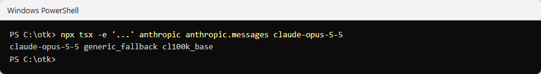

*Real output of the command, which appears shortened in the image as `npx tsx -e '...'`.*

**What you should see:** `claude-opus-5-5 generic_fallback cl100k_base`.

In that output, `exact` means exact ruler, `alias_known` is the dated version of an exact model, `generic_fallback` is the approximate ruler and `unsupported` means that the OTK does not count that model and only records the declared value.

If you see `unsupported sem régua` (unsupported, no ruler) for a Google model, check that you wrote `gemini`, and not `google`.

### 12.4 How to start using a model or provider that is not here yet

**This part needs someone who programs and costs money.** Whoever does not program can do alone only the note of the *before you start* and the checks of steps 6 and 7, which only ask you to open a file and read a line, while steps 1 to 5 require editing code, and the collection of step 4 is the paid part. Each step below says who does it.

This is the path of the October 7 collection, the only one whose correction already came out in the format the proxy loads. The corrections of the November models, in turn, followed the same method (line computed on one part of the texts, limit chosen on another and test on a third, used only once), but with another tool, which is not in this repository, and so the collection and analysis commands, written for the three models of October 7, must be adapted in the files indicated.

To give an order of magnitude of the cost, the November 23 collection sent 215 short texts to each of 8 models (1,720 calls), with a cost computed by the OTK of US$ 0.734 to US$ 0.756 in total, checked against the invoice only at Anthropic and OpenAI (Chapter 4). With texts of that size, the at least 120 answered calls a correction cycle needs (step 4) would cost from less than one cent (about US$ 0.004 on `gpt-6-luna` and US$ 0.006 on `gpt-4o-mini`) to about US$ 0.21 (`claude-opus-5-5`). With long texts the cost rises a lot: the November 18 study cost up to US$ 42.21, US$ 34.23 of it in 96 calls to `claude-opus-5-5` (Appendix I), and the cost also grows when the correction fails and another cycle is needed.

Until an approved correction is loaded, the new model stays **measured only** or, if it has an exact ruler, **measured and compared** (see the summary in 12.3).

**Before you start, without looking at any result, decide and write down** the exact model (with date, if the provider has one), the kinds of request you will measure, how many calls, the spending cap, the stopping rule (for example, stop on repeated refusals from the provider, as in the dissertation collections) and the approval criterion of step 6. Save that text in a file and write down its sha256 (`(Get-FileHash arquivo).Hash` on Windows, `shasum -a 256 arquivo` on a Mac), because changing the criterion after seeing the numbers invalidates the approval.

1. **New provider (only if it is not OpenAI, Anthropic or Google; someone who programs).** You need to program, in the path that produces the signed receipts:
   - the provider's address, in `src/proxy/ProxyGateway.ts`, list `UPSTREAM_BASE`;
   - the recognition of the kind of call from the address, in `detectApi` of `src/operations/proxyDurable.ts`;
   - the kinds of call measured, in `PROVIDER_APIS` of `src/providers/catalog/modelCatalog.ts` and in the list `SUPPORTED` of `src/operations/d1d8Ports.ts`;
   - the reading of the usage the provider declares in the response, in `src/providers/usage/normalizeUsage.ts`;
   - the provider's approximate ruler, in `APPROXIMATE_PROVIDERS` of `modelCatalog.ts`.

   Before any paid call, write tests with real provider responses, including missing fields, zero and cache.
2. **Ruler (someone who programs).** If the provider publishes the tokenizer, add the model to the catalog (`modelCatalog.ts`), editing the code, with that ruler, and if it does not, the OTK uses the approximate ruler and the correction of step 5 becomes necessary. Check with the command at the end of 12.3.
3. **Price and cap (someone who programs).** Copy a table from `scripts/pilot/price_table_*.json` (format `otk.price_table.v1`) and add one row per token kind of the new model (input, output, cache), with the price in micro-dollars per million tokens (`1000000` = US$ 1 per million), the date and the address of the official price page, and point the OTK to it with `OTK_PRICE_TABLE_FILES`. To use a budget in dollars, also create a new cap policy in `src/operations/moneyBound.ts`, with its own version, the model rule (context window, maximum output and models the provider may return) and the documentation source, register it in `MONEY_BOUND_POLICIES` and choose it with `OTK_MONEY_BOUND_POLICY`.
4. **Collect pairs (someone who programs; this is the paid part).** Send synthetic texts through the proxy, with no personal data, and keep, for each call, the OTK's own count (computed before the send) and the input the provider declared.

   The generator of these texts, which is in `scripts/calibration/corpus.ts` and `scripts/calibration/messageCorpus.ts`, splits the texts **by group** (a text and its variations always stay in the same part) into three parts, the **fit**, the **limit choice** and the **held-out test**.

   The collector used on October 7 is `scripts/pilot/anthropic/runPilotV3.ts`, with each provider's model in the list `PROFILES` of that file, and it is called by `scripts/pilot/campaign/run_campaign_ovn2.sh`, which reads the key from `.env` without printing it and stops by itself if the spending becomes uncertain. Before the paid collection, do a rehearsal with the synthetic provider (a program on your own computer that answers without charging, as in section 9.2), `npx tsx scripts/pilot/anthropic/runPilotV3.ts --provider=<provedor> --mode=synthetic --phase=gate --out=<pasta>` (in which `<provedor>` is `anthropic`, `openai`, `gemini` for gemini-2.5-flash-lite or `gemini35` for gemini-3.5-flash-lite).

   Finally, the minimum to be able to approve is 60 calls in the fit, 30 in the limit choice and 30 in the held-out test, with at least 10 groups in the test.
5. **Compute the correction (someone who programs).** Run `npx tsx scripts/pilot/campaign/analyzeCampaign.ts --root=<pasta da coleta> --out=<pasta de saída>`, which reads the collection, without calling the provider, and writes `calibration_profile_<provedor>_<modelo>.json`. This program computes the line only with the fit part and chooses the limit only with the choice part, and only after that looks at the held-out test. Before running it, adapt in the file itself the correction name, the date, the corpus and the scope, which are still fixed with the October 7 values, and the `API` map if the provider is new.
6. **Check the correction (you alone).** Open the generated file and look at the field `"calibrated"`, which is only `true` if all the checks of the field `"acceptance"` passed (for `gpt-4o-mini` there are 8):
   - the four minimum sizes of step 4;
   - the limit chosen on the right part;
   - the existence of the line;
   - **at most 5% false alerts** on the held-out test;
   - **at least 50% detection** when the declared value is raised by 25% on purpose, on your own computer, over the numbers already collected and with no new paid call.

   If it gives `false`, the correction is **not** valid, and the criterion must not be loosened; in that case, collect new texts (a new cycle) and repeat steps 4 to 6, because the held-out test can only be used once. For an independent check, ask someone else to run step 5 on the same collection and compare the sha256 of the file and the numbers.
7. **Start using it (someone who programs starts the OTK, and you check the startup summary).** Put the approved file in a folder only for corrections, without editing it by hand, because the field `evidenceHash`, a sha256 stored inside the file, exposes any edit. Then start the OTK with `OTK_CALIBRATION_PROFILES_DIR=<essa pasta>` and with the price table of step 3 in `OTK_PRICE_TABLE_FILES`.

   The other variables are at the start of `src/operations/bootstrapD1D8.ts`, and `demo/demo_banca.mts` shows a complete set.

   On start, the OTK startup summary shows, in the item `calibration`, how many corrections it loaded and the name of each (for example `1 loaded [...]`), while a damaged file shows up as `CORRUPT` and is ignored, and a file made for another ruler or another counter version is not used either.

   That correction applies to the model name recorded in the file, which is the name returned by the provider (usually with a date), and so request the model by that name, or add the other names in `modelAliases` **before** computing the `evidenceHash` (in step 5). From then on, each call of that model is compared with the correction, and the record stores the name of the correction used, while the verifier of section 8 checks these receipts without any change.

Redo the collection whenever the provider releases a new version of the model or changes the price or the counting, because a correction applies only to the model, the ruler and the kinds of request in which it was tested.

## 13. If you get stuck: paste this into an AI

If a step gives an error, open an AI (ChatGPT, Claude, Gemini or another), copy the text below, replace the parts between `<...>` and paste it. The text is in Portuguese, as in the Portuguese version; to get the answer in English, add a line asking for it.

```
Estou seguindo o README do repositório https://github.com/BrunoQuintaes/otk-open-token-ledger
para conferir os resultados de uma dissertação. Não sei programar. Meu computador é <Windows 11 / Mac>.
Estou na seção <número e nome da seção, por exemplo "6. Refazer os números">.
Colei este comando:
<cole aqui o comando>
E apareceu este erro (copiei tudo o que o terminal mostrou):
<cole aqui a saída inteira do terminal>
O que eu rodei antes deu certo até a seção <número>. As versões são:
node -v: <resultado>   npm -v: <resultado>   git --version: <resultado>
Me explique em português, passo a passo, o que fazer, um comando por vez, e o que deve aparecer depois de cada um.
Não me peça para desligar antivírus, mudar configurações de segurança do sistema nem colar chaves ou senhas.
```

To copy the terminal output on Windows, select the text with the mouse (drag from start to end) and press **Ctrl + C**, and on a Mac, select it and use **Command + C**. If the output is long, on Windows you can also open the file named in the message (for example `testes-banca-saida.txt`) with a double click and copy from there. Finally, never paste the content of the `.env` file or your API key into an AI.

## 14. Where everything is, file origin, license and citation

| Folder / file | What it is |
|---|---|
| `src/`, `scripts/`, `test/`, `tools/`, `zk/`, `config/`, `sdk/`, `infra/` ... | the OTK. The folder `src/` is **identical** to the one of the evaluated version (`7606bc9b`), except the new folder `src/verifier/`. The history of the internal repository, including the commit `7606bc9b` itself, is not published here. `PROVENIENCIA.json` lists the sha256 of each file and where it came from, and with it you can check that the files are the ones listed by the author, but that the list corresponds to `7606bc9b` only the author can confirm, because that commit is not public. `scripts/h2eval/` is the program that made the November collections, kept unchanged (version `b0ec6f24`), and it uses the same code as `src/`. |
| `src/verifier/`, `scripts/verify/`, `test/verifier/`, `web/verificador/` | the receipt verifier (made after the evaluated version; version `535ac19c`) |
| `chaveiro/chaveiro_operador_otk.json` | the operator's public keyring (fingerprint `c9dcbb90…`, published in the dissertation) |
| `reproducao/otk-banca-pack-20261111.zip` and the folder `otk-banca-pack-20261111/` | the committee package of the October 7 collection (described in Appendix C; sha256 of the ZIP `3943637b…`, checked by the command of section 6) |
| `reproducao/cmp8/` | sanitized data of the November 23 collection (attempts, journal without the provider identifier, prior counts), synthetic texts, applied corrections, expected values and the analysis scripts |
| `reproducao/reproduzir_tudo.mjs`, `reproducao/testes_banca.mjs`, `reproducao/ferramentas/sem_rede.mjs` | the commands of sections 6 and 7 and the network lock |
| `demo/demo_banca.mts` | the command of section 9 |
| `docs/` | only the public product documents the tests read (API contract, guides) and the images of this README |
| `PROVENIENCIA.json` | where each file came from (commit and sha256) and what was changed relative to the origin, without listing itself or `zk/ceremony/LEIA-ME.md`, which is new in this repository |

**Not here, on purpose:** the internal coordination folder (`docs/_ops`, with letters, terminals and decisions), the raw data of the collections (with the providers' responses), secrets and `.env` files, and the text of the dissertation. Moreover, the personal folder paths that appeared in comments and default values of some operational scripts were replaced by `<HOME>` (list in `PROVENIENCIA.json`).

**The images in this README** (`docs/imagens/`), apart from the diagram at the top, are screenshots of the real output of the commands, which were run following this guide in a fresh clone from GitHub, on Windows 11 (Node 24.22.2, npm 11.8.0 and Git 2.56).

Of those screenshots, the terminal ones were drawn in a terminal window from the real output, with the folder shown as `C:\otk`, while the page ones are the verifier page itself, opened offline.

**License:** MIT (file `LICENSE`). **How to cite:** file `CITATION.cff` (GitHub shows the "Cite this repository" button).
