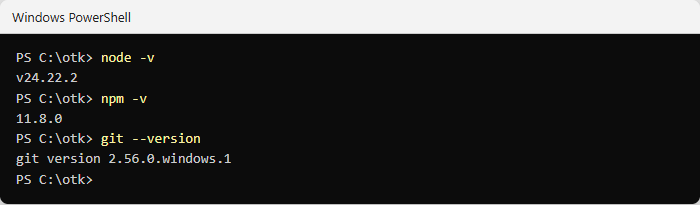
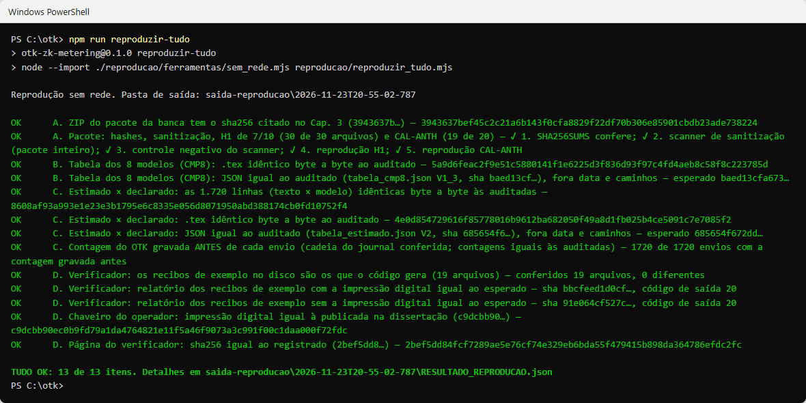
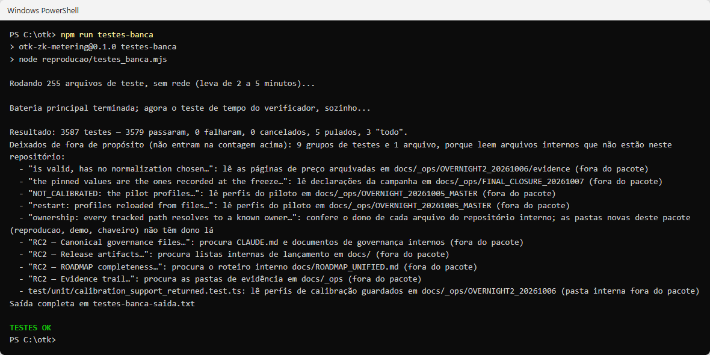
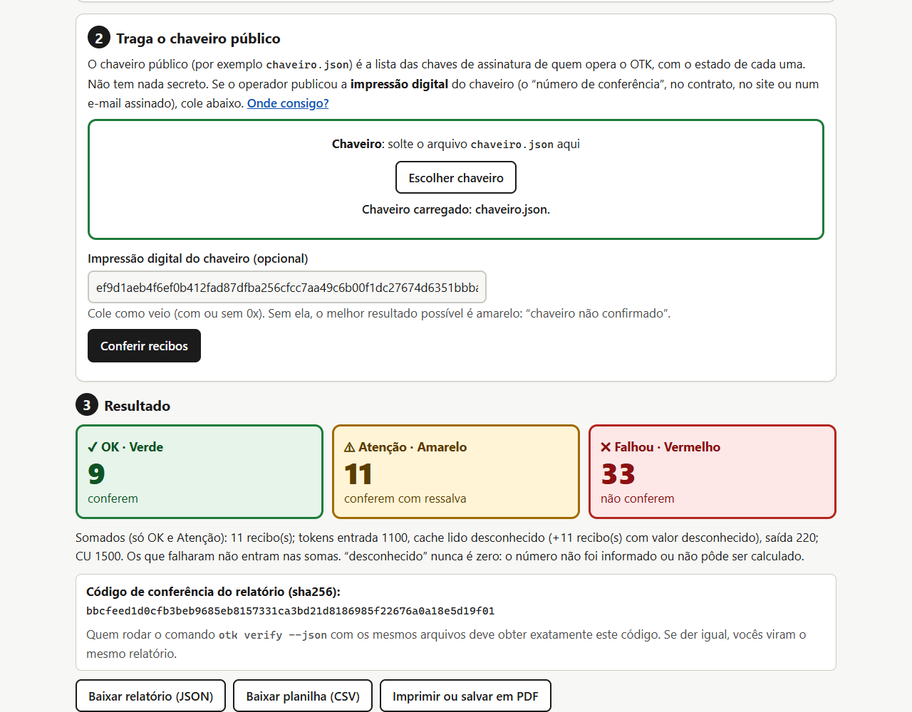
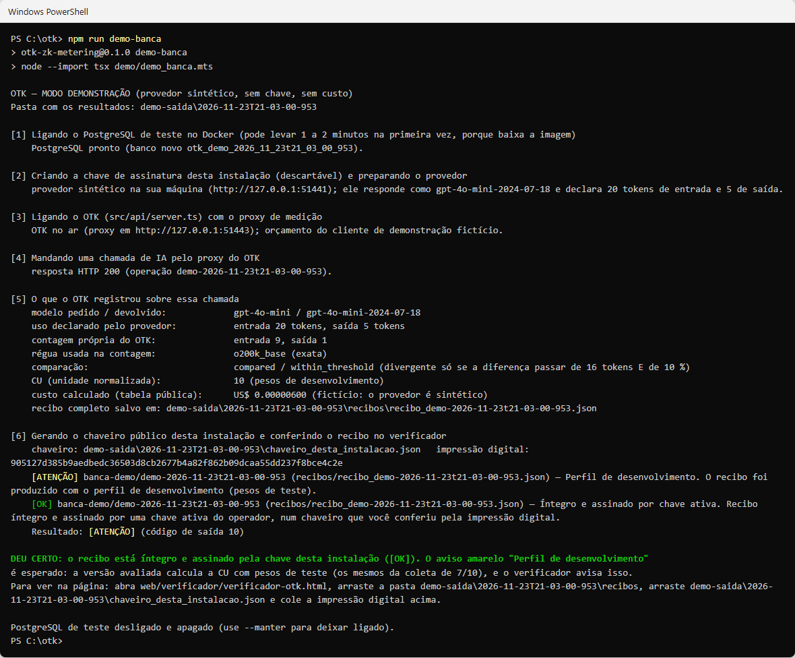
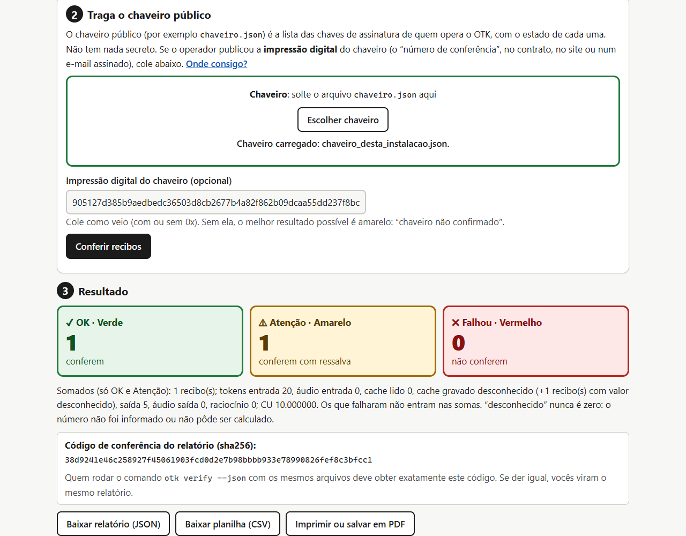

# OTK — Open Token Ledger

Este repositório acompanha a dissertação sobre o **OTK**, um medidor que fica entre um programa e os provedores de IA (OpenAI, Anthropic, Google). A cada chamada, o OTK conta os tokens do pedido **antes** de enviá-lo, guarda o que o provedor declara depois, compara as duas contagens, calcula o custo pela tabela pública de preços e emite um **recibo assinado** que qualquer pessoa pode conferir.

Aqui estão:

- o **código do OTK na versão avaliada** na dissertação (commit `7606bc9b`), com os testes;
- os **dados das coletas** citadas na dissertação, já sanitizados (sem texto de conversa, sem identificador de resposta do provedor, sem caminho pessoal);
- **um comando que refaz, sem internet, os números da coleta de 7 de outubro e as tabelas da coleta de 23 de novembro** que entram na dissertação e diz OK ou FALHOU para cada um;
- o **verificador de recibos** (comando e página que abre no navegador);
- um **passo a passo para usar o OTK no seu computador**, primeiro sem chave nenhuma e depois, se quiser, com a sua própria chave de API.

Você **não precisa saber programar**. Basta seguir os passos na ordem, copiando e colando cada comando. Se algo der errado, a seção [Se travar: cole isto numa IA](#se-travar-cole-isto-numa-ia) tem um texto pronto para pedir ajuda.

---

## Sumário

1. [O que instalar antes](#1-o-que-instalar-antes)
2. [Como abrir o terminal e colar um comando](#2-como-abrir-o-terminal-e-colar-um-comando)
3. [Conferir se ficou tudo instalado](#3-conferir-se-ficou-tudo-instalado)
4. [Baixar este repositório](#4-baixar-este-repositório)
5. [Instalar as dependências](#5-instalar-as-dependências)
6. [Refazer os números da dissertação (sem internet)](#6-refazer-os-números-da-dissertação-sem-internet)
7. [Rodar os testes automáticos](#7-rodar-os-testes-automáticos)
8. [Conferir recibos com o verificador](#8-conferir-recibos-com-o-verificador)
9. [Use o OTK você mesmo](#9-use-o-otk-você-mesmo)
10. [O que precisa de chave de API e o que não precisa](#10-o-que-precisa-de-chave-de-api-e-o-que-não-precisa)
11. [O que o OTK faz e o que não faz (limites)](#11-o-que-o-otk-faz-e-o-que-não-faz-limites)
12. [Se travar: cole isto numa IA](#se-travar-cole-isto-numa-ia)
13. [Onde está cada coisa, origem dos arquivos, licença e citação](#13-onde-está-cada-coisa-origem-dos-arquivos-licença-e-citação)

---

## 1. O que instalar antes

Você precisa de **dois programas** (e de um terceiro só para a parte 9). Todos são gratuitos. Use sempre o site oficial.

| Programa | Para quê | Versão | Windows | Mac |
|---|---|---|---|---|
| **Git** | baixar o repositório | qualquer 2.x (testado com 2.51) | https://git-scm.com/download/win — baixe o instalador "64-bit Git for Windows Setup" e clique em **Next** em todas as telas (as opções padrão servem) | abra o Terminal (passo 2) e digite `git --version`; se o Mac oferecer instalar as "ferramentas de linha de comando", aceite. Ou: https://git-scm.com/download/mac |
| **Node.js** (já traz o **npm**) | rodar o OTK, os testes e a reprodução | **24 LTS** (testado com 24.22.2; o npm que vem junto é o 11) | https://nodejs.org/pt/download — escolha "LTS", versão **24**, "Windows Installer (.msi)", e clique em **Next** em todas as telas | mesma página, "macOS Installer (.pkg)" da versão **24 LTS** |
| **Docker Desktop** (só para a parte 9) | ligar o banco de dados do OTK numa caixa isolada | qualquer versão atual (testado com 29.x) | https://www.docker.com/products/docker-desktop/ — "Download for Windows". Ele pede para ativar o WSL 2; aceite e reinicie o computador se pedir | mesma página, "Download for Mac" (escolha Apple Silicon ou Intel conforme o seu Mac) |

Este repositório usa o **npm**, que já vem com o Node.js. Você **não** precisa instalar pnpm, Python, banco de dados nem conta em provedor de IA.

> Depois de instalar o Git e o Node.js, **feche e abra de novo** o terminal (passo 2). Terminal aberto antes da instalação não enxerga os programas novos.

## 2. Como abrir o terminal e colar um comando

O terminal é uma janela onde você cola comandos de texto.

**Windows:** aperte a tecla **Windows**, digite `PowerShell` e aperte **Enter**. Abre uma janela azul ou preta com algo como `PS C:\Users\seu-nome>`.

**Mac:** aperte **Command + Espaço**, digite `Terminal` e aperte **Enter**.

Para cada comando deste guia:

1. clique no botão de copiar no canto do bloco cinza (ou selecione o texto e use **Ctrl + C** no Windows, **Command + C** no Mac);
2. clique dentro da janela do terminal;
3. cole com **Ctrl + V** (Windows; ou clique com o botão direito) ou **Command + V** (Mac);
4. aperte **Enter** e espere o terminal mostrar de novo o `PS C:\...>` (ou o `%` no Mac) antes de colar o próximo.

Cada bloco cinza é **um comando**. Cole um de cada vez, na ordem.

## 3. Conferir se ficou tudo instalado

```
node -v
```

**O que deve aparecer:** `v24.` seguido de números, por exemplo `v24.22.2`.
**Se aparecer** `node : O termo 'node' não é reconhecido` (Windows) ou `command not found: node` (Mac): o Node.js não foi instalado ou o terminal foi aberto antes da instalação. Feche o terminal, abra de novo e repita. Se continuar, instale o Node.js de novo (passo 1).
**Se aparecer** `v20.` ou `v22.`: funciona para quase tudo, mas a reprodução da coleta de 7/10 foi validada com a 24. Instale a 24 LTS.

```
npm -v
```

**O que deve aparecer:** um número como `11.8.0` (qualquer `10.` ou `11.` serve).
**Se aparecer** (só no Windows) `npm.ps1 não pode ser carregado porque a execução de scripts foi desabilitada`: cole o comando abaixo, aperte Enter, responda `S` (ou `Y`) se perguntar, e repita o `npm -v`. Ele só libera scripts assinados para o seu usuário.

```
Set-ExecutionPolicy -Scope CurrentUser RemoteSigned
```

```
git --version
```

**O que deve aparecer:** `git version 2.` seguido de números.
**Se aparecer** "não é reconhecido" ou "command not found": instale o Git (passo 1), feche e abra o terminal.



## 4. Baixar este repositório

Os exemplos usam a pasta **`C:\otk`** no Windows e **`otk`** dentro da sua pasta pessoal no Mac.

**Windows:**

```
git clone https://github.com/BrunoQuintaes/otk-open-token-ledger.git C:\otk
```

**Mac:**

```
git clone https://github.com/BrunoQuintaes/otk-open-token-ledger.git ~/otk
```

**O que deve aparecer:** `Cloning into 'C:\otk'...` e, depois de alguns segundos, linhas terminando em `done.`

**Enquanto o repositório estiver privado** (antes de o autor torná-lo público), o GitHub pede login:

- **Windows:** abre uma janela "Connect to GitHub". Clique em **Sign in with your browser**, entre na sua conta do GitHub e clique em **Authorize**. Sua conta precisa ter sido convidada pelo autor (você recebe um e-mail do GitHub; aceite o convite antes).
- **Mac:** o terminal pede `Username` e `Password`. Em `Username` digite o seu usuário do GitHub. Em `Password` **não** use a senha da conta: crie um token em https://github.com/settings/tokens?type=beta ("Generate new token", acesso só de leitura ao repositório `otk-open-token-ledger`, "Contents: Read-only") e cole o token. O terminal não mostra nada enquanto você cola; é normal. Aperte Enter.

Depois que o repositório ficar **público**, nenhum login é pedido.

**Se aparecer** `Repository not found`: o repositório ainda é privado e sua conta não tem acesso (peça o convite ao autor), ou o endereço foi digitado errado.
**Se aparecer** `destination path 'C:\otk' already exists`: você já baixou antes. Pule para o passo 5, ou apague a pasta `C:\otk` e repita.

Agora entre na pasta (todos os comandos seguintes são colados **dentro dela**):

**Windows:**

```
cd C:\otk
```

**Mac:**

```
cd ~/otk
```

**O que deve aparecer:** o começo da linha muda para `PS C:\otk>` (no Mac, `otk %`).

## 5. Instalar as dependências

Baixa as bibliotecas que o OTK usa, nas versões exatas guardadas no arquivo `package-lock.json`. **Usa a internet** (só o registro público do npm), uma vez.

```
npm ci
```

**O que deve aparecer** (em 10 segundos a 2 minutos):

```
added 187 packages, and audited 188 packages in 1m

44 packages are looking for funding
  run `npm fund` for details

18 vulnerabilities (16 low, 1 moderate, 1 high)
```

Podem aparecer linhas `npm warn deprecated ...` e um aviso como `found ... vulnerabilities` seguido de `To address all issues, run: npm audit fix --force`: são avisos sobre as bibliotecas da versão avaliada e **não** são erro. **Não rode** `npm audit fix`: ele troca as versões das bibliotecas, e aí você deixa de rodar exatamente a versão avaliada.
**Se aparecer** `npm error code EUSAGE` ou `npm ci can only install packages when your package.json and package-lock.json are in sync`: você não está dentro da pasta `C:\otk`. Rode o `cd C:\otk` do passo 4 e repita.
**Se aparecer** `npm error network` ou `ETIMEDOUT`: a internet caiu ou uma rede de empresa bloqueia o npm. Tente em outra rede.

## 6. Refazer os números da dissertação (sem internet)

Um comando confere os arquivos e **recalcula, sem internet e sem chave de API**, todos os resultados numéricos da dissertação. Se você quiser ter certeza de que nada usa a rede, **desligue o Wi-Fi antes**: o comando funciona igual. Ele também tem uma trava própria: qualquer tentativa de conexão para fora do computador é bloqueada e aparece como erro `SEM_REDE`.

```
npm run reproduzir-tudo
```

Leva de 1 a 3 minutos. **O que deve aparecer** no fim (cada linha começa com `OK`):

```
OK      A. ZIP do pacote da banca tem o sha256 descrito no Apêndice C (3943637b…) — 3943637bef45c2c21a6b143f0cfa8829f22df70b306e85901cbdb23ade738224
OK      A. Pacote: hashes, sanitização, H1 de 7/10 (30 de 30 arquivos) e CAL-ANTH (19 de 20) — ✓ 1. SHA256SUMS confere; ✓ 2. scanner de sanitização (pacote inteiro); ✓ 3. controle negativo do scanner; ✓ 4. reprodução H1; ✓ 5. reprodução CAL-ANTH
OK      B. Tabela dos 8 modelos (CMP8): .tex idêntico byte a byte ao auditado — 5a9d6feac2f9e51c5880141f1e6225d3f836d93f97c4fd4aeb8c58f8c223785d
OK      B. Tabela dos 8 modelos (CMP8): JSON igual ao auditado (tabela_cmp8.json V1_3, sha baed13cf…), fora data e caminhos — esperado baed13cfa673…
OK      C. Estimado × declarado: as 1.720 linhas (texto × modelo) idênticas byte a byte às auditadas — 8608af93a993e1e23e3b1795e6c8335e056d8071950abd388174cb0fd10752f4
OK      C. Estimado × declarado: .tex idêntico byte a byte ao auditado — 4e0d854729616f85778016b9612ba682050f49a8d1fb025b4ce5091c7e7085f2
OK      C. Estimado × declarado: JSON igual ao auditado (tabela_estimado.json V2, sha 685654f6…), fora data e caminhos — esperado 685654f672dd…
OK      C. Contagem do OTK gravada ANTES de cada envio (cadeia do journal conferida; contagens iguais às auditadas) — 1720 de 1720 envios com a contagem gravada antes
OK      D. Verificador: os recibos de exemplo no disco são os que o código gera (19 arquivos) — conferidos 19 arquivos, 0 diferentes
OK      D. Verificador: relatório dos recibos de exemplo com a impressão digital igual ao esperado — sha bbcfeed1d0cf…, código de saída 20
OK      D. Verificador: relatório dos recibos de exemplo sem a impressão digital igual ao esperado — sha 91e064cf527c…, código de saída 20
OK      D. Chaveiro do operador: impressão digital igual à publicada na dissertação (c9dcbb90…) — c9dcbb90ec0b9fd79a1da4764821e11f5a46f9073a3c991f00c1daa000f72fdc
OK      D. Página do verificador: sha256 igual ao registrado (2bef5dd8…) — 2bef5dd84fcf7289ae5e76cf74e329eb6bda55f479415b898da364786efdc2fc

TUDO OK: 13 de 13 itens. Detalhes em saida-reproducao\...\RESULTADO_REPRODUCAO.json
```



**O que cada parte refaz:**

| Parte | O que é na dissertação | De onde vêm os dados |
|---|---|---|
| **A** | A campanha de 7/10/2026 (H1): as 662 operações, os denominadores, as tabelas de erro e o corpus de 216 textos; e a verificação independente da calibração Anthropic (19 de 20 números reproduzidos; o 20º difere por definição, por escopo do custo por modelo) | o pacote da banca descrito no Apêndice C, `reproducao/otk-banca-pack-20261111.zip` (sha256 `3943637b…`), e a mesma pasta já descompactada |
| **B** | A tabela dos tokens de entrada declarados por **8 modelos** para os mesmos 215 textos (coleta CMP8 de 23/11/2026) | `reproducao/cmp8/dados` (1.720 tentativas, sem texto de resposta) |
| **C** | A tabela "o que o OTK estima × o que o provedor declarou" e a **prova de que a contagem do OTK foi gravada antes de cada envio** (1.720 de 1.720) | a mesma coleta, os perfis de correção congelados e o journal encadeado por hash |
| **D** | A conferência dos recibos de exemplo pelo verificador, a impressão digital do chaveiro do operador e o sha256 da página | `test/verifier/vetores`, `chaveiro/`, `web/verificador` |

"Idêntico byte a byte" quer dizer que o arquivo recalculado tem o mesmo sha256 (uma "impressão digital" de 64 caracteres que muda se qualquer letra mudar) do arquivo auditado. Nos JSON, a comparação ignora só a data de geração e o caminho dos arquivos na máquina do autor; os sha256 dos arquivos de origem são comparados.

**Se aparecer** `FALHOU` em alguma linha: o comando continua e mostra todas as linhas. Abra o arquivo indicado em "Detalhes em ..." e a pasta `saida-reproducao` (dentro de `C:\otk`): ela tem um arquivo `.log.txt` por etapa, com o erro. Use a seção [Se travar](#se-travar-cole-isto-numa-ia).
**Se aparecer** `Falta instalar as dependências`: rode o passo 5.
**Se aparecer** `FALHOU ... sha256 ...` só nas linhas do chaveiro ou da página: o Git converteu o fim de linha desses arquivos ao baixar. Apague a pasta `C:\otk` e baixe de novo (passo 4); o arquivo `.gitattributes` deste repositório impede essa conversão num clone novo.

## 7. Rodar os testes automáticos

A versão avaliada tem cerca de 3.500 testes automáticos. Eles também rodam **sem internet**.

```
npm run testes-banca
```

Leva de 2 a 5 minutos. **O que deve aparecer** no fim:

```
Resultado: 3587 testes — 3579 passaram, 0 falharam, 0 cancelados, 5 pulados, 3 "todo".
```

seguido da lista dos testes deixados de fora de propósito e de `TESTES OK`.



- **pulados (5)**: já eram pulados na versão avaliada (precisam de uma chave histórica de prova ZK que só existe na máquina do autor, ou de um serviço externo).
- **todo (3)**: testes marcados como "a decidir" desde a versão avaliada (decisões de produto em aberto, não defeitos). Aparecem com `⚠` na saída completa.
- **deixados de fora (não entram na contagem)**: 9 grupos de testes e 1 arquivo que leem arquivos internos que **não** estão neste repositório (a pasta de coordenação `docs/_ops`, documentos de governança, as regras de dono de cada arquivo). O comando lista cada um com o motivo.
- A contagem inclui os testes do verificador (que não existiam na versão avaliada). Na versão avaliada, com todos os arquivos internos presentes, a bateria completa dava **3.563 testes: 3.560 passam e 3 "todo"**.

**Se aparecer** `HOUVE FALHA`: abra o arquivo `testes-banca-saida.txt` (na pasta `C:\otk`) e procure as linhas que começam com `✖`. Alguns testes medem tempo (por exemplo `desempenho: 1.000 recibos verificados em menos de 5 s`) e podem falhar se o computador estiver ocupado com outra coisa; feche outros programas e rode de novo antes de concluir que há defeito.
**Se aparecer** `Aviso: não achei o bash do Git for Windows`: alguns testes rodam scripts bash, que vêm com o Git for Windows. Instale o Git pelo instalador oficial (passo 1) e repita.

## 8. Conferir recibos com o verificador

O OTK entrega, a cada chamada, um **recibo assinado**. O verificador confere, **no seu computador e sem internet**, se o recibo foi alterado depois de assinado e se a assinatura é de uma chave do operador. Precisa de três coisas: os **recibos**, o **chaveiro público** (a lista das chaves do operador, sem nada secreto) e a **impressão digital** do chaveiro (o sha256 do arquivo do chaveiro, que tem de chegar por outro caminho: contrato, site, a própria dissertação).

### 8.1 Pela página (mais fácil)

1. Abra a pasta `C:\otk\web\verificador` no Explorador de Arquivos (no Mac, no Finder: pasta `otk/web/verificador`).
2. Dê dois cliques em **`verificador-otk.html`**. Abre no navegador (testado no Edge; Chrome deve funcionar igual). Pode desligar a internet: a página funciona igual.
3. Para usar os **recibos de exemplo**: arraste a pasta `C:\otk\test\verifier\vetores\recibos` para a área **Recibos** e o arquivo `C:\otk\test\verifier\vetores\chaveiro.json` para a área **Chaveiro**.
4. No campo **Impressão digital do chaveiro**, cole:

```
ef9d1aeb4f6ef0b412fad87dfba256cfcc7aa49c6b00f1dc27674d6351bbba24
```

5. Clique em **Conferir recibos**.

**O que deve aparecer:** os cartões no alto com **9 OK (verde)**, **11 Atenção (amarelo)** e **33 Falhou (vermelho)**. Os recibos de exemplo foram feitos de propósito para testar o verificador: a maioria foi **alterada** depois de assinada (por isso dá vermelho), e só alguns são íntegros.



| Cor | Quer dizer |
|---|---|
| ✔ **OK (verde)** | o recibo está íntegro e foi assinado por uma chave ativa de um chaveiro confirmado pela impressão digital. Ninguém mudou os números depois da assinatura. |
| ⚠ **Atenção (amarelo)** | há uma ressalva: você não colou a impressão digital, a chave já foi aposentada, ou a assinatura não pôde ser conferida (chave fora do chaveiro, formato antigo). Leia o motivo. Quando aparece "não entra nas somas", os números daquele recibo ficam fora dos totais. |
| ✖ **Falhou (vermelho)** | o recibo foi alterado depois de assinado, a assinatura não confere, a chave foi revogada ou o arquivo está ilegível. Não use os números dele. |

Clique numa linha da tabela para ver, em português, **o que aconteceu**, **o que isso significa** e **o que isso não garante**. Sem a impressão digital, nenhum recibo fica verde (o melhor é amarelo, "chaveiro não confirmado"): isso é o esperado.

### 8.2 Pelo terminal

Dentro da pasta `C:\otk`:

```
npm run otk -- verify test/verifier/vetores/recibos --keyring test/verifier/vetores/chaveiro.json --fingerprint ef9d1aeb4f6ef0b412fad87dfba256cfcc7aa49c6b00f1dc27674d6351bbba24
```

**O que deve aparecer** no fim:

```
Resumo
  Itens: 9 verde(s), 11 amarelo(s), 33 vermelho(s).
...
Resultado: [FALHOU] (código de saída 20)
sha256 do relatório JSON: bbcfeed1d0cfb3beb9685eb8157331ca3bd21d8186985f22676a0a18e5d19f01
```

"FALHOU" aqui está certo: o conjunto de exemplo tem recibos adulterados de propósito. O sha256 do relatório é o mesmo que a página mostra para os mesmos arquivos. Logo depois, o npm pode escrever linhas `npm error ... code 20` ou `command failed`: é só o npm repetindo que o verificador terminou com o código 20 (há vermelho), não é defeito.

### 8.3 O chaveiro do operador citado na dissertação

O arquivo **`chaveiro/chaveiro_operador_otk.json`** é o chaveiro público do operador do OTK cuja **impressão digital está publicada na dissertação**:

```
c9dcbb90ec0b9fd79a1da4764821e11f5a46f9073a3c991f00c1daa000f72fdc
```

Para conferir que o arquivo é esse mesmo:

**Windows (PowerShell, dentro de `C:\otk`):**

```
(Get-FileHash chaveiro\chaveiro_operador_otk.json).Hash
```

**O que deve aparecer:** `C9DCBB90EC0B9FD79A1DA4764821E11F5A46F9073A3C991F00C1DAA000F72FDC` (o PowerShell mostra em maiúsculas; maiúsculas ou minúsculas não importam).

**Mac:**

```
shasum -a 256 chaveiro/chaveiro_operador_otk.json
```

**Cuidado com o fim de linha.** A impressão digital é calculada sobre os bytes exatos do arquivo. Se ele passar por um programa que troca o fim de linha (o Git com conversão automática, um editor que salva com CRLF, um e-mail que reformata o anexo), a impressão digital muda e o verificador mostra vermelho "impressão digital não confere", sem que nenhum recibo tenha sido alterado. Este repositório marca a pasta `chaveiro/` e a página como `-text` no `.gitattributes` justamente para o Git não mexer neles. Não abra e salve esse arquivo num editor.

## 9. Use o OTK você mesmo

Aqui você liga o OTK da versão avaliada no seu computador, manda uma chamada de IA através dele e confere o recibo que ele gera.

### 9.1 O que é preciso

- **Docker Desktop** instalado e aberto (passo 1). O OTK guarda as operações num banco PostgreSQL; o Docker liga esse banco numa caixa isolada, sem instalar nada no seu sistema. No Windows, o Docker Desktop usa o WSL 2 (ele mesmo oferece ativar). Num Windows sem WSL 2 e sem permissão de administrador, a parte 9 não roda; as partes 6, 7 e 8 rodam do mesmo jeito.
- Uns 2 GB livres em disco para a imagem do PostgreSQL (baixada uma vez, **usa a internet** só na primeira vez).

Abra o Docker Desktop e espere aparecer **Engine running** (no canto de baixo da janela dele).

### 9.2 Modo demonstração: sem chave, sem custo

O provedor de IA é **sintético**: um programa na sua própria máquina que responde como o `gpt-4o-mini` e declara 20 tokens de entrada e 5 de saída. Nenhuma chamada sai do seu computador.

```
npm run demo-banca
```

**O que acontece**, passo a passo, na tela:

1. liga o PostgreSQL de teste no Docker (na primeira vez baixa a imagem; pode levar 1 a 2 minutos);
2. cria uma chave de assinatura **desta instalação** (descartável, só na memória) e o provedor sintético;
3. liga o OTK (o mesmo ponto de entrada da versão avaliada, `src/api/server.ts`) com o proxy de medição;
4. manda **uma chamada de IA** pelo proxy;
5. mostra o que o OTK registrou: o modelo, o uso declarado, a contagem própria feita antes do envio, a comparação, a CU (unidade normalizada de consumo) e o custo calculado pela tabela pública;
6. exporta o **recibo** (o mesmo que a rota `GET /v1/operations/{id}/conference` entrega), gera o **chaveiro público desta instalação** e confere o recibo com o verificador.

**O que deve aparecer** na parte 5 e no fim (os números de porta, datas e impressão digital mudam a cada vez):

```
[5] O que o OTK registrou sobre essa chamada
    modelo pedido / devolvido:             gpt-4o-mini / gpt-4o-mini-2024-07-18
    uso declarado pelo provedor:           entrada 20 tokens, saída 5 tokens
    contagem própria do OTK:               entrada 9, saída 1
    régua usada na contagem:               o200k_base (exata)
    comparação:                            compared / within_threshold (divergente só se a diferença passar de 16 tokens E de 10 %)
    CU (unidade normalizada):              10 (pesos de desenvolvimento)
    custo calculado (tabela pública):      US$ 0.00000600 (fictício: o provedor é sintético)
...
    [ATENÇÃO] banca-demo/demo-... — Perfil de desenvolvimento. O recibo foi produzido com o perfil de desenvolvimento (pesos de teste).
    [OK] banca-demo/demo-... — Íntegro e assinado por chave ativa. ...

DEU CERTO: o recibo está íntegro e assinado pela chave desta instalação ([OK]). O aviso amarelo "Perfil de desenvolvimento"
é esperado: a versão avaliada calcula a CU com pesos de teste (os mesmos da coleta de 7/10), e o verificador avisa isso.
```



Como ler:

- **uso declarado 20 e contagem própria 9**: o provedor sintético declara sempre 20 tokens de entrada, qualquer que seja o texto; a contagem do OTK (9) é a do texto de verdade. A diferença (11) fica dentro do limite (16 tokens) e por isso a comparação dá `within_threshold`. Com o provedor real, o gpt-4o-mini declara 7 tokens a mais do que o OTK conta (o envelope da mensagem; ver a dissertação).
- **custo**: calculado pela tabela pública de preços do gpt-4o-mini; aqui é fictício porque nada foi cobrado.
- **verificador**: o recibo é **[OK] na assinatura** (íntegro, assinado pela chave desta instalação, chaveiro conferido pela impressão digital). O **amarelo** vem só do aviso "perfil de desenvolvimento": a versão avaliada não tem pesos de CU definitivos (essa escolha ficou em aberto na dissertação) e o verificador avisa isso em todo recibo.

Os arquivos ficam em `C:\otk\demo-saida\<data-hora>`: `recibos\recibo_....json` (o recibo, o mesmo que a rota `GET /v1/operations/{id}/conference` entrega), `chaveiro_desta_instalacao.json`, `operacao.json`, `verificacao.txt` e `RESUMO_DEMO.json`. Para ver na página, abra `web\verificador\verificador-otk.html`, arraste a pasta `recibos` e o `chaveiro_desta_instalacao.json` e cole a impressão digital que o comando mostrou na parte 6.



No fim, o comando desliga e apaga o PostgreSQL de teste. Para deixá-lo ligado (e olhar o banco), use `npm run demo-banca -- --manter`.

**Se aparecer** `PAROU: o Docker não está respondendo`: abra o Docker Desktop e espere "Engine running".
**Se aparecer** `PAROU: ... porta ... already allocated` ou `porta ocupada`: outro programa usa a porta 55432. No PowerShell, rode `$env:OTK_DEMO_PG_PORT="55433"` e depois `npm run demo-banca` de novo.

### 9.3 Modo com as suas próprias chaves (opcional, custa centavos)

A versão avaliada mede três modelos: **gpt-4o-mini** (OpenAI), **claude-haiku-4-5** (Anthropic) e **gemini-3.5-flash-lite** (Google). Com uma chave de API sua, o mesmo comando manda **uma** chamada real (no máximo 16 tokens de saída) ao provedor através do OTK.

> **Atenção:** este modo **não** foi testado com chave real na preparação deste repositório (nenhuma chamada paga foi feita para isso). Ele usa o mesmo caminho de código da coleta de 7/10. Refazer as coletas da dissertação **não é necessário** para conferir os números: a parte 6 faz isso sem chave.

1. Crie a chave no site do provedor (OpenAI: https://platform.openai.com/api-keys ; Anthropic: https://console.anthropic.com/settings/keys ; Google: https://aistudio.google.com/apikey). O provedor cobra do seu cartão.
2. Na pasta `C:\otk`, crie um arquivo chamado exatamente **`.env`** (com o ponto na frente e sem `.txt` no fim). No PowerShell:

```
notepad .env
```

   O Bloco de Notas pergunta se quer criar o arquivo: clique **Sim**. Escreva **uma** linha, conforme o provedor, colando a sua chave depois do `=`, e salve:

```
OPENAI_API_KEY=cole-aqui-a-sua-chave
```

   (para os outros: `ANTHROPIC_API_KEY=...` ou `GEMINI_API_KEY=...`). No Mac, use `nano .env`, escreva a linha, aperte Control+O, Enter e Control+X.

3. O arquivo `.env` **nunca vai para o Git**: o `.gitignore` deste repositório o exclui, e o comando confere isso antes de ler a chave. Não mande esse arquivo para ninguém.
4. Antes de gastar, confira a configuração (não faz nenhuma chamada):

```
npm run demo-banca -- --real openai --so-conferir
```

   **O que deve aparecer:** `achei OPENAI_API_KEY (... caracteres)` e, no fim, `CONFIGURAÇÃO OK: a chave OPENAI_API_KEY está no .env, o .env está fora do git e o Docker responde. Nenhuma chamada foi feita (--so-conferir).`
   **Se aparecer** `PAROU: não achei OPENAI_API_KEY=... no arquivo .env`: o arquivo não foi salvo com o nome `.env` (o Bloco de Notas às vezes salva `.env.txt`) ou a linha está escrita diferente. Rode `notepad .env` de novo e confira.

5. Rode de verdade (escolha um; troque `openai` por `anthropic` ou `gemini` também no passo 4 se for o caso):

```
npm run demo-banca -- --real openai
```

```
npm run demo-banca -- --real anthropic
```

```
npm run demo-banca -- --real gemini
```

O comando mostra que achou a chave (só o tamanho, nunca o valor), o **custo aproximado** da chamada (menos de US$ 0,0001 no gpt-4o-mini e no gemini-3.5-flash-lite; cerca de US$ 0,0001 no claude-haiku-4-5) e, depois, os mesmos passos 4 a 6 do modo demonstração, agora com o uso que o provedor real declarou. O orçamento do OTK para essa execução é de US$ 1.

Quando terminar, apague o arquivo `.env` ou revogue a chave no site do provedor.

## 10. O que precisa de chave de API e o que não precisa

| O quê | Precisa de chave? | Usa internet? | Custa? |
|---|---|---|---|
| Instalar (`npm ci`) | não | sim, uma vez (registro do npm) | não |
| Refazer os números (`npm run reproduzir-tudo`) | **não** | **não** | não |
| Testes automáticos (`npm run testes-banca`) | **não** | **não** | não |
| Verificador (página e `npm run otk -- verify`) | **não** | **não** | não |
| Modo demonstração (`npm run demo-banca`) | **não** | só para baixar a imagem do PostgreSQL na primeira vez | não |
| Modo com a sua chave (`npm run demo-banca -- --real ...`) | sim, sua | sim | centavos de dólar |
| Refazer as coletas pagas da dissertação (7/10 e 23/11) | sim, de três provedores | sim | sim; **não é necessário** para conferir a dissertação e não faz parte deste roteiro |

## 11. O que o OTK faz e o que não faz (limites)

**Faz:**

- conta os tokens do pedido **antes** de enviá-lo e grava essa contagem num registro encadeado por hash (não dá para reescrever depois sem quebrar a cadeia);
- guarda o uso que o provedor **declara** e compara as duas contagens com um limite fixo (16 tokens **e** 10 %);
- calcula o custo com a **tabela pública de preços** congelada antes da coleta e a CU (unidade normalizada);
- assina um recibo por chamada, que qualquer pessoa confere com o verificador, sem internet.

**Não faz:**

- **não prova que o provedor contou certo**: o OTK registra o que o provedor declarou; a contagem própria é auxiliar e, para modelos cujo tokenizador não é publicado, aproximada;
- o **custo é calculado, não é a fatura**: a conferência com a fatura do provedor é outra etapa (a conciliação);
- o valor que o OTK **reserva** antes de cada chamada é um **teto de segurança** (o custo se o pedido ocupasse toda a janela do modelo), não uma previsão do gasto;
- o recibo prova que os números **não mudaram depois de assinados** e quem assinou; não impede que o próprio operador assine outro recibo, nem diz se faltam recibos;
- o **corpus é sintético** e só três modelos de três provedores foram avaliados na H1; não há generalização para outros modelos, línguas ou tipos de pedido;
- a coleta CMP8 de 23/11 é **exploratória**, não faz parte da H1; um item (gpt-6-luna, `numeric-005-v1`) ficou sem uso declarado (HTTP 400) e está listado como exclusão;
- o "estimado × declarado" da CMP8 é **conferência pós-coleta** (calculada depois), e a prova da parte C mostra que a contagem bruta já tinha sido gravada antes de cada envio;
- os gráficos originais do pacote de 7/10 não são regenerados pelo comando sem rede (precisariam de Python e matplotlib).

## Se travar: cole isto numa IA

Se algum passo der erro, abra uma IA (ChatGPT, Claude, Gemini ou outra), copie o texto abaixo, troque as partes entre `<...>` e cole:

```
Estou seguindo o README do repositório https://github.com/BrunoQuintaes/otk-open-token-ledger
para conferir os resultados de uma dissertação. Não sei programar. Meu computador é <Windows 11 / Mac>.
Estou no passo <número e nome do passo, por exemplo "6. Refazer os números">.
Colei este comando:
<cole aqui o comando>
E apareceu este erro (copiei tudo o que o terminal mostrou):
<cole aqui a saída inteira do terminal>
O que eu rodei antes deu certo até o passo <número>. As versões são:
node -v: <resultado>   npm -v: <resultado>   git --version: <resultado>
Me explique em português, passo a passo, o que fazer, um comando por vez, e o que deve aparecer depois de cada um.
Não me peça para desligar antivírus, mudar configurações de segurança do sistema nem colar chaves ou senhas.
```

Para copiar a saída do terminal: no PowerShell, selecione o texto com o mouse e aperte **Enter** (ou clique com o botão direito); no Mac, selecione e use **Command + C**. Nunca cole o conteúdo do arquivo `.env` nem a sua chave de API numa IA.

## 13. Onde está cada coisa, origem dos arquivos, licença e citação

| Pasta / arquivo | O que é |
|---|---|
| `src/`, `scripts/`, `test/`, `tools/`, `zk/`, `config/`, `sdk/`, `infra/` ... | o OTK. `src/` é **idêntico** ao da versão avaliada H1 (`7606bc9b`), exceto a pasta nova `src/verifier/`. `scripts/h2eval/` é o executor congelado das coletas posteriores (`b0ec6f24`), que lê as mesmas classes de `src/`. |
| `src/verifier/`, `scripts/verify/`, `test/verifier/`, `web/verificador/` | o verificador de recibos (ramo `feat/verificador-f4-20261123`, commit `535ac19c`) |
| `chaveiro/chaveiro_operador_otk.json` | o chaveiro público do operador (impressão digital `c9dcbb90…`, publicada na dissertação) |
| `reproducao/otk-banca-pack-20261111.zip` e a pasta `otk-banca-pack-20261111/` | o pacote da banca da coleta de 7/10 (sha256 do ZIP `3943637b…`, descrito no Apêndice C) |
| `reproducao/cmp8/` | dados sanitizados da coleta CMP8 de 23/11 (tentativas, journal sem o identificador do provedor, contagens prévias), corpus sintético, perfis, valores esperados e os scripts de análise |
| `reproducao/reproduzir_tudo.mjs`, `reproducao/testes_banca.mjs`, `reproducao/ferramentas/sem_rede.mjs` | os comandos das partes 6 e 7 e a trava de rede |
| `demo/demo_banca.mts` | o comando da parte 9 |
| `docs/` | só os documentos públicos do produto que os testes leem (contrato da API, guias) |
| `PROVENIENCIA.json` | de onde veio cada arquivo (commit e sha256), e o que foi mudado em relação à origem |

**O que não está aqui, de propósito:** a pasta interna de coordenação (`docs/_ops`, com cartas, terminais e decisões), os dados brutos das coletas (com as respostas dos provedores), segredos e arquivos `.env`, e o texto da dissertação. Os caminhos de pastas pessoais que apareciam em comentários e valores padrão de alguns scripts operacionais foram trocados por `<HOME>` (lista em `PROVENIENCIA.json`).

**As imagens deste README** (`docs/imagens/`) são capturas da saída real dos comandos, rodados seguindo este guia num clone limpo em Windows 11 (Node 24.22.2, npm 11.8.0); as de terminal foram desenhadas numa janela de terminal a partir do texto real, com a pasta mostrada como `C:\otk`. As da página são a própria página do verificador, aberta sem internet.

**Licença:** MIT (arquivo `LICENSE`). **Como citar:** arquivo `CITATION.cff` (o GitHub mostra o botão "Cite this repository").
