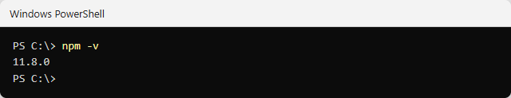
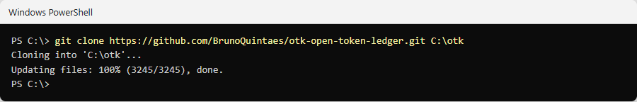
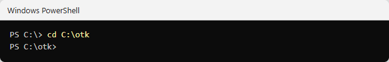
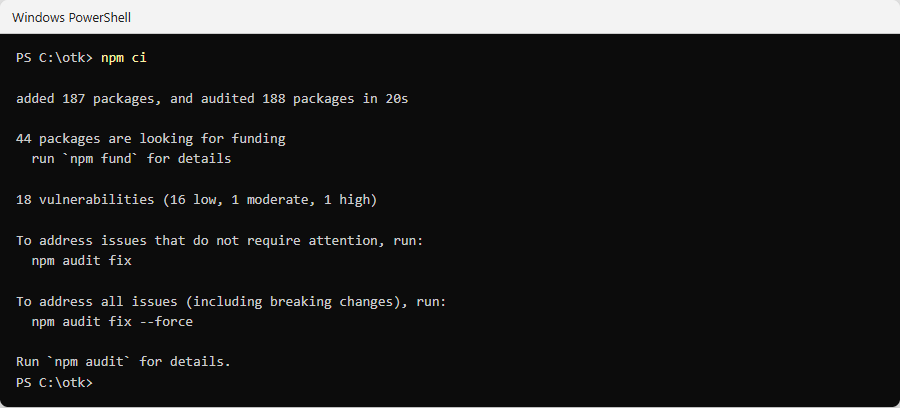
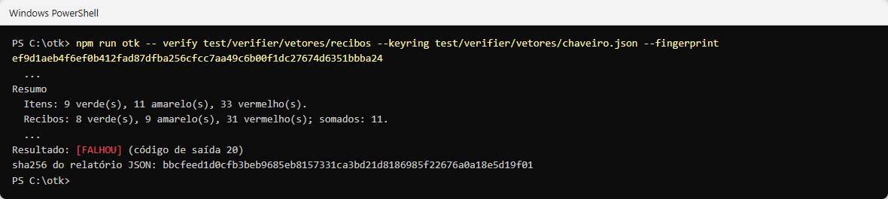

# OTK (Open Token Ledger)

[English version](README.en.md)

Este repositório acompanha a dissertação sobre o **OTK**, um medidor que fica entre um programa e os provedores de IA (OpenAI, Anthropic e Google), que contam e cobram cada pedido em **tokens**, os pedaços em que o texto é dividido (em geral, partes de palavras). A cada chamada, o OTK conta os tokens do pedido **antes** de enviá-lo, guarda o que o provedor declara depois e emite um **recibo assinado**, que qualquer pessoa pode conferir. Para alguns modelos, o OTK também compara as duas contagens e calcula o custo pela tabela pública de preços, e a seção 12 diz para quais.


*O caminho de uma chamada: a contagem é feita antes do envio e gravada, com o uso declarado, quando a resposta chega.*

Na coleta de 7 de outubro de 2026, o próprio OTK conferiu na hora a assinatura do recibo em 658 das 662 chamadas reais, e todas conferiram, já as outras 4 foram recusadas pelo provedor (3 por limite de uso, 1 pela OpenAI) e não geraram recibo. O programa de coleta, porém, guardou só o resultado dessa checagem chamada a chamada, nos registros do pacote da banca (`*_calls.jsonl`, campo `receipt_signature_verifies`), e não o recibo inteiro. Já a coleta de 23 de novembro foi feita por um programa à parte (`scripts/h2eval/`), que usa o mesmo contador do OTK, mas não passa pelo proxy e por isso não gera recibo, de modo que os recibos que podem ser conferidos aqui são os de exemplo e os da demonstração (seção 9).

O repositório traz:

- o **código do OTK na versão avaliada** na dissertação (versão `7606bc9b`), com os testes, e o programa que fez as coletas de novembro (`scripts/h2eval/`, versão `b0ec6f24`);
- os **dados das coletas** citadas na dissertação, já sanitizados, sem texto de conversa, sem identificador de resposta do provedor e sem caminho pessoal;
- **um comando que refaz, sem internet, os números da coleta de 7 de outubro e parte dos números da coleta de 23 de novembro** (seção 6), e que diz OK ou FALHOU para cada item;
- o **verificador de recibos**, como comando e como página que abre no navegador;
- um **passo a passo para usar o OTK no seu computador**, primeiro sem chave nenhuma e depois, se quiser, com a sua própria chave de API.

Para seguir este guia **não é preciso saber programar**, pois basta seguir as seções na ordem, copiando e colando cada comando, e se algo der errado, a seção [13. Se travar: cole isto numa IA](#13-se-travar-cole-isto-numa-ia) tem um texto pronto para pedir ajuda. O guia foi ensaiado do começo ao fim no Windows 11, já os comandos para Mac seguem o mesmo caminho, mas **não foram ensaiados num Mac**.

### Caminho rápido (sem chave e sem custo)

1. Instale o **Git** e o **Node.js 24 LTS** ([seção 1](#1-o-que-instalar-antes)) e abra o terminal ([seção 2](#2-como-abrir-o-terminal-e-colar-um-comando)).
2. Baixe o repositório com `git clone https://github.com/BrunoQuintaes/otk-open-token-ledger.git C:\otk` (no Mac, troque `C:\otk` por `~/otk`).
3. Entre na pasta com `cd C:\otk` (no Mac, `cd ~/otk`).
4. Instale as bibliotecas com `npm ci`.
5. Refaça os números com `npm run reproduzir-tudo`, que no fim deve mostrar `TUDO OK: 13 de 13 itens`.

Os detalhes de cada passo, o que deve aparecer e o que fazer se der erro estão nas seções 1 a 6, e o resto do guia é opcional.

### O que ler, conforme o seu interesse

| Você quer… | Leia |
|---|---|
| só conferir os números da dissertação | o caminho rápido acima (detalhes nas seções 1 a 6) |
| rodar os testes automáticos | seção 7 |
| conferir um recibo | seção 8 |
| ver o OTK funcionando, sem chave | seção 9.2 (precisa do Docker) |
| saber o que o OTK prova e o que não prova | o resumo abaixo e a seção 11 |
| acrescentar um modelo ou provedor (é preciso programar) | seção 12 |

### Em poucas linhas: o que isto prova e o que não prova

- **Prova** que os números da coleta de 7 de outubro e parte dos números da coleta de 23 de novembro saem dos dados publicados aqui, e que, no registro publicado da coleta de 23 de novembro, há um registro gravado antes de cada um dos 1.720 envios, com a contagem do OTK em 1.505 deles (o gpt-6-luna ficou sem contagem). Com o verificador, prova também que um recibo não foi alterado depois de assinado e qual chave o assinou.
- **Não prova** se o provedor contou certo, se o custo calculado é igual à fatura, se falta algum recibo nem se as coletas aconteceram como registradas, pois os registros e os horários foram gravados na máquina do autor. Além disso, nada aqui mostra que os resultados valem para outros modelos, línguas ou tipos de pedido, e cada um desses limites aparece em detalhe na seção 11.

### Palavras que aparecem neste guia

- **Token** é o pedaço de texto (em geral, parte de uma palavra) pelo qual o provedor conta e cobra cada pedido e cada resposta.
- **Chave de API** é a senha que o provedor dá para cobrar as chamadas na sua conta, e só a seção 9.3 usa.
- **sha256** é um resumo de 64 caracteres calculado sobre um arquivo, que muda se qualquer letra do arquivo mudar. Já a **impressão digital** do chaveiro (seção 8) é o sha256 desse arquivo.
- O **recibo assinado** traz os números de uma chamada com a assinatura digital do operador, e o **chaveiro** é a lista pública das chaves do operador, sem nada secreto.
- O **proxy** é a parte do OTK que fica no meio do caminho, como um porteiro, que recebe o pedido, conta, repassa ao provedor e anota a resposta.
- A **CU** (unidade normalizada de consumo) soma os tokens de cada tipo usando como pesos os preços de uma data-base congelada (1 CU = 1.000 tokens de entrada sem cache do gpt-4o-mini), como num índice de quantidade de Laspeyres, para que a CU não mude quando o preço muda (Capítulos 2 e 3 da dissertação).
- **Régua**, **correção da contagem** e **limite de alerta** estão explicados na [seção 12.1](#121-alguns-termos-antes-da-tabela).
- **H1** é a hipótese principal da dissertação, testada na coleta de 7 de outubro de 2026.
- **CMP8** é o nome, na saída do comando, da coleta de 23 de novembro de 2026, que mandou os mesmos 215 textos a 8 modelos, e que é exploratória e não faz parte da H1.
- **CAL-ANTH** é o nome, na saída do comando, do recálculo independente do primeiro experimento de correção da Anthropic, de 15 de outubro de 2026.

---

## Sumário

1. [O que instalar antes](#1-o-que-instalar-antes)
2. [Como abrir o terminal e colar um comando](#2-como-abrir-o-terminal-e-colar-um-comando)
3. [Conferir se o Node.js, o npm e o Git estão instalados](#3-conferir-se-o-nodejs-o-npm-e-o-git-estão-instalados)
4. [Baixar este repositório](#4-baixar-este-repositório)
5. [Instalar as dependências](#5-instalar-as-dependências)
6. [Refazer os números da dissertação (sem internet)](#6-refazer-os-números-da-dissertação-sem-internet)
7. [Rodar os testes automáticos](#7-rodar-os-testes-automáticos)
8. [Conferir recibos com o verificador](#8-conferir-recibos-com-o-verificador)
9. [O OTK funcionando no seu computador](#9-o-otk-funcionando-no-seu-computador)
10. [O que precisa de chave de API e o que não precisa](#10-o-que-precisa-de-chave-de-api-e-o-que-não-precisa)
11. [O que o OTK faz e o que não faz (limites)](#11-o-que-o-otk-faz-e-o-que-não-faz-limites)
12. [Provedores e modelos: o que o OTK mede hoje e como acrescentar um novo](#12-provedores-e-modelos-o-que-o-otk-mede-hoje-e-como-acrescentar-um-novo)
13. [Se travar: cole isto numa IA](#13-se-travar-cole-isto-numa-ia)
14. [Onde está cada coisa, origem dos arquivos, licença e citação](#14-onde-está-cada-coisa-origem-dos-arquivos-licença-e-citação)

---

## 1. O que instalar antes

São necessários **dois programas**, o Git e o Node.js, e ainda um terceiro, o Docker, só para a seção 9, e por isso quem quiser só conferir os números e os recibos (seções 6 a 8) pode pular o Docker. Todos são gratuitos e devem ser baixados sempre do site oficial.

| Programa | Para quê | Versão | Windows | Mac |
|---|---|---|---|---|
| **Git** | baixar o repositório | qualquer 2.x (as capturas deste guia usam a 2.56) | https://git-scm.com/download/win, com o instalador "64-bit Git for Windows Setup" e **Next** em todas as telas (as opções padrão servem; se o Windows perguntar "Deseja permitir que este aplicativo faça alterações?", clique em **Sim**) | abra o Terminal (seção 2) e digite `git --version`, e se o Mac oferecer instalar as "ferramentas de linha de comando", aceite. Ou use https://git-scm.com/download/mac |
| **Node.js** (já traz o **npm**) | rodar o OTK, os testes e a reprodução | **24 LTS** (testado com 24.22.2, com o npm 11 que vem junto) | https://nodejs.org/pt/download, em "LTS", versão **24**, "Windows Installer (.msi)", e **Next** em todas as telas | mesma página, "macOS Installer (.pkg)" da versão **24 LTS** |
| **Docker Desktop** (só para a seção 9) | ligar o banco de dados do OTK numa caixa isolada | qualquer versão atual (testado com 29.x) | https://www.docker.com/products/docker-desktop/, em "Download for Windows". Ele pede para ativar o **WSL 2**, um recurso do Windows que exige ser administrador do computador; aceite e reinicie se ele pedir | mesma página, "Download for Mac" (escolha Apple Silicon ou Intel conforme o seu Mac) |

Não é preciso instalar pnpm, Python nem banco de dados, nem ter conta em provedor de IA.

> Depois de instalar o Git e o Node.js, **feche e abra de novo** o terminal (seção 2), pois um terminal aberto antes da instalação não enxerga os programas novos.

## 2. Como abrir o terminal e colar um comando

O terminal é uma janela onde você cola comandos de texto.

**Windows:** aperte a tecla **Windows**, digite `PowerShell` e aperte **Enter**. Abre uma janela azul ou preta com algo como `PS C:\Users\seu-nome>`.

**Mac:** aperte **Command + Espaço**, digite `Terminal` e aperte **Enter**.

Todos os comandos deste guia são para o **PowerShell**. O Prompt de Comando (`cmd`), a janela com `C:\...>` sem o `PS` na frente, não serve.

Cada comando vem num bloco cinza, abaixo de um subtítulo que diz para que ele serve, e os outros blocos cinza mostram o que deve aparecer. Cole um comando por vez, na ordem, e para cada um:

1. clique no botão de copiar no canto do bloco cinza (ou selecione o texto e use **Ctrl + C** no Windows, **Command + C** no Mac);
2. clique dentro da janela do terminal;
3. cole com **Ctrl + V** (Windows; ou clique com o botão direito) ou **Command + V** (Mac);
4. aperte **Enter** e espere o terminal mostrar de novo o `PS C:\...>` (ou o `%` no Mac) antes de colar o próximo.

A partir da seção 5, o começo da linha deve mostrar `PS C:\otk>` (no Mac, `otk %`), e se não mostrar (por exemplo, porque o terminal foi fechado e aberto de novo), rode antes `cd C:\otk` (no Mac, `cd ~/otk`).

## 3. Conferir se o Node.js, o npm e o Git estão instalados

Esta seção confere, um por um, os três programas da seção 1, pois sem eles nenhum dos passos seguintes funciona. Cada comando só mostra a versão instalada e não muda nada no computador.

#### Para verificar o Node.js

**Onde rodar:** no **PowerShell** (no Windows, e não o Prompt de Comando) ou no Terminal (no Mac), de qualquer pasta ou unidade.

```
node -v
```

Esse comando pede ao Node.js que diga a sua versão, o que serve para saber se ele foi instalado e se é a 24, que é a versão que os programas deste repositório pedem.


*Saída real do comando, com o Node.js 24.22.2.*

**O que deve aparecer:** `v24.` seguido de números, por exemplo `v24.22.2`.

**Se aparecer** `node : O termo 'node' não é reconhecido` (Windows) ou `command not found: node` (Mac), o Node.js não foi instalado ou o terminal foi aberto antes da instalação. Nesse caso, feche o terminal, abra de novo e repita, e se continuar, instale o Node.js de novo (seção 1).

**Se aparecer** `v20.` ou `v22.`, instale a 24 LTS (seção 1) antes de seguir, pois os programas que refazem a coleta de 7 de outubro (parte A da seção 6) foram feitos para o Node 24 ou mais novo, e numa versão anterior essa parte pode dar `FALHOU`.

#### Para verificar o npm

**Onde rodar:** no **PowerShell** (no Windows, e não o Prompt de Comando) ou no Terminal (no Mac), de qualquer pasta ou unidade.

```
npm -v
```

Esse comando mostra a versão do npm, o programa que vem junto com o Node.js e que baixa as bibliotecas do OTK na seção 5.



*Saída real do comando, com o npm 11.8.0.*

**O que deve aparecer:** um número como `11.8.0` (qualquer `10.` ou `11.` serve).

**Se aparecer** (só no Windows) `npm.ps1 não pode ser carregado porque a execução de scripts foi desabilitada`, rode o comando do bloco seguinte, responda `S` (ou `Y`) caso ele pergunte e repita o `npm -v`.

#### Para liberar o npm no PowerShell (só se aparecer o erro acima)

**Onde rodar:** no **PowerShell**, de qualquer pasta, e não é preciso abri-lo como administrador, pois a mudança vale só para o seu usuário.

```
Set-ExecutionPolicy -Scope CurrentUser RemoteSigned
```

Esse comando permite que o seu usuário rode scripts que já estão no computador, como o do npm, enquanto scripts baixados da internet ainda precisam de assinatura. Como a mudança vale só para o seu usuário (`-Scope CurrentUser`), nada muda para os outros usuários do computador. Ele não tem imagem, pois muda uma configuração do sistema e não foi rodado no ensaio.

#### Para verificar o Git

**Onde rodar:** no **PowerShell** (no Windows, e não o Prompt de Comando) ou no Terminal (no Mac), de qualquer pasta ou unidade.

```
git --version
```

Esse comando mostra a versão do Git, o programa que baixa o repositório na seção 4.


*Saída real do comando, com o Git 2.56.*

**O que deve aparecer:** `git version 2.` seguido de números.

**Se aparecer** "não é reconhecido" ou "command not found", instale o Git (seção 1), feche e abra o terminal.

## 4. Baixar este repositório

Os exemplos usam a pasta **`C:\otk`** no Windows e **`otk`** dentro da sua pasta pessoal no Mac.

> **No Windows, use uma pasta de nome curto, como `C:\otk`.** O caminho mais longo dentro do pacote da banca tem 198 caracteres, e o Windows recusa caminhos com mais de 260, contando a pasta onde o repositório foi baixado, de modo que essa pasta não pode passar de uns 60 caracteres. Numa pasta funda (por exemplo uma pasta temporária, ou `Documentos\GitHub\...` com nome de usuário comprido), o Git mostra `Filename too long`, o download fica incompleto e a seção 6 dá `FALHOU`.

#### Para baixar o repositório

**Onde rodar:** no **PowerShell** (no Windows, e não o Prompt de Comando) ou no Terminal (no Mac), de qualquer pasta ou unidade. O comando baixa sempre em `C:\otk`, mesmo rodado em outra unidade, como o `H:` do Google Drive.

**Windows:**

```
git clone https://github.com/BrunoQuintaes/otk-open-token-ledger.git C:\otk
```

**Mac:**

```
git clone https://github.com/BrunoQuintaes/otk-open-token-ledger.git ~/otk
```

Esse comando copia o repositório inteiro do GitHub para a pasta `C:\otk` (no Mac, `~/otk`), que ele mesmo cria, e por isso só precisa ser rodado uma vez.



*Saída real do download, com a pasta mostrada como `C:\otk`.*

**O que deve aparecer:** `Cloning into 'C:\otk'...` e, depois de alguns segundos, linhas terminando em `done.`, sem nenhum pedido de login, pois o repositório é **público**.

**Se aparecer** `Repository not found`, o endereço foi digitado errado (copie o comando de novo) ou o computador está sem internet.

**Se aparecer** `destination path 'C:\otk' already exists`, o repositório já foi baixado antes, e então pule para a seção 5, ou apague a pasta `C:\otk` e repita.

**Se aparecer** `Filename too long` ou `Clone succeeded, but checkout failed`, a pasta escolhida é funda demais (veja o aviso acima), e por isso apague a pasta e baixe de novo em `C:\otk`.

**Só para quem vai além das seções 6 a 8 (pode pular os dois blocos seguintes).**

#### Para baixar sem a troca do fim de linha (opcional)

**Onde rodar:** no **PowerShell** (no Windows, e não o Prompt de Comando) ou no Terminal (no Mac), de qualquer pasta ou unidade.

```
git -c core.autocrlf=false clone https://github.com/BrunoQuintaes/otk-open-token-ledger.git C:\otk
```

No Windows, o Git troca o *fim de linha* (o caractere invisível que encerra cada linha) de cerca de mil arquivos de texto, e com isso o sha256 deles fica diferente do registrado em `PROVENIENCIA.json`. Essa troca **não afeta as seções 6 a 8**, pois os arquivos que o comando e o verificador conferem estão protegidos contra ela, e por conta disso só quem quiser conferir o `PROVENIENCIA.json` arquivo por arquivo precisa baixar com este comando, no lugar do anterior. Esse comando não tem imagem, já que a saída é a mesma do download normal, mostrada acima.

#### Para baixar numa pasta funda (opcional)

**Onde rodar:** no **PowerShell** (no Windows, e não o Prompt de Comando) ou no Terminal (no Mac), de qualquer pasta ou unidade.

```
git -c core.longpaths=true clone https://github.com/BrunoQuintaes/otk-open-token-ledger.git C:\caminho\da\sua\pasta
```

Esse comando autoriza o Git a usar caminhos longos, e nele `C:\caminho\da\sua\pasta` deve ser trocado pela pasta que você quer. Esse comando não tem imagem, pois a saída é a mesma do download normal, mostrada acima, só com a sua pasta no lugar de `C:\otk`.

#### Para entrar na pasta

**Onde rodar:** no **PowerShell** (no Mac, no Terminal), de qualquer pasta ou unidade.

**Windows:**

```
cd C:\otk
```

**Mac:**

```
cd ~/otk
```

Esse comando faz o terminal entrar na pasta do repositório, pois todos os comandos seguintes são colados **dentro dela**. Ele funciona de qualquer pasta ou unidade (até do `H:` do Google Drive), porque o caminho é completo e o PowerShell troca de unidade sozinho.



*Saída real do comando, com a pasta mostrada como `C:\otk`.*

**O que deve aparecer:** o começo da linha muda para `PS C:\otk>` (no Mac, `otk %`).

**Se aparecer** `Cannot find path 'C:\otk'`, o repositório não foi baixado em `C:\otk`, e por isso repita a seção 4.

**Se o começo da linha não tiver `PS`** (por exemplo `H:\>` ou `C:\Users\...>`), você abriu o Prompt de Comando, e não o PowerShell. Nesse caso, feche e abra o PowerShell (seção 2), ou, se quiser ficar no Prompt de Comando, use `cd /d C:\otk`, pois nele o `cd` sem o `/d` não troca de unidade.

## 5. Instalar as dependências

Este passo baixa as bibliotecas que o OTK usa, nas versões exatas guardadas no arquivo `package-lock.json`, e **usa a internet** uma vez, só para o registro público do npm.

#### Para instalar as dependências

**Onde rodar:** no **PowerShell**, dentro de `C:\otk`, com a linha começando em `PS C:\otk>` (se não começar, rode antes `cd C:\otk`). No Mac, no Terminal, dentro de `~/otk`, com a linha em `otk %` (senão, `cd ~/otk`).

```
npm ci
```

Esse comando instala as bibliotecas exatamente nas versões do `package-lock.json`, sem trocar nenhuma, e com isso o que roda nas seções seguintes é a mesma versão avaliada.



*Saída real do comando, que levou 20 segundos.*

**O que deve aparecer** (em 10 segundos a 2 minutos):

```
added 187 packages, and audited 188 packages in 20s

44 packages are looking for funding
  run `npm fund` for details

18 vulnerabilities (16 low, 1 moderate, 1 high)

To address issues that do not require attention, run:
  npm audit fix

To address all issues (including breaking changes), run:
  npm audit fix --force

Run `npm audit` for details.
```

O tempo, o número de *vulnerabilities* e, no Mac, o número de pacotes podem ser outros, pois o npm consulta uma lista de avisos que muda com o tempo e alguns pacotes são só de um sistema, e por isso o que importa é não aparecer `npm error`.

As linhas finais, que mandam rodar `npm audit fix` ou `npm audit fix --force` (e as linhas `npm warn deprecated ...`, que podem aparecer), são avisos sobre as bibliotecas da versão avaliada e **não** são erro. Ainda assim, **não rode nenhum dos dois**, pois eles trocam as versões das bibliotecas, e com isso deixa de rodar exatamente a versão avaliada.

**Se aparecer** `npm error code EUSAGE` ou `npm ci can only install packages when your package.json and package-lock.json are in sync`, o terminal não está dentro da pasta `C:\otk`, e por isso rode o `cd C:\otk` da seção 4 e repita.

**Se aparecer** `npm error network` ou `ETIMEDOUT`, a internet caiu ou uma rede de empresa bloqueia o npm, e vale tentar em outra rede.

## 6. Refazer os números da dissertação (sem internet)

Um comando confere os arquivos e **recalcula, sem internet e sem chave de API**, os resultados das coletas de 7 de outubro e de 23 de novembro listados na tabela abaixo, mas não refaz a dissertação inteira. Para ter certeza de que nada usa a rede, o Wi-Fi pode ser **desligado antes**, e o comando funciona igual; além disso, ele tem uma trava própria, que bloqueia, nos programas que ele roda, as conexões e consultas de endereço para fora do computador, e elas aparecem como erro `SEM_REDE`.

> **O que este comando não refaz.** Da coleta de 23 de novembro, ele refaz a **primeira versão** da tabela *estimado × declarado*, que aplica só as retas de correção de claude-sonnet-5-5, claude-opus-5-5 e gemini-3.1-flash-lite (para o Sonnet e o Gemini 3.1, a reta do estudo à parte, que depois não se confirmou; ver 12.3). Aplicar uma reta a esses 215 textos só descreve o que aconteceu, e por isso não aprova nem reprova a correção. Já a tabela do Capítulo 4 acrescenta as correções dos dois Haiku, a recontagem do gpt-6-luna e os intervalos de 95 %, que este comando não refaz, e o resto do que fica de fora está na seção 11.

#### Para refazer os números

**Onde rodar:** no **PowerShell**, dentro de `C:\otk`, com a linha começando em `PS C:\otk>` (se não começar, rode antes `cd C:\otk`). No Mac, no Terminal, dentro de `~/otk`, com a linha em `otk %` (senão, `cd ~/otk`).

```
npm run reproduzir-tudo
```

Esse comando roda, um depois do outro, os programas que refazem as partes A a D da tabela abaixo e compara cada resultado com o valor guardado no repositório, dizendo OK ou FALHOU para cada item.


*Saída real do comando, com os 13 itens OK.*

Leva de 20 segundos a 3 minutos, conforme o computador. **O que deve aparecer** no fim (cada linha começa com `OK`):

```
OK      A. ZIP do pacote da banca tem o sha256 esperado (3943637b…) — 3943637bef45c2c21a6b143f0cfa8829f22df70b306e85901cbdb23ade738224
OK      A. Pacote: hashes, sanitização, H1 de 7/10 (30 de 30 arquivos) e CAL-ANTH (19 de 20) — ✓ 1. SHA256SUMS confere; ✓ 2. scanner de sanitização (pacote inteiro); ✓ 3. controle negativo do scanner; ✓ 4. reprodução H1; ✓ 5. reprodução CAL-ANTH
OK      B. Tabela dos 8 modelos (CMP8): .tex idêntico byte a byte ao auditado — 5a9d6feac2f9e51c5880141f1e6225d3f836d93f97c4fd4aeb8c58f8c223785d
OK      B. Tabela dos 8 modelos (CMP8): JSON igual ao auditado (tabela_cmp8.json V1_3, sha baed13cf…), fora data e caminhos — esperado baed13cfa673…
OK      C. Estimado × declarado: as 1.720 linhas (texto × modelo) idênticas byte a byte às auditadas — 8608af93a993e1e23e3b1795e6c8335e056d8071950abd388174cb0fd10752f4
OK      C. Estimado × declarado: .tex idêntico byte a byte ao auditado — 4e0d854729616f85778016b9612ba682050f49a8d1fb025b4ce5091c7e7085f2
OK      C. Estimado × declarado: JSON igual ao auditado (tabela_estimado.json V2, sha 685654f6…), fora data e caminhos — esperado 685654f672dd…
OK      C. Registro da contagem gravado ANTES de cada envio (cadeia do journal conferida; contagens iguais às auditadas) — 1720 de 1720 envios com o registro gravado antes; 1505 deles com a contagem do OTK
OK      D. Verificador: os recibos de exemplo no disco são os que o código gera (19 arquivos) — conferidos 19 arquivos, 0 diferentes
OK      D. Verificador: relatório dos recibos de exemplo com a impressão digital igual ao esperado — sha bbcfeed1d0cf…, código de saída 20
OK      D. Verificador: relatório dos recibos de exemplo sem a impressão digital igual ao esperado — sha 91e064cf527c…, código de saída 20
OK      D. Chaveiro do operador: impressão digital igual à publicada na dissertação (c9dcbb90…) — c9dcbb90ec0b9fd79a1da4764821e11f5a46f9073a3c991f00c1daa000f72fdc
OK      D. Página do verificador: sha256 igual ao registrado (2bef5dd8…) — 2bef5dd84fcf7289ae5e76cf74e329eb6bda55f479415b898da364786efdc2fc

TUDO OK: 13 de 13 itens. Detalhes em saida-reproducao\...\RESULTADO_REPRODUCAO.json
```

Na linha do registro gravado antes do envio, o *1720 de 1720* conta os envios que têm esse registro prévio, e em 1.505 deles o registro já traz a contagem do OTK. Nos 215 do gpt-6-luna, porém, o registro diz que o OTK não sabe contar esse modelo, pois o contador da versão avaliada não conhece a família gpt-6, e por conta disso a contagem desse modelo foi refeita depois da coleta, por fora deste comando.

**O que cada parte refaz:**

| Parte | O que é na dissertação | De onde vêm os dados |
|---|---|---|
| **A** | A coleta de 7 de outubro de 2026, que testou a hipótese principal (H1), com as 662 operações, os denominadores, as tabelas de erro e o corpus de 216 textos, e o recálculo independente do primeiro experimento de correção da Anthropic, de 15 de outubro (na saída, CAL-ANTH), em que 19 de 20 números são reproduzidos e o 20º difere por definição, porque o custo por modelo foi calculado com outro escopo | o pacote da banca descrito no Apêndice C, `reproducao/otk-banca-pack-20261111.zip` (sha256 `3943637b…`, conferido pelo próprio comando), e a mesma pasta já descompactada |
| **B** | A tabela dos tokens de entrada declarados por **8 modelos** para os mesmos 215 textos (coleta de 23 de novembro de 2026, na saída CMP8) | `reproducao/cmp8/dados` (1.720 tentativas, sem texto de resposta) |
| **C** | A primeira versão da tabela "o que o OTK estima × o que o provedor declarou" e a **conferência de que o programa de coleta gravou um registro antes de cada envio** (1.720 de 1.720, com a contagem do OTK em 1.505) | a mesma coleta, as correções da contagem congeladas e o diário das operações (*journal*), em que cada registro leva o sha256 do anterior, de modo que mudar um registro antigo quebra a corrente |
| **D** | A conferência dos recibos de exemplo pelo verificador, a impressão digital do chaveiro do operador e o sha256 da página | `test/verifier/vetores` (17 arquivos na pasta `recibos`, mais o chaveiro de teste e os resultados esperados, no total 19 arquivos), `chaveiro/`, `web/verificador` |

*Idêntico byte a byte* quer dizer que o arquivo recalculado tem o mesmo sha256 do arquivo guardado no repositório (em `reproducao/cmp8/esperado` e no pacote da banca). Já nos JSON, a comparação ignora só a data de geração e o caminho dos arquivos na máquina do autor, e mantém a comparação dos sha256 dos arquivos de origem. Com isso, o comando confirma que os cálculos, refeitos a partir dos dados publicados, dão os mesmos arquivos, mas não confirma que esses dados vieram do provedor (seção 11).

**Onde comparar na dissertação.** Os arquivos refeitos são as versões de trabalho das tabelas, com os mesmos números e outro formato, e por isso o sha256 deles não é o das tabelas impressas. Na parte B, as medianas e porcentagens podem ser comparadas com a tabela do Apêndice D *Tokens de entrada declarados e textos fora do limite de alerta, por modelo e tipo de texto, em 23 de novembro de 2026*.

Já na parte C, a comparação é com a tabela do Capítulo 4 *Tokens de entrada contados pelo OTK antes do envio e declarados pelo provedor, por modelo, na coleta de 23 de novembro de 2026*. Nela, batem as linhas *antes da correção*, exceto a raiz do erro quadrático médio, e as colunas *depois* de gpt-4o-mini, Sonnet 5.5, Opus 5.5 e Gemini. Ainda nessa tabela, a raiz do erro quadrático médio, as colunas *depois* dos dois Haiku, o gpt-6-luna e os intervalos entre colchetes ficam de fora, pois o comando não os refaz.

Esses arquivos foram gravados durante o trabalho e por isso ainda guardam rótulos internos do projeto, como *TEXTO NOVO, NÃO APROVADO* ou *Resultado PARCIAL*, este último só porque um texto do gpt-6-luna ficou sem uso declarado, e esses rótulos não foram mexidos porque o sha256 mudaria. Além disso, neles *perfil aprovado* quer dizer aprovado no estudo à parte, anterior à confirmação, já o resultado final de cada correção está na seção 12.3.

**Se aparecer** `FALHOU` em alguma linha (e, no fim, `ALGO FALHOU`), o comando segue até o fim, mas uma parte que deu erro pode virar uma linha só, com `erro:`, e o total no fim fica menor que 13. Nesse caso, abra o arquivo indicado em *Detalhes em ...* e a pasta `saida-reproducao` (dentro de `C:\otk`), que tem um arquivo `.log.txt` por etapa com o erro, e use a seção [13. Se travar](#13-se-travar-cole-isto-numa-ia).

**Se aparecer** `Falta instalar as dependências`, rode a seção 5.

**Se aparecer** `FALHOU ... sha256 ...` só nas linhas do chaveiro ou da página, o Git converteu o fim de linha desses arquivos ao baixar, e por isso apague a pasta `C:\otk` e baixe de novo (seção 4), já que o arquivo `.gitattributes` deste repositório impede essa conversão num clone novo.

## 7. Rodar os testes automáticos

A bateria tem cerca de 3.600 testes automáticos, que também rodam **sem internet**.

#### Para rodar os testes

**Onde rodar:** no **PowerShell**, dentro de `C:\otk`, com a linha começando em `PS C:\otk>` (se não começar, rode antes `cd C:\otk`). No Mac, no Terminal, dentro de `~/otk`, com a linha em `otk %` (senão, `cd ~/otk`).

```
npm run testes-banca
```

Esse comando roda, sem internet, a bateria de testes da versão avaliada e do verificador, e diz no fim se algum teste falhou.


*Saída real do comando, terminando em TESTES OK.*

Leva de 2 a 6 minutos. **O que deve aparecer** no fim:

```
Resultado: 3587 testes — 3579 passaram, 0 falharam, 0 cancelados, 5 pulados, 3 "todo".
```

seguido da lista dos testes deixados de fora de propósito e de `TESTES OK`. O total de testes pode ser um pouco diferente no seu computador, e o que importa é `0 falharam` e a última linha `TESTES OK`.

- Os **pulados (5)** renderizam a configuração de produção com o Helm e precisam da imagem Docker `alpine/helm:3.16.4` já baixada, o que este comando não faz, e por isso o próprio teste se pula e avisa `alpine/helm:3.16.4 not present locally`, sem que esse aviso seja defeito. Num computador sem o Docker, outros 6 testes (de `docker compose`) também se pulam, com o aviso `docker CLI not available`, e o total de pulados passa a 11. Já os grupos que avisam `SKIPPED — set OTK_TEST_PG_URL`, que precisam de um PostgreSQL de teste ligado, também ficam de fora, mas o Node não os soma nos pulados.
- Os **todo (3)** são testes marcados como *a decidir* desde a versão avaliada (na dissertação, os *3 pendentes*), que são decisões de produto em aberto, e não defeitos, e aparecem com `⚠` na saída completa.
- Os **deixados de fora**, que não entram na contagem, são 9 grupos de testes e 1 arquivo que leem arquivos internos que **não** estão neste repositório (a pasta de coordenação `docs/_ops`, documentos de governança e as regras de dono de cada arquivo), e o comando lista cada um com o motivo.
- Na versão avaliada, com os arquivos internos presentes, eram 3.563 testes, dos quais 3.560 passavam e 3 ficavam a decidir, número do registro interno do autor que não pode ser refeito aqui. Essa diferença para o total de hoje vem dos testes do verificador, que ainda não existiam, e dos grupos deixados de fora.

**Se aparecer** `HOUVE FALHA`, veja quais linhas começam com `✖`, no fim da tela ou no arquivo `testes-banca-saida.txt`, na pasta `C:\otk`, que abre no Bloco de Notas com dois cliques e permite buscar com Ctrl+F. Caso a **única** linha com `✖` seja `desempenho: 1.000 recibos verificados em menos de 5 s`, o computador estava só lento naquele momento, e por isso basta fechar os outros programas e rodar `npm run testes-banca` de novo, e se continuar só esse, não é defeito do OTK.

Do mesmo jeito, caso as únicas linhas com `✖` sejam `H1-S23 GDPR erasure: receipt integrity and audit trail` e `OWNER of A erases A ...` (`test/security/h1_s23_privacy_retention.test.ts:181`), rode `npm run testes-banca` de novo, pois esse teste, com um defeito que já existia na versão avaliada, falha raramente por acaso, já que procura o texto 1001 numa linha com um resumo sha256 e um identificador aleatórios.

Já qualquer outra linha com `✖` merece a seção 13.

**Se aparecer** `Aviso: não achei o bash do Git for Windows`, instale o Git pelo instalador oficial (seção 1) e repita, pois alguns testes rodam scripts bash, que vêm com o Git for Windows.

## 8. Conferir recibos com o verificador

O verificador confere, **no seu computador e sem internet**, se um recibo foi alterado depois de assinado e se a assinatura é de uma chave do operador.

Para essa conferência, ele precisa dos **recibos**, do **chaveiro público** e da **impressão digital** do chaveiro, que tem de chegar por outro caminho, como um contrato, um site ou a própria dissertação.

### 8.1 Pela página (mais fácil)

1. Abra a pasta `C:\otk\web\verificador` no Explorador de Arquivos (no Mac, no Finder, a pasta `otk/web/verificador`).
2. Dê dois cliques em **`verificador-otk.html`**, que abre no navegador (testado no Edge, no Windows, e não testado em outros navegadores). A internet pode ser desligada, e a página funciona igual.
3. Para usar os **recibos de exemplo**, clique em **Escolher pasta**, na área **Recibos**, e escolha a pasta `C:\otk\test\verifier\vetores\recibos`, e caso o navegador pergunte se quer carregar os arquivos para o site, pode aceitar, pois a página roda só no seu computador. Já na área **Chaveiro**, clique em **Escolher chaveiro** e escolha o arquivo `C:\otk\test\verifier\vetores\chaveiro.json`, ou, se preferir, arraste a pasta e o arquivo para essas áreas.
4. No campo **Impressão digital do chaveiro**, cole:

```
ef9d1aeb4f6ef0b412fad87dfba256cfcc7aa49c6b00f1dc27674d6351bbba24
```

5. Clique em **Conferir recibos**.

**O que deve aparecer:** os cartões no alto com **9 OK (verde)**, **11 Atenção (amarelo)** e **33 Falhou (vermelho)**. Os recibos de exemplo foram feitos de propósito para testar o verificador, de modo que a maioria foi **alterada** depois de assinada (por isso dá vermelho) e só alguns são íntegros. Além disso, os cartões contam **itens**, e não arquivos, pois um mesmo arquivo pode trazer vários recibos (um por linha) e um recibo pode gerar mais de um aviso, o que dá 53 itens.


| Cor | Quer dizer |
|---|---|
| ✔ **OK (verde)** | o recibo está íntegro e foi assinado por uma chave ativa de um chaveiro confirmado pela impressão digital, e ninguém mudou os números depois da assinatura. |
| ⚠ **Atenção (amarelo)** | há uma ressalva, e o motivo está na linha, como a impressão digital não colada, a chave já aposentada ou a assinatura que não pôde ser conferida (chave fora do chaveiro, formato antigo). Se a linha disser "não entra nas somas", os números desse recibo ficam fora dos totais. |
| ✖ **Falhou (vermelho)** | o recibo foi alterado depois de assinado, a assinatura não confere, a chave foi revogada ou o arquivo está ilegível, e por isso os números dele não devem ser usados. |

Ao clicar numa linha da tabela, a página mostra, em português, **o que aconteceu**, **o que isso significa** e **o que isso não garante**.

Caso a impressão digital não seja colada, nenhum recibo fica verde, e o melhor resultado passa a ser o amarelo, com o motivo *Chaveiro não ancorado* (na ajuda do campo, *chaveiro não confirmado*), o que já é esperado.

### 8.2 Pelo terminal

#### Para conferir os recibos de exemplo pelo terminal

**Onde rodar:** no **PowerShell**, dentro de `C:\otk`, com a linha começando em `PS C:\otk>` (se não começar, rode antes `cd C:\otk`). No Mac, no Terminal, dentro de `~/otk`, com a linha em `otk %` (senão, `cd ~/otk`).

```
npm run otk -- verify test/verifier/vetores/recibos --keyring test/verifier/vetores/chaveiro.json --fingerprint ef9d1aeb4f6ef0b412fad87dfba256cfcc7aa49c6b00f1dc27674d6351bbba24
```

Esse comando, rodado dentro da pasta `C:\otk`, faz a mesma conferência da página, com a mesma pasta de recibos, o mesmo chaveiro e a mesma impressão digital, e por isso tem de dar a mesma conta dos cartões.



*Trecho da saída real: a saída é longa, e as reticências marcam o corte.*

**O que deve aparecer** no fim:

```
Resumo
  Itens: 9 verde(s), 11 amarelo(s), 33 vermelho(s).
...
Resultado: [FALHOU] (código de saída 20)
sha256 do relatório JSON: bbcfeed1d0cfb3beb9685eb8157331ca3bd21d8186985f22676a0a18e5d19f01
```

O *FALHOU* aqui está certo, pois o conjunto de exemplo tem recibos adulterados de propósito. A linha *Itens* é a mesma conta dos cartões da página, já a linha seguinte, *Recibos* (8, 9 e 31), conta só os recibos, e o sha256 do relatório é o mesmo que a página mostra para os mesmos arquivos. Logo depois, o npm ainda pode escrever linhas `npm error ... code 20` ou `command failed`, que são só o npm repetindo que o verificador terminou com o código 20 (há vermelho), e por isso não são um defeito.

### 8.3 O chaveiro do operador citado na dissertação

O arquivo **`chaveiro/chaveiro_operador_otk.json`** é o chaveiro público do operador do OTK cuja **impressão digital está publicada na dissertação** (Apêndice E). Esse chaveiro é o da chave criada pelo autor em 18 de novembro de 2026 para ligar o OTK ao seu assistente no WhatsApp, chave que até 23 de novembro ainda não tinha assinado nenhum recibo real, e nenhum recibo assinado por ela é publicado aqui. Já os recibos de exemplo usam o chaveiro de teste `test/verifier/vetores/chaveiro.json`, de impressão digital `ef9d1aeb…`, enquanto a demonstração cria uma chave nova a cada vez. A impressão digital desse chaveiro do operador é a seguinte.

```
c9dcbb90ec0b9fd79a1da4764821e11f5a46f9073a3c991f00c1daa000f72fdc
```

#### Para conferir a impressão digital do chaveiro do operador

**Onde rodar:** no **PowerShell**, dentro de `C:\otk`, com a linha começando em `PS C:\otk>` (se não começar, rode antes `cd C:\otk`). No Mac, no Terminal, dentro de `~/otk`, com a linha em `otk %` (senão, `cd ~/otk`).

**Windows (PowerShell, dentro de `C:\otk`):**

```
(Get-FileHash chaveiro\chaveiro_operador_otk.json).Hash
```

**Mac:**

```
shasum -a 256 chaveiro/chaveiro_operador_otk.json
```

Esse comando calcula o sha256 do arquivo do chaveiro, que tem de ser igual à impressão digital publicada na dissertação e mostrada acima, e com isso confirma que o arquivo é esse mesmo.


*Saída real no PowerShell, em maiúsculas.*

**O que deve aparecer:** `C9DCBB90EC0B9FD79A1DA4764821E11F5A46F9073A3C991F00C1DAA000F72FDC` (o PowerShell mostra em maiúsculas, e maiúsculas ou minúsculas não importam).

**Cuidado com o fim de linha.** A impressão digital é calculada sobre os bytes exatos do arquivo, e por isso muda caso ele passe por um programa que troca o fim de linha (o Git com conversão automática, um editor que salva com CRLF, um e-mail que reformata o anexo). Nesse caso, o verificador mostra vermelho, com o aviso *impressão digital não confere*, mesmo sem nenhum recibo alterado. Para evitar essa troca, este repositório marca a pasta `chaveiro/` e a página como `-text` no `.gitattributes`, de modo que o Git não mexe neles, e além disso esse arquivo não deve ser aberto e salvo num editor.

## 9. O OTK funcionando no seu computador

Nesta seção, o OTK da versão avaliada é ligado no seu computador, uma chamada de IA passa por ele e o recibo que ele gera é conferido pelo verificador.

### 9.1 O que é preciso

- O **Docker Desktop** instalado e aberto (seção 1), pois o OTK guarda as operações num banco PostgreSQL, que o Docker liga numa caixa isolada, e com isso nada precisa ser instalado no seu sistema. Já num Windows sem WSL 2 (seção 1) e sem permissão de administrador, a seção 9 não roda, enquanto as seções 6, 7 e 8 rodam do mesmo jeito.
- Uns 500 MB livres em disco para a **imagem** do PostgreSQL, o pacote pronto do banco que o Docker baixa uma vez, e que por isso **usa a internet** só na primeira vez, além de mais alguns GB para o próprio Docker Desktop.

Abra o Docker Desktop (no Windows, tecla **Windows**, digite `Docker Desktop` e aperte **Enter**; no Mac, pasta Aplicativos) e espere aparecer **Engine running** no canto de baixo da janela dele.

Caso ele peça login ou conta, clique em **Skip**/Pular, pois não é preciso conta.

### 9.2 Modo demonstração: sem chave, sem custo

Neste modo, o provedor de IA é **sintético**, um programa na sua própria máquina que responde como o `gpt-4o-mini` e declara 20 tokens de entrada e 5 de saída, e por isso nenhuma chamada sai do seu computador.

#### Para rodar a demonstração

**Onde rodar:** no **PowerShell**, dentro de `C:\otk`, com a linha começando em `PS C:\otk>` (se não começar, rode antes `cd C:\otk`). No Mac, no Terminal, dentro de `~/otk`, com a linha em `otk %` (senão, `cd ~/otk`).

```
npm run demo-banca
```

Esse comando liga tudo o que a demonstração precisa, manda uma chamada ao provedor sintético e confere o recibo no fim, sem que nenhuma chamada saia do computador.


*Saída real do comando, com o recibo conferido no fim.*

**O que acontece**, item a item, na tela:

1. liga o PostgreSQL de teste no Docker (na primeira vez baixa a imagem, o que pode levar 1 a 2 minutos);
2. cria uma chave de assinatura **desta instalação** (descartável, só na memória) e o provedor sintético;
3. liga o OTK (o mesmo ponto de entrada da versão avaliada, `src/api/server.ts`) com o proxy de medição;
4. manda **uma chamada de IA** pelo proxy;
5. mostra o que o OTK registrou, que são o modelo, o uso declarado, a contagem própria feita antes do envio, a comparação, a CU e o custo calculado pela tabela pública;
6. exporta o **recibo** (o mesmo que o OTK entrega a quem pede o recibo de uma operação), gera o **chaveiro público desta instalação** e confere o recibo com o verificador.

**O que deve aparecer** no item [5] e no fim (os números de porta, datas e impressão digital mudam a cada vez):

```
[5] O que o OTK registrou sobre essa chamada
    modelo pedido / devolvido:             gpt-4o-mini / gpt-4o-mini-2024-07-18
    uso declarado pelo provedor:           entrada 20 tokens, saída 5 tokens
    contagem própria do OTK:               entrada 9, saída 1
    régua usada na contagem:               o200k_base (exata)
    comparação:                            compared / within_threshold (divergente só se a diferença passar de 16 tokens E de 10 %)
    CU (unidade normalizada):              10 (pesos de desenvolvimento)
    custo calculado (tabela pública):      US$ 0.00000600 (fictício: o provedor é sintético)
...
    [ATENÇÃO] banca-demo/demo-... — Perfil de desenvolvimento. O recibo foi produzido com o perfil de desenvolvimento (pesos de teste).
    [OK] banca-demo/demo-... — Íntegro e assinado por chave ativa. ...
    Resultado: [ATENÇÃO] (código de saída 10)

DEU CERTO: o recibo está íntegro e assinado pela chave desta instalação ([OK]). O aviso amarelo "Perfil de desenvolvimento"
é esperado: a versão avaliada calcula a CU com pesos de teste (os mesmos da coleta de 7/10), e o verificador avisa isso.
```

Essa saída se lê assim:

- No **uso declarado 20 e contagem própria 9**, o provedor sintético declara sempre 20 tokens de entrada, qualquer que seja o texto, enquanto a contagem do OTK (9) é a do texto de verdade. A diferença (11) fica dentro do limite de alerta (16 tokens), e por isso a comparação dá `within_threshold`, já com o provedor real o gpt-4o-mini declara 7 tokens a mais do que o OTK conta, que são o envelope da mensagem (ver 12.1).
- Na **CU**, a versão avaliada usa **pesos de teste**, já que a escolha dos pesos definitivos ficou em aberto na dissertação, que chama essa de *CU antiga*, e a CU com os pesos-base do Capítulo 3 não é a que aparece neste recibo.
- No **verificador**, o recibo é **[OK] na assinatura**, e o **amarelo** vem só do aviso *Perfil de desenvolvimento*, em que *perfil* é o conjunto de pesos da CU, e não a correção da contagem da seção 12, e por isso o `Resultado: [ATENÇÃO] (código de saída 10)` não é um erro.

Os arquivos da demonstração ficam em `C:\otk\demo-saida\<data-hora>`, que guarda o recibo (`recibos\recibo_....json`), `chaveiro_desta_instalacao.json`, `operacao.json`, `verificacao.txt` e `RESUMO_DEMO.json`.

Para ver esse recibo na página, abra `web\verificador\verificador-otk.html`, escolha (ou arraste) a pasta `recibos` e o `chaveiro_desta_instalacao.json` e cole a impressão digital que o comando mostrou no item [6] da saída, na linha `chaveiro: ... impressão digital: ...`.


No fim, o comando desliga e apaga o PostgreSQL de teste, e para deixá-lo ligado (e olhar o banco), use `npm run demo-banca -- --manter`.

**Se aparecer** `PAROU: o Docker não está respondendo`, abra o Docker Desktop e espere *Engine running*.

Se a porta 55432 (o número pelo qual o OTK fala com o banco dentro do computador) estiver ocupada ou reservada pelo Windows, o comando escolhe sozinho outra porta livre e avisa na tela.

**Se aparecer** `PAROU: ... porta ... already allocated`, `ports are not available` ou `porta ocupada`, use os dois comandos abaixo.

#### Para usar outra porta (só se aparecer o erro de porta ocupada)

**Onde rodar:** no **PowerShell**, dentro de `C:\otk`, e os dois comandos na **mesma janela**, pois a variável só vale naquela janela do PowerShell.

```
$env:OTK_DEMO_PG_PORT="15432"
```

```
npm run demo-banca
```

Esses comandos mandam a demonstração usar a porta 15432 para o banco de teste, no lugar da 55432, já ocupada por outro programa. No Mac, a alternativa é `OTK_DEMO_PG_PORT=15432 npm run demo-banca`. Além disso, eles não têm imagem, pois o erro de porta não aconteceu durante a preparação deste guia.

**Se o comando parar com `PAROU:` depois do item [1]**, o PostgreSQL de teste pode ter ficado ligado, e para desligá-lo e apagá-lo, use o comando do bloco seguinte, dentro da pasta `C:\otk`.

#### Para desligar e apagar o PostgreSQL de teste

**Onde rodar:** no **PowerShell**, dentro de `C:\otk`, com a linha começando em `PS C:\otk>` (se não começar, rode antes `cd C:\otk`). No Mac, no Terminal, dentro de `~/otk`, com a linha em `otk %` (senão, `cd ~/otk`).

```
docker compose -p otk-banca-demo -f infra/test/docker-compose.services.yml down -v
```

Esse comando desliga o PostgreSQL de teste e apaga a caixa e os dados dele, que só existiam para a demonstração.


*Saída real do comando, com o PostgreSQL de teste parado e removido.*

Ou, no Docker Desktop, em **Containers**, apague o grupo `otk-banca-demo`.

### 9.3 Modo com as suas próprias chaves (opcional; a chamada custa cerca de US$ 0,0001)

O modo com chave real (`--real`) funciona com os três modelos que já têm preço e teto de gasto prontos na versão avaliada (ver 12.3), o **gpt-4o-mini** (OpenAI), o **claude-haiku-4-5** (Anthropic) e o **gemini-3.5-flash-lite** (Google).

Com uma chave de API sua, esse mesmo comando manda **uma** chamada real, de no máximo 16 tokens de saída, ao provedor através do OTK.

> **Atenção:** este modo **não** foi testado com chave real na preparação deste repositório, pois nenhuma chamada paga foi feita para isso, mas ele usa o mesmo caminho de código da coleta de 7 de outubro.

Primeiro, crie a chave no site do provedor (OpenAI: https://platform.openai.com/api-keys ; Anthropic: https://console.anthropic.com/settings/keys ; Google: https://aistudio.google.com/apikey), sabendo que o provedor cobra do seu cartão.

#### Para criar o arquivo .env

**Onde rodar:** no **PowerShell**, dentro de `C:\otk`, com a linha começando em `PS C:\otk>`, pois o arquivo `.env` tem de ficar na raiz do repositório.

```
notepad .env
```

Esse comando abre o Bloco de Notas num arquivo chamado exatamente **`.env`** (com o ponto na frente e sem `.txt` no fim), na pasta `C:\otk`, e é nesse arquivo que fica a sua chave.

Esse comando não tem imagem, pois só abre a janela do Bloco de Notas.

O Bloco de Notas pergunta se quer criar o arquivo, e a resposta é **Sim**.

Escreva **uma** linha, conforme o provedor, com a sua chave depois do `=`, e salve com Ctrl+S (caso abra a janela **Salvar como**, escolha **Todos os arquivos** em **Tipo** e mantenha o nome `.env`):

```
OPENAI_API_KEY=cole-aqui-a-sua-chave
```

Para os outros provedores, a linha é `ANTHROPIC_API_KEY=...` ou `GEMINI_API_KEY=...`. No Mac, use `nano .env`, escreva a linha, aperte Control+O, Enter e Control+X.

O arquivo `.env` **nunca vai para o Git**, pois o `.gitignore` deste repositório o exclui e o comando confere isso antes de ler a chave, e esse arquivo não deve ser mandado para ninguém.

#### Para conferir a configuração sem gastar

**Onde rodar:** no **PowerShell**, dentro de `C:\otk`, com a linha começando em `PS C:\otk>` (se não começar, rode antes `cd C:\otk`). No Mac, no Terminal, dentro de `~/otk`, com a linha em `otk %` (senão, `cd ~/otk`).

```
npm run demo-banca -- --real openai --so-conferir
```

Esse comando confere, antes de gastar e sem fazer nenhuma chamada, se a chave está no `.env`, se o `.env` está fora do Git e se o Docker responde. Para outro provedor, troque `openai` por `anthropic` ou `gemini`.

**O que deve aparecer:** `achei OPENAI_API_KEY (... caracteres)` e, no fim, `CONFIGURAÇÃO OK: a chave OPENAI_API_KEY está no .env, o .env está fora do git e o Docker responde. Nenhuma chamada foi feita (--so-conferir).`

**Se aparecer** `PAROU: não achei OPENAI_API_KEY=... no arquivo .env`, o arquivo não foi salvo com o nome `.env` (o Bloco de Notas às vezes salva `.env.txt`) ou a linha está escrita diferente, e por isso vale rodar `notepad .env` de novo e conferir.


*O que aparece sem o `.env`, numa rodada real feita sem chave.*

#### Para fazer a chamada real

**Onde rodar:** no **PowerShell**, dentro de `C:\otk`, com a linha começando em `PS C:\otk>` (se não começar, rode antes `cd C:\otk`). No Mac, no Terminal, dentro de `~/otk`, com a linha em `otk %` (senão, `cd ~/otk`).

Escolha um dos três comandos abaixo, com o mesmo provedor que você usou na conferência:

```
npm run demo-banca -- --real openai
```

```
npm run demo-banca -- --real anthropic
```

```
npm run demo-banca -- --real gemini
```

Esse comando faz a mesma demonstração da 9.2, mas com o provedor real e a sua chave. Ele não tem imagem, pois é uma chamada paga, e nenhuma foi feita para este guia.

O comando mostra que achou a chave (só o tamanho, nunca o valor), o **custo aproximado** da chamada (menos de US$ 0,0001 no gpt-4o-mini e no gemini-3.5-flash-lite e cerca de US$ 0,0001 no claude-haiku-4-5) e, depois, os mesmos itens [4] a [6] do modo demonstração, agora com o uso que o provedor real declarou. O orçamento do OTK para essa execução é de US$ 1, que é um teto, e não o valor cobrado.

Quando terminar, apague o arquivo `.env` ou revogue a chave no site do provedor.

## 10. O que precisa de chave de API e o que não precisa

| O quê | Precisa de chave? | Usa internet? | Custa? |
|---|---|---|---|
| Instalar (`npm ci`) | não | sim, uma vez (registro do npm) | não |
| Refazer os números (`npm run reproduzir-tudo`) | **não** | **não** | não |
| Testes automáticos (`npm run testes-banca`) | **não** | **não** | não |
| Verificador (página e `npm run otk -- verify`) | **não** | **não** | não |
| Modo demonstração (`npm run demo-banca`) | **não** | só para baixar a imagem do PostgreSQL na primeira vez | não |
| Modo com a sua chave (`npm run demo-banca -- --real ...`) | sim, sua | sim | cerca de US$ 0,0001 por execução |
| Refazer as coletas pagas da dissertação (7 de outubro e 23 de novembro) | sim, de três provedores | sim | sim, mas **não é necessário** para conferir a dissertação e não faz parte deste roteiro |

## 11. O que o OTK faz e o que não faz (limites)

**Faz:**

- conta os tokens do pedido **antes** de enviá-lo, mas guarda essa contagem só em memória e a grava no fim da chamada, junto com o uso declarado, já que antes do envio o que fica gravado é a operação;
- grava cada operação num banco de dados (PostgreSQL) antes do envio e, no fim, a contagem e o uso declarado, mas quem controla o banco pode alterar esses registros, e é por conta disso que existem os recibos assinados, que qualquer pessoa confere e que podem ser guardados fora dele;
- guarda o uso que o provedor **declara** e, com régua exata (OpenAI), compara as duas contagens com o limite de alerta (16 tokens **e** 10 %), já com régua aproximada grava as duas lado a lado, sem veredito (seção 12);
- usa um limite de alerta cujos dois valores foram fixados antes da primeira coleta, mas sem calibração e sem um motivo registrado para eles (Capítulo 3);
- calcula o custo com a **tabela pública de preços** congelada antes da coleta, e a CU, para os modelos que estão nessa tabela;
- assina um recibo por chamada, que qualquer pessoa confere com o verificador, sem internet.

**Não faz:**

- **não prova que o provedor contou certo**, pois o OTK registra o que o provedor declarou, e a contagem própria é auxiliar e, para modelos cujo tokenizador (a regra que corta o texto em tokens) não é publicado, aproximada;
- o **custo é calculado, e não é a fatura**, já que a conferência com a fatura do provedor é outra etapa (a conciliação);
- o valor que o OTK **reserva** antes de cada chamada é um **teto de segurança**, o custo se o pedido ocupasse todo o espaço de texto que o modelo aceita numa chamada, e não uma previsão do gasto;
- o recibo prova que os números **não mudaram depois de assinados** e qual chave assinou, mas não impede que o próprio operador assine outro recibo nem tem carimbo de tempo de terceiros;
- o verificador aponta cópias repetidas do mesmo recibo e dois recibos diferentes para a mesma operação, mas **não percebe recibos que faltam**, e a ordem dos arquivos não importa para ele;
- **não prova a um terceiro que as coletas aconteceram como registradas**, pois o registro encadeado e os horários foram gravados pela máquina do autor, e o identificador de resposta do provedor foi retirado dos dados publicados. Além disso, a conferência dos totais com as faturas da Anthropic e da OpenAI, feita pelo autor (Capítulo 4), não está neste repositório;
- os **textos de teste são sintéticos** (escritos para o teste, sem conversa real) e só três modelos de três provedores foram avaliados na H1, de modo que não há generalização para outros modelos, línguas ou tipos de pedido;
- a coleta de 23 de novembro (CMP8) é **exploratória** e fica fora da H1, e nela um item (gpt-6-luna, `numeric-005-v1`) ficou sem uso declarado, pois o provedor recusou o pedido (erro HTTP 400), e foi listado como exclusão;
- o *estimado × declarado* da coleta de 23 de novembro é uma **conferência pós-coleta**, calculada depois, e só em 7 dos 8 modelos a contagem do OTK já estava no registro que o programa de coleta gravou antes do envio (parte C da seção 6);
- o custo da coleta de 23 de novembro (US$ 0,734 a US$ 0,756 na dissertação) foi calculado pelo programa de coleta (`scripts/h2eval/`), com a tabela de preços dele (`scripts/h2eval/modal/pricing/`), e não é refeito pelo comando da seção 6;
- o comando da seção 6 **não refaz a dissertação inteira**, e por isso ficam de fora (lista no Apêndice C da dissertação) as 9.211 chamadas das coletas de 15 de outubro a 20 de novembro e, com elas, os testes das correções por modelo, exceto o primeiro experimento de 15 de outubro. Além disso, também ficam de fora a conciliação com a fatura, o uso de teste no assistente do autor, o estudo de modelos candidatos, a versão da tabela *estimado × declarado* do Capítulo 4 e os gráficos originais do pacote de 7 de outubro, que precisariam de Python e matplotlib, e os dados brutos dessas coletas não estão neste repositório;
- o proxy **recusa**, antes de enviar, alguns pedidos que o provedor aceitaria, pois não consegue calcular um teto de gasto para eles, como pedir várias respostas numa só chamada (`n` maior que 1), pedir à Anthropic que guarde o pedido por 1 hora para reaproveitar (cache de 1 hora) e mandar um arquivo enviado antes no lugar do texto. Além disso, ele recusa também tipos de chamada que não mede, por exemplo o endereço da Anthropic compatível com a OpenAI;
- por último, o proxy **altera** um campo do pedido, pois nas chamadas da OpenAI em que a resposta chega aos poucos (*streaming*) ele liga `stream_options.include_usage`, para que o provedor informe o uso no fim da resposta.

## 12. Provedores e modelos: o que o OTK mede hoje e como acrescentar um novo

A 12.1, a 12.2 e a tabela da 12.3 servem a qualquer leitor, já o comando do fim da 12.3 e a 12.4 são para quem programa, e para conferir a dissertação bastam as seções 6 a 9.

### 12.1 Alguns termos antes da tabela

- A **contagem própria** é a que o OTK faz dos tokens do pedido no seu computador, antes de enviá-lo, com uma *régua* (um tokenizador, o programa que corta o texto em tokens). Para os modelos da OpenAI, a régua é a mesma que o provedor publica (`o200k_base` nos modelos atuais, `cl100k_base` nos antigos `gpt-4` e `gpt-3.5`, que são os nomes das réguas da OpenAI), e por isso a contagem é **exata**, já para Anthropic e Google o provedor não publica a régua, e o OTK usa outra (`cl100k_base`), com uma contagem **aproximada**.
- O **envelope da mensagem** são os tokens que o provedor acrescenta em volta do texto (marcas de início e fim de cada mensagem), e é por conta dele que, mesmo com a régua exata, o gpt-4o-mini declara 7 tokens a mais do que o OTK conta no texto.
- A **correção da contagem** é uma conta simples, fator × contagem do OTK + valor fixo (uma reta), que aproxima a contagem própria do número que o provedor declara. Essa correção é calculada com chamadas reais e só é **aprovada** se passar num teste com chamadas guardadas, que não foram usadas para calculá-la (detalhes em 12.4), e quando reprova, é preciso coletar textos novos e tentar de novo, sendo cada tentativa um **ciclo**. Já o **estudo à parte** foi uma primeira prova, fora dos ciclos, em que só a **confirmação**, com textos novos, vale como resultado.
- O **limite de alerta** vale com régua **exata** (OpenAI) e nenhuma correção, e nesse caso o OTK compara as duas contagens e só aponta diferença quando ela passa de **16 tokens e de 10 %** ao mesmo tempo.
- A **regra fixa da coleta de 7 de outubro** é esse mesmo limite de alerta, aplicado também à Anthropic e ao Google naquela coleta, quando ainda não havia correção ajustada a cada modelo, e não quer dizer somar um valor fixo.
- O **veredito**, que é o OTK dizer se o provedor contou certo ou errado, fica de fora com régua **aproximada** (Anthropic, Google), caso ainda não haja correção aprovada carregada, e o OTK só grava as duas contagens (`incomplete` / `not_applicable`), pois essa contagem aproximada não basta para acusar o provedor.
- O **critério de aprovação** é de no máximo 5 % de alertas falsos nas chamadas guardadas e de pelo menos 50 % de detecção quando o declarado é aumentado em 25 % de propósito.
- A **tabela de preços congelada** é um arquivo com o preço público de cada modelo, gravado com data e fonte **antes** das chamadas, para que o custo não possa ser ajustado depois.

Em qualquer modelo, com ou sem correção, o OTK **registra o que o provedor declarou e assina o recibo**, e a correção só muda a comparação entre as duas contagens, sem mudar o uso declarado nem o custo.

### 12.2 Provedores

| Provedor | Nome do provedor no OTK | Tipo de chamada que o proxy mede | Situação |
|---|---|---|---|
| OpenAI | `openai` | Chat Completions (`/v1/chat/completions`), e o código também aceita a Responses (`/v1/responses`), nunca usada com chamada real | medido com chamadas reais nas coletas da dissertação |
| Anthropic | `anthropic` | Messages, a API nativa (`/v1/messages`), e o endereço da Anthropic compatível com a OpenAI **não** é medido | medido com chamadas reais nas coletas da dissertação |
| Google (Gemini) | `gemini` (não `google`) | generateContent (`/v1beta/models/<modelo>:generateContent`) e a versão com streaming (`:streamGenerateContent`) | medido com chamadas reais nas coletas da dissertação |
| Cohere, Mistral, Meta, DeepSeek | — | o código tem o endereço do provedor | **nunca testados com chamada real**, e por isso devem ser tratados como não suportados |

### 12.3 Modelos

As colunas *régua*, *preço* e *teto* dizem o que está pronto **no código deste repositório**, enquanto a coluna *correção* resume o que a dissertação conclui (Capítulo 4, tabelas dos testes da correção).

Já na coluna da correção, os números entre parênteses são os alertas falsos sobre o total de chamadas guardadas do teste, cujo critério de aprovação era de no máximo 5 %, e a coluna final diz se o **proxy** usa essa correção hoje. Quando a coluna diz que a margem de erro *inclui os 5 %*, a taxa medida ficou abaixo do limite, mas com tão poucas chamadas não dá para garantir que ficaria abaixo com outros textos, e no `claude-haiku-5-5` a exceção é que o 2º ciclo reaproveitou textos que já tinham servido de teste no 1º.

Os testes de 7 e 15 de outubro são refeitos pela parte A da seção 6, já os de novembro **não podem ser refeitos com este repositório**, pois os dados dessas coletas não foram publicados, e por isso os números vêm dos relatórios citados na dissertação.

Em resumo, cada modelo cai hoje num de três níveis, e só o último usa uma correção aprovada. Uma correção aprovada na dissertação, porém, **não** quer dizer calibrada no OTK, pois das correções aprovadas só a do `gpt-4o-mini` está num arquivo que o OTK sabe carregar, e por conta disso o `claude-opus-5-5` e os dois Haiku continuam **só medidos** no proxy, da mesma forma que o `gpt-6-luna`, que nem tem régua no OTK.

| Nível | O que o OTK faz | Modelos hoje |
|---|---|---|
| **Só medido** | registra o uso que o provedor declarou e assina o recibo, mas não diz se o provedor contou certo; calcula o custo só quando o modelo está na tabela de preços congelada, o que hoje vale para o `claude-haiku-4-5` e o `gemini-3.5-flash-lite`, mas não para os outros modelos de novembro | todos os modelos da Anthropic e do Google, o `gpt-6-luna` e qualquer modelo novo sem régua exata e sem correção |
| **Medido e comparado** | além disso, compara o declarado com a própria contagem pela régua exata e aponta diferença acima do limite de alerta (16 tokens e 10 %) | os modelos da OpenAI do catálogo, inclusive o `gpt-4o-mini` pedido sem a data |
| **Calibrado no proxy** | a comparação usa uma correção aprovada e carregada pelo OTK | só o `gpt-4o-mini-2024-07-18`, com o OTK ligado com `OTK_CALIBRATION_PROFILES_DIR` (passo 7 da 12.4) |

| Provedor | Modelo | Régua do OTK | Preço na tabela congelada | Teto de gasto em dólar | Correção da contagem (dissertação) | O proxy usa a correção? |
|---|---|---|---|---|---|---|
| OpenAI | `gpt-4o-mini` | `o200k_base`, exata | sim | sim, com as políticas `v3` a `v5` (ver abaixo) | aprovada na coleta de 7 de outubro, e soma 7 tokens (o envelope da mensagem); na dissertação, aparece como “sim (+7)” na linha *Correção* da Tabela 3 do Capítulo 4, sobre a coleta de 23 de novembro | **sim, se você ligar**, pois o arquivo vem em `config/calibration/`, mas só é usado com `OTK_CALIBRATION_PROFILES_DIR=config/calibration` (passo 7 da 12.4) e com o nome `gpt-4o-mini-2024-07-18` no pedido, e fora disso (inclusive no modo demonstração) vale o limite de alerta |
| OpenAI | `gpt-6-luna` | nenhuma, pois o contador não conhece a família `gpt-6` | não | não | nos testes de 16 e 17 de novembro, o declarado foi sempre a contagem `o200k_base` + 6 (na dissertação, a correção “+6” da Tabela 3), mas o contador do OTK não reconhece o nome `gpt-6-luna`, e por isso, na coleta de 23 de novembro, essa contagem foi feita à parte, depois da coleta, e não pelo OTK | **não**, pois sem régua o OTK só registra o declarado |
| Anthropic | `claude-haiku-4-5` | `cl100k_base`, aproximada | sim | sim, com as políticas `v2` (padrão) a `v5` | a regra fixa da coleta de 7 de outubro ficou acima dos 5 % (2 em 37), e a reta do 1º experimento de 15 de outubro foi aceita (3 em 72), mas a margem de erro do teste (até 12,5 %) inclui os 5 % | **não** (usada só na análise; aprovação no limite) |
| Anthropic | `claude-haiku-5-5` | `cl100k_base`, aproximada | não | não | aceita no 2º ciclo (6 em 216, 2,78 %), mas a margem de erro (1,0 % a 5,95 %) inclui os 5 %, e o 2º ciclo reaproveitou textos do teste do 1º | **não** (usada só na análise; aprovação com exceção) |
| Anthropic | `claude-sonnet-5-5` | `cl100k_base`, aproximada | não | não | passou no estudo à parte (0 em 96), mas não se confirmou em 19 de novembro (9 em 72, 12,5 %) | **não** |
| Anthropic | `claude-opus-5-5` | `cl100k_base`, aproximada | não | não | aprovada no 3º ciclo, em 14 de novembro (0 em 96; margem de erro até 3,8 %, abaixo dos 5 %), com um dos tipos de diálogo do teste com 6 pedidos, abaixo dos 10 previstos, desvio aceito pelo autor; vale só para os tipos de pedido testados (não para resumos curtos) | **não** (usada só na análise) |
| Google | `gemini-3.5-flash-lite` | `cl100k_base`, aproximada | sim | sim, com a política `v5` | só a regra fixa da coleta de 7 de outubro, muito acima dos 5 % (17 em 37, 45,9 %), e só 8 % dos aumentos de 25 % percebidos (o mínimo era 50 %) | **não** |
| Google | `gemini-3.1-flash-lite` | `cl100k_base`, aproximada | não | não | passou no estudo à parte, mas reprovou na confirmação de 17 de novembro (9 em 36) | **não** |

Outros modelos da OpenAI listados no catálogo do OTK (`src/providers/catalog/modelCatalog.ts`, famílias `gpt-4o`, `gpt-4.1`, `gpt-5`, `o1`, `o3`, `o4-mini`, `gpt-4` e `gpt-3.5`, com as versões com data) têm régua exata, mas **nenhum foi medido com chamada real** nem tem correção. Já qualquer outro modelo da Anthropic ou do Google recebe a régua aproximada e nenhuma correção.

O que isso quer dizer na prática:

- **Sem preço na tabela congelada.** Nesse caso, o OTK registra o uso declarado e assina o recibo, mas não calcula o custo, e se receber um orçamento em dólar, ele **recusa** a chamada antes de enviá-la, com a mensagem de recusa `402 money_bound_unavailable`, pois não consegue provar o pior caso de gasto.
- **Teto de gasto.** O OTK aplica uma política de teto por vez, escolhida com a variável `OTK_MONEY_BOUND_POLICY`, e cada política inclui as anteriores. Por isso, a padrão (`otk.money_bound_policy.v2@2026-10-02`) cobre só o `claude-haiku-4-5`, a `otk.money_bound_policy.v3@2026-10-03` acrescenta o `gpt-4o-mini`, e a `otk.money_bound_policy.v5@2026-10-04` cobre os três modelos de 7 de outubro (e o `gemini-2.5-flash-lite`, um modelo do Google que o coletor ainda traz, mas que não entrou nas coletas da dissertação), enquanto o modo demonstração escolhe sozinho a política do modelo usado.
- **Correções fora do proxy (usadas só na análise).** As correções de `claude-sonnet-5-5`, `claude-opus-5-5` e `gemini-3.1-flash-lite` da seção 6 estão em `reproducao/cmp8/perfis/`, num formato que o proxy não carrega, pois ele só aceita o tipo `otk.calibration_profile.v1`.
- **Arquivos das correções dos dois Haiku.** As correções do `claude-haiku-4-5` e do `claude-haiku-5-5` aparecem na tabela do Capítulo 4, mas os arquivos congelados delas não estão neste repositório, e por isso a parte C da seção 6 não as refaz.
- **Nome do modelo com data.** A correção vale para o nome exato gravado no arquivo e para os apelidos dele (outros nomes do mesmo modelo), e por isso um pedido com `gpt-4o-mini` cai no limite de alerta, já que o arquivo traz só `gpt-4o-mini-2024-07-18`.
- **Sem veredito para Anthropic e Google, hoje.** Nenhuma correção desses provedores está no formato do proxy, e por isso cada chamada a eles sai sem veredito (`incomplete` / `not_applicable`), mas com o uso declarado, o custo e o recibo assinado.

#### Para ver o que o OTK sabe de um modelo

**Onde rodar:** no **PowerShell**, dentro de `C:\otk`, com a linha começando em `PS C:\otk>` (se não começar, rode antes `cd C:\otk`). No Mac, no Terminal, dentro de `~/otk`, com a linha em `otk %` (senão, `cd ~/otk`).

```
npx tsx -e 'import(`./src/providers/catalog/modelCatalog.ts`).then(m => { const [p, a, id] = process.argv.slice(-3); const s = m.resolveModelSupport(p, a, id); console.log(id, s.support, s.tokenizer ? s.tokenizer.encoding : `sem régua`) })' anthropic anthropic.messages claude-opus-5-5
```

Esse comando pergunta ao catálogo do OTK qual régua ele usa para um modelo. Para outro modelo, dentro da pasta `C:\otk`, troque os três últimos valores pelo provedor (`openai`, `anthropic` ou `gemini`), pelo tipo de chamada (`openai.chat_completions`, `anthropic.messages` ou `gemini.generate_content`) e pelo modelo.


*Saída real do comando, que na imagem aparece abreviado como `npx tsx -e '...'`.*

**O que deve aparecer:** `claude-opus-5-5 generic_fallback cl100k_base`.

Nessa saída, `exact` quer dizer régua exata, `alias_known` é a versão com data de um modelo exato, `generic_fallback` é a régua aproximada e `unsupported` quer dizer que o OTK não conta esse modelo e só registra o declarado.

Caso apareça `unsupported sem régua` para um modelo do Google, confira se escreveu `gemini`, e não `google`.

### 12.4 Como passar a usar um modelo ou provedor que ainda não está aqui

**Esta parte exige quem programe e gasta dinheiro.** Quem não programa consegue fazer sozinho só a anotação do *antes de começar* e a conferência dos passos 6 e 7, que pedem abrir um arquivo e ler uma linha, já os passos 1 a 5 pedem editar código, e a coleta do passo 4 é a parte paga. Cada passo abaixo diz quem o faz.

Este é o caminho da coleta de 7 de outubro, a única cuja correção já saiu no formato que o proxy carrega. As correções dos modelos de novembro, por sua vez, seguiram o mesmo método (reta calculada numa parte dos textos, limite escolhido noutra e teste numa terceira, usada uma só vez), mas com outra ferramenta, que não está neste repositório. Por isso, os comandos de coleta e de análise, escritos para os três modelos de 7 de outubro, precisam ser adaptados nos arquivos indicados.

Para ter uma ordem de grandeza do custo, a coleta de 23 de novembro mandou 215 textos curtos a cada um de 8 modelos (1.720 chamadas), com custo calculado pelo OTK de US$ 0,734 a US$ 0,756 no total, conferido com a fatura só na Anthropic e na OpenAI (Capítulo 4). Com textos desse tamanho, as 120 chamadas com resposta que um ciclo de correção exige no mínimo (passo 4) custariam de menos de um centavo (cerca de US$ 0,004 no `gpt-6-luna` e US$ 0,006 no `gpt-4o-mini`) a cerca de US$ 0,21 (`claude-opus-5-5`). Já com textos longos o custo sobe muito, tanto que o estudo de 18 de novembro custou até US$ 42,21, dos quais US$ 34,23 em 96 chamadas do `claude-opus-5-5` (Apêndice I), e ele cresce também quando a correção reprova e é preciso outro ciclo.

Enquanto não houver correção aprovada e carregada, o modelo novo fica **só medido** ou, se tiver régua exata, **medido e comparado** (ver o resumo da 12.3).

**Antes de começar, sem olhar nenhum resultado, decida e anote** o modelo exato (com data, caso o provedor tenha), os tipos de pedido que você vai medir, quantas chamadas, o teto de gasto, a regra de parada (por exemplo, parar diante de recusas seguidas do provedor, como nas coletas da dissertação) e o critério de aprovação do passo 6. Guarde esse texto num arquivo e anote o sha256 dele (`(Get-FileHash arquivo).Hash` no Windows, `shasum -a 256 arquivo` no Mac), pois mudar o critério depois de ver os números invalida a aprovação.

1. **Provedor novo (só se não for OpenAI, Anthropic nem Google; quem programa).** É preciso programar, no caminho que gera os recibos assinados:
   - o endereço do provedor, em `src/proxy/ProxyGateway.ts`, lista `UPSTREAM_BASE`;
   - o reconhecimento do tipo de chamada pelo endereço, em `detectApi` de `src/operations/proxyDurable.ts`;
   - os tipos de chamada medidos, em `PROVIDER_APIS` de `src/providers/catalog/modelCatalog.ts` e na lista `SUPPORTED` de `src/operations/d1d8Ports.ts`;
   - a leitura do uso que o provedor declara na resposta, em `src/providers/usage/normalizeUsage.ts`;
   - a régua aproximada do provedor, em `APPROXIMATE_PROVIDERS` de `modelCatalog.ts`.

   Antes de qualquer chamada paga, escreva testes com respostas reais do provedor, inclusive campos ausentes, zero e cache.
2. **Régua (quem programa).** Se o provedor publica o tokenizador, acrescente o modelo ao catálogo (`modelCatalog.ts`), editando o código, com essa régua, e se não publica, o OTK usa a régua aproximada e a correção do passo 5 passa a ser necessária. Confira com o comando do fim de 12.3.
3. **Preço e teto (quem programa).** Copie uma tabela de `scripts/pilot/price_table_*.json` (formato `otk.price_table.v1`) e acrescente uma linha por tipo de token do modelo novo (entrada, saída, cache), com o preço em micro-dólares por milhão de tokens (`1000000` = US$ 1 por milhão), a data e o endereço da página oficial de preços, e aponte o OTK para ela com `OTK_PRICE_TABLE_FILES`. Para usar orçamento em dólar, crie também uma política de teto nova em `src/operations/moneyBound.ts`, com versão própria, a regra do modelo (janela de contexto, saída máxima e modelos que o provedor pode devolver) e a fonte da documentação, registre-a em `MONEY_BOUND_POLICIES` e escolha-a com `OTK_MONEY_BOUND_POLICY`.
4. **Coletar pares (quem programa; é a parte paga).** Mande pelo proxy textos sintéticos, sem dado pessoal, e guarde, para cada chamada, a contagem própria do OTK (calculada antes do envio) e a entrada que o provedor declarou.

   O gerador desses textos, que está em `scripts/calibration/corpus.ts` e `scripts/calibration/messageCorpus.ts`, divide os textos **por grupo** (um texto e suas variações ficam sempre na mesma parte) em três partes, o **ajuste**, a **escolha do limite** e o **teste guardado**.

   Já o coletor usado em 7 de outubro é `scripts/pilot/anthropic/runPilotV3.ts`, com o modelo de cada provedor na lista `PROFILES` desse arquivo, e ele é chamado por `scripts/pilot/campaign/run_campaign_ovn2.sh`, que lê a chave do `.env` sem imprimi-la e para sozinho caso o gasto fique incerto. Antes da coleta paga, faça um ensaio com o provedor sintético (um programa no próprio computador que responde sem cobrar, como na seção 9.2), `npx tsx scripts/pilot/anthropic/runPilotV3.ts --provider=<provedor> --mode=synthetic --phase=gate --out=<pasta>` (em que `<provedor>` é `anthropic`, `openai`, `gemini` para o gemini-2.5-flash-lite ou `gemini35` para o gemini-3.5-flash-lite).

   Por último, o mínimo para poder aprovar é de 60 chamadas no ajuste, 30 na escolha do limite e 30 no teste guardado, com pelo menos 10 grupos no teste.
5. **Calcular a correção (quem programa).** Rode `npx tsx scripts/pilot/campaign/analyzeCampaign.ts --root=<pasta da coleta> --out=<pasta de saída>`, que lê a coleta, sem chamar o provedor, e grava `calibration_profile_<provedor>_<modelo>.json`. Esse programa calcula a reta só com a parte de ajuste e escolhe o limite só com a parte de escolha, e somente depois disso olha o teste guardado. Antes de rodar, adapte no próprio arquivo o nome da correção, a data, o corpus e o escopo, que ainda estão fixos com os valores de 7 de outubro, e o mapa `API` caso o provedor seja novo.
6. **Conferir a correção (você sozinho).** Abra o arquivo gerado e veja o campo `"calibrated"`, que só é `true` se todas as checagens do campo `"acceptance"` passaram (no `gpt-4o-mini` são 8):
   - os quatro tamanhos mínimos do passo 4;
   - o limite escolhido na parte certa;
   - a existência da reta;
   - **no máximo 5 % de alertas falsos** no teste guardado;
   - **pelo menos 50 % de detecção** quando o declarado é aumentado em 25 % de propósito, no próprio computador, sobre os números já coletados e sem nova chamada paga.

   Se der `false`, a correção **não** vale, e o critério não deve ser afrouxado; nesse caso, colete textos novos (um novo ciclo) e repita os passos 4 a 6, pois o teste guardado só pode ser usado uma vez. Para uma conferência independente, peça a outra pessoa que rode o passo 5 sobre a mesma coleta e compare o sha256 do arquivo e os números.
7. **Passar a usar (quem programa liga o OTK, e você confere o resumo de partida).** Ponha o arquivo aprovado numa pasta só para correções, sem editá-lo à mão, pois o campo `evidenceHash`, um sha256 guardado dentro do arquivo, acusa qualquer edição. Com isso, ligue o OTK com `OTK_CALIBRATION_PROFILES_DIR=<essa pasta>` e com a tabela de preços do passo 3 em `OTK_PRICE_TABLE_FILES`.

   As outras variáveis estão no começo de `src/operations/bootstrapD1D8.ts`, e `demo/demo_banca.mts` mostra um conjunto completo.

   Ao ligar, o resumo de partida do OTK mostra, no item `calibration`, quantas correções carregou e o nome de cada uma (por exemplo `1 loaded [...]`), enquanto um arquivo danificado aparece como `CORRUPT` e é ignorado, e um arquivo feito para outra régua ou outra versão do contador também não é usado.

   Essa correção vale para o nome de modelo gravado no arquivo, que é o nome devolvido pelo provedor (em geral, com data), e por isso peça o modelo por esse nome, ou acrescente os outros nomes em `modelAliases` **antes** de calcular o `evidenceHash` (no passo 5). A partir daí, cada chamada daquele modelo é comparada com a correção, e o registro guarda o nome da correção usada, enquanto o verificador da seção 8 confere esses recibos sem nenhuma mudança.

Refaça a coleta sempre que o provedor lançar uma versão nova do modelo ou mudar preço ou contagem, pois uma correção vale só para o modelo, a régua e os tipos de pedido em que foi testada.

## 13. Se travar: cole isto numa IA

Se algum passo der erro, abra uma IA (ChatGPT, Claude, Gemini ou outra), copie o texto abaixo, troque as partes entre `<...>` e cole:

```
Estou seguindo o README do repositório https://github.com/BrunoQuintaes/otk-open-token-ledger
para conferir os resultados de uma dissertação. Não sei programar. Meu computador é <Windows 11 / Mac>.
Estou na seção <número e nome da seção, por exemplo "6. Refazer os números">.
Colei este comando:
<cole aqui o comando>
E apareceu este erro (copiei tudo o que o terminal mostrou):
<cole aqui a saída inteira do terminal>
O que eu rodei antes deu certo até a seção <número>. As versões são:
node -v: <resultado>   npm -v: <resultado>   git --version: <resultado>
Me explique em português, passo a passo, o que fazer, um comando por vez, e o que deve aparecer depois de cada um.
Não me peça para desligar antivírus, mudar configurações de segurança do sistema nem colar chaves ou senhas.
```

Para copiar a saída do terminal no Windows, selecione o texto com o mouse (arraste do começo ao fim) e aperte **Ctrl + C**, e no Mac, selecione e use **Command + C**. Caso a saída seja longa, no Windows ainda dá para abrir o arquivo indicado na mensagem (por exemplo `testes-banca-saida.txt`) com dois cliques e copiar de lá. Por último, nunca cole o conteúdo do arquivo `.env` nem a sua chave de API numa IA.

## 14. Onde está cada coisa, origem dos arquivos, licença e citação

| Pasta / arquivo | O que é |
|---|---|
| `src/`, `scripts/`, `test/`, `tools/`, `zk/`, `config/`, `sdk/`, `infra/` ... | o OTK. A pasta `src/` é **idêntica** à da versão avaliada (`7606bc9b`), exceto a pasta nova `src/verifier/`. O histórico do repositório interno, inclusive o próprio commit `7606bc9b`, não é publicado aqui. O `PROVENIENCIA.json` lista o sha256 de cada arquivo e de onde ele veio, e com ele dá para conferir que os arquivos são os listados pelo autor, mas que a lista corresponde ao `7606bc9b`, só o autor pode confirmar, porque esse commit não é público. Já `scripts/h2eval/` é o programa que fez as coletas de novembro, guardado sem mudanças (versão `b0ec6f24`), e usa o mesmo código de `src/`. |
| `src/verifier/`, `scripts/verify/`, `test/verifier/`, `web/verificador/` | o verificador de recibos (feito depois da versão avaliada; versão `535ac19c`) |
| `chaveiro/chaveiro_operador_otk.json` | o chaveiro público do operador (impressão digital `c9dcbb90…`, publicada na dissertação) |
| `reproducao/otk-banca-pack-20261111.zip` e a pasta `otk-banca-pack-20261111/` | o pacote da banca da coleta de 7 de outubro (descrito no Apêndice C; sha256 do ZIP `3943637b…`, conferido pelo comando da seção 6) |
| `reproducao/cmp8/` | dados sanitizados da coleta de 23 de novembro (tentativas, journal sem o identificador do provedor, contagens prévias), textos sintéticos, correções aplicadas, valores esperados e os scripts de análise |
| `reproducao/reproduzir_tudo.mjs`, `reproducao/testes_banca.mjs`, `reproducao/ferramentas/sem_rede.mjs` | os comandos das seções 6 e 7 e a trava de rede |
| `demo/demo_banca.mts` | o comando da seção 9 |
| `docs/` | só os documentos públicos do produto que os testes leem (contrato da API, guias) e as imagens deste README |
| `PROVENIENCIA.json` | de onde veio cada arquivo (commit e sha256) e o que foi mudado em relação à origem, sem listar a si mesmo nem `zk/ceremony/LEIA-ME.md`, que é novo deste repositório |

**De propósito, não estão aqui** a pasta interna de coordenação (`docs/_ops`, com cartas, terminais e decisões), os dados brutos das coletas (com as respostas dos provedores), os segredos e arquivos `.env` e o texto da dissertação. Além disso, os caminhos de pastas pessoais que apareciam em comentários e valores padrão de alguns scripts operacionais foram trocados por `<HOME>` (lista em `PROVENIENCIA.json`).

**As imagens deste README** (`docs/imagens/`), fora o diagrama do começo, são capturas da saída real dos comandos, que foram rodados seguindo este guia num clone novo do GitHub, em Windows 11 (Node 24.22.2, npm 11.8.0 e Git 2.56).

Dessas capturas, as de terminal foram desenhadas numa janela de terminal a partir da saída real, com a pasta mostrada como `C:\otk`, já as da página são a própria página do verificador, aberta sem internet.

**Licença:** MIT (arquivo `LICENSE`). **Como citar:** arquivo `CITATION.cff` (o GitHub mostra o botão "Cite this repository").
